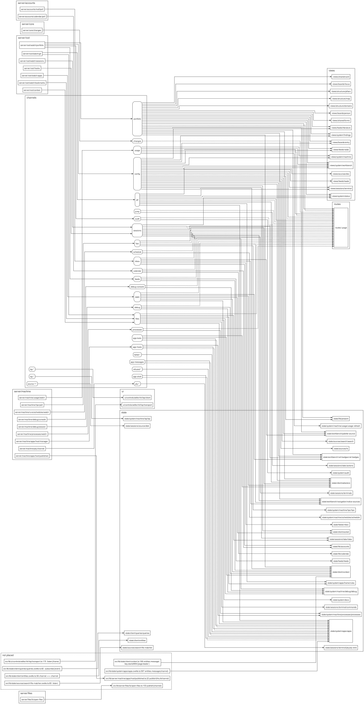
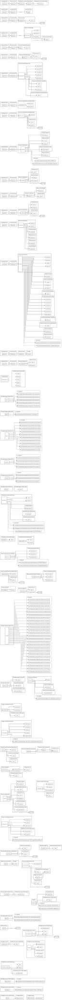
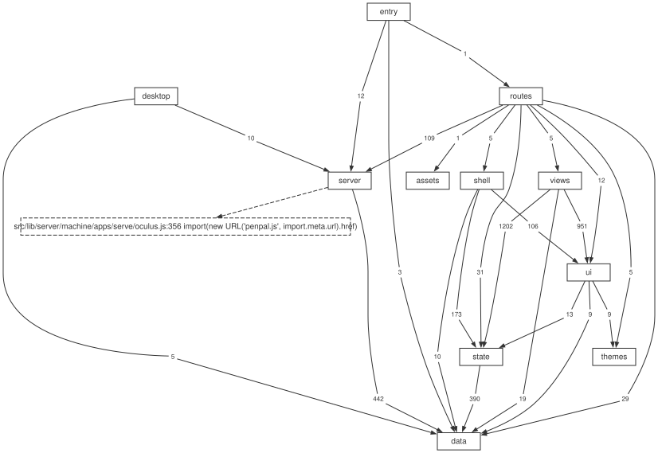
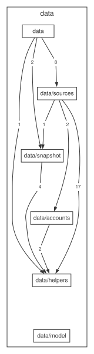
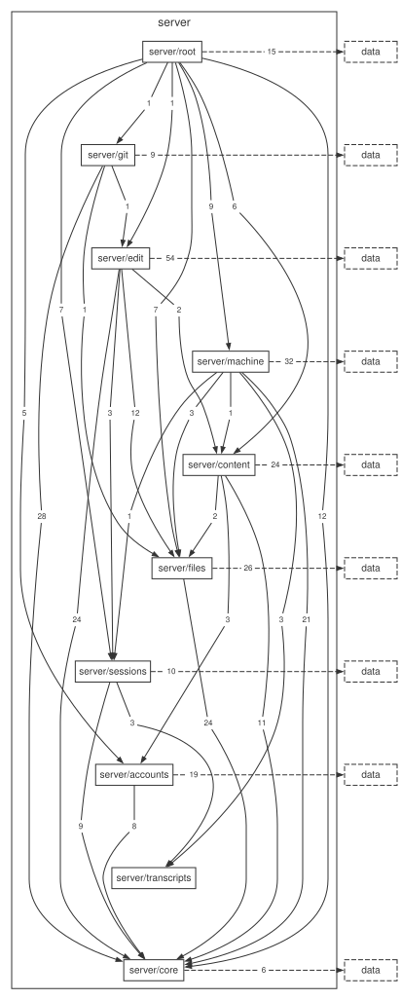
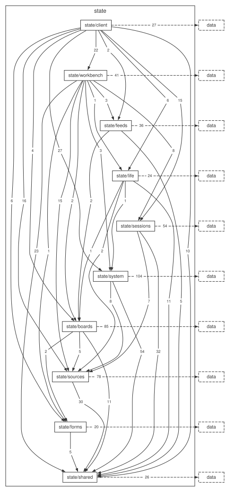
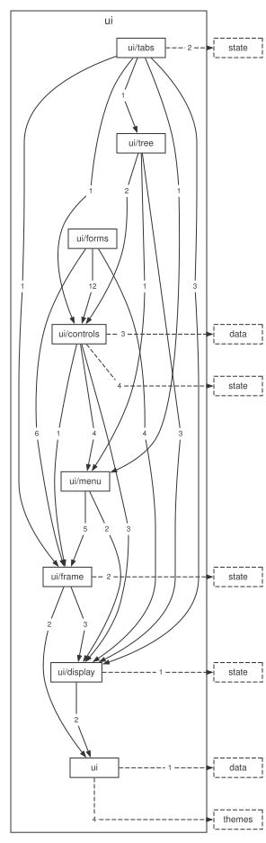
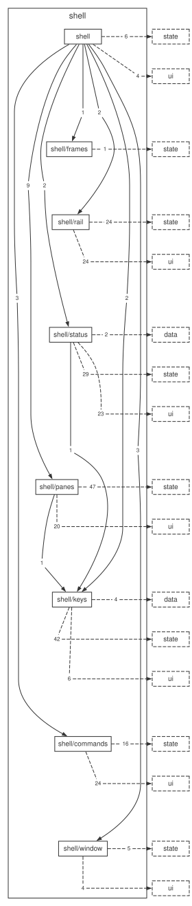
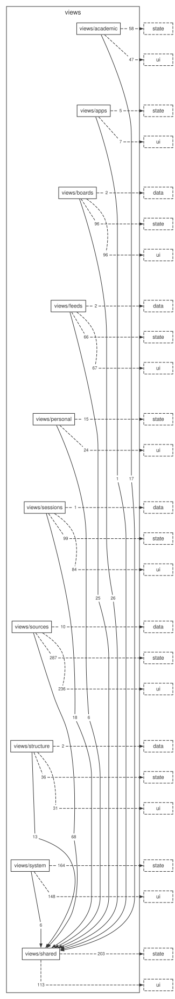

# oculus, design

A local research workbench: the projects, manuscripts, grants, data and code of a research hub, and the Claude Code sessions working on them, in one VS Code-like app. Its construction: one language, three layers, one definition per screen, live data pushed by the server rather than polled by the page, and an arrangement you edit in the app.

This is the artefact every change is measured against. When the code and this file disagree, one of them is wrong and the disagreement is a finding, never something to paper over.

The name: the eye, alongside `iris`, `scotoma` and `umbra`; and the opening at the top of a dome that lets the light in, alongside `cathedra`.

## Why a server and a page

A dashboard over a hub's files could be a static site, one portable HTML file generated with all its CSS and JS inlined, served with a page patched in place when files change. That shape has costs oculus does not carry:

- the screens are defined twice, once in the generator and once in the client script that renders their live half;
- a live reload patches the generated document in place, with escape hatches so it does not wipe what the client rendered, and observers to apply the client's decoration again after it does;
- a module system made by hand stands in for a bundler;
- configuration read into module-level values at import makes a config edit restart the whole process.

Oculus is a server and a page instead: one definition per screen, a bundler, configuration read per change, and the hub's data files read as they are.

## Non-goals

- Not multi-user, not remote, not peered. Clodex-style fleet features are out.
- Not an IDE. It is a development platform for the hub's own files: a file browser, an editor for every text file, search, a language server client (pyright for Python, clangd for C and C++, the TypeScript server for TypeScript and JavaScript, the Svelte server for Svelte, yaml-language-server for YAML, Microsoft's Markdown language server for Markdown, texlab for LaTeX and BibTeX), linters (ChkTeX, ruff, ESLint, ShellCheck and the hub's writing rules, run on save and listed in the Problems view), LaTeX builds, PDF reading, project commands and the rite debugger. It has no other debugger.
- Not a rewrite of the data. The YAML in the hub is the source of truth and its records keep their shape; the `schema:` blocks of its files may change, so that the editor can check and complete them.

## The three layers

**Data.** Reads files, produces a typed, validated model. Knows nothing about screens. Runs on the server.

**Code.** Everything between the model and the pixels. Split by where it can run: the server-pinned half touches the filesystem, git, processes and the socket; the client half holds state and computes joins and filters. Neither half renders anything.

**View.** Components. Split into primitives that know no domain, a shell that knows no view, and views that know no layout.

The rules that keep this honest are the import-graph tests (`tests/checks/tree/boundaries.test.ts` for the layers, `tests/checks/imports/` for the order of the folders inside a layer and for cycles) plus one boundary SvelteKit enforces itself. See Boundaries below.

## Repository layout

```
oculus/
  DESIGN.md  README.md  HELP.md     the decisions, how to run and check it, and the user's guide the Help view draws
  .scratch/migration/               the migration's ledger, state file and agent material; tracked
  config/                           the interface described as data, one concern per file
    appearance.yml behavior.yml layout.yml present.yml sources.yml
    catalogs/                       the vocabularies and the options: agents, file-nesting, glyphs, icons, latex, vocab, meta, options
    schemas/                        the schemas of files that are not hub data files: manifest-schema, deck-schema, cpp-schema
    text/                           every user-facing string, one catalog fragment per owner
      views/<group>/                a view's strings, in the folder of its view group
    (each hub's .oculus/local.yml holds this machine's values, read on its own, gitignored)
  src/
    routes/                         +page.svelte mounts the workbench; views.ts registers every view and, while the page runs, every app
      api/(<group>)/<route>/        the endpoints, in route groups that leave the URL as it is
      apps/[...path]/               an app's files and the shared bridge files, outside /api/ ("Apps added while oculus runs")
    lib/
      data/                         LAYER 1, top down: index.ts, sources/, snapshot/, accounts/, shapes/,
                                    helpers/, prose/, model/ (model/index.ts the facade of every
                                    type)
      server/                       LAYER 2, server-pinned, top down: root/ (the composition root
                                    and the watchers), git/, edit/, machine/, content/, files/,
                                    sessions/, accounts/, transcripts/, core/ (what they all share)
      state/                        LAYER 2, client, top down: client/ (the composition root),
                                    workbench/, feeds/, life/ (the calendar, the wall, notes
                                    and the decks), sessions/, system/, boards/, sources/, forms/,
                                    shared/ (words/ the catalogs, above stores/ the shapes of
                                    the shared stores)
      ui/                           LAYER 3, primitives, top down: tabs/, tree/, forms/,
                                    controls/, menu/, frame/, display/, then html.ts, theme.ts,
                                    shown.ts
      shell/                        LAYER 3, the workbench, top down: Workbench.svelte, frames/, rail/,
                                    status/, panes/, keys/, commands/
      views/                        LAYER 3: one folder per view group, then shared/
        <group>/<name>/             one view: its component and its partials
      themes/                       tokens.css, themes.css, rice/ (one sheet per palette family), vscode.css, vscode-rules.json, code.css, derive.ts
    server.ts                       the Node entry: http server with the WebSocket attached
    desktop/                        the native window: the Electron main, its preload and the packaging script
  tests/                            mirrors src/lib: data/, server/, state/, ui/, shell/, views/,
                                    routes/, fixtures/, and checks/ over the whole tree,
                                    checks/imports/ holding the folder order and the cycle check
  utils/                            the checks the verification list runs and utils/diagrams/, the diagram tool;
                                    migrations/ holds the one-off hub migrations
  docs/diagrams/                    the diagrams utils/diagrams/ draws: the layers, one per layer,
                                    the channels and the write chain
  docs/apps.md                      the guide to building an app, opened in oculus as Apps guide
  docs/palette.md                   every palette command, argument, prefix and key, written by npm run docs:palette
  build/  .svelte-kit/              the build of npm run build and the dev server; gitignored
  build-app/  .svelte-kit-app/      the build of npm run app (vite build --mode app); gitignored
```

The mapping to the three layers is literal: `lib/data` is layer 1; `lib/server` and `lib/state` are the two halves of layer 2; `lib/ui`, `lib/shell` and `lib/views` are layer 3, and `routes/` is SvelteKit's required entry and stays thin. A view's folder says what kind of view it is (boards, structure, sessions, academic, sources, feeds, personal, apps, system), and a view's group in the Views catalogue is the rail page it sits on, or Float for the views of the shipped float (Live HPC, Usage and Workbenches), and a view opened for something rather than listed sits in the folder of the view it is opened from: `nav_groups` of `config/layout.yml` holds one group per rail page and the group `float`, and a view's registration names its group and its place in it.

## Configuration

The tracked files under `config/`, `config/catalogs/` and `config/schemas/` are the interface described as data, one concern to a file, and they are treated alike: what the portfolio reads, words and colours, arrangement, thresholds, themes, the glyph vocabulary, the edit form, the schemas of the YAML the editor checks, the agent composer and the options catalog each have a file of their own, which `HELP.md#configuration-and-the-data` lists with what each holds. The machine's own values are the `.oculus/local.yml` of each hub of the open workspace, read by `readMachine` (`src/lib/data/sources/config/machine.ts`) and never merged; `loadConfig` merges every other file's top-level keys into one map and reports a key two files define, so a key can move between files and no key sits in two. When it is given the hub it then reads the hub's own settings file, `<hub>/.oculus/config.yml`, which sets only the keys of `HUB_LIST` (`src/lib/data/helpers/hub-names.ts`), each value replacing the engine's whole, and `from` records the file each key came from. The words of a hub apply to that hub's own records alone, and they are read from its own files, never from a settings key: the colour (`color`) and title of each entry of its domains registry, and the options of the `themes` field of its venues and data registries, colour and label the projects, venues and datasets read from that hub, and a record of a hub whose files list no such word is drawn as unlisted, never with the primary hub's entry. The `config` channel carries each hub's three lists beside the merged map, by hub name, with the collection keys the hub lists (`ConfigPayload.hubs`, built by `hubVocabs` of `src/lib/data/index.ts`), and the first frame of every page carries them too, so the tone and label lookups of `src/lib/state/shared/words/tones.ts` and the theme labels of `src/lib/state/shared/words/themes.ts` find a record's hub from the hub name in front of its id or its domain. Every user-facing string lives in the catalog fragments under `config/text/`, read through `t("group.key")` on the client and `findingText` on the server, and every option of every config file is described once in `catalogs/options.yml`, so no component holds a literal user-facing string, a raw colour or a literal glyph; `tests/checks/source/keys.test.ts` and `tests/checks/config/config-folder.test.ts` fail on a key or a glyph name that does not hold.

Paths resolve without environment variables: the command-line argument `--engine <dir>`, then a default derived from the file's own location. No path of a hub is set in oculus: the open workspace is `~/.oculus/workspace.json`, the state oculus writes itself, naming a workspace file (`<hub>/.oculus/workspaces/<name>.yml`) or none, so the tree carries no machine path. The open workspace and the machine's joined `local.yml` values are read once per change: the workspace holder (`src/lib/server/files/workspace/follow.ts`) polls the state file, the open file and the files that make a folder a hub or hold a workspace, and `POST /api/write` and `POST /api/fs` ask it to read again after they wrote; the machine holder (`src/lib/server/root/process/context/machine.ts`) reads the hubs' `local.yml` files when one changed or the workspace moved, and a request takes the held values and reads no disk. A key the process is started with (`port` and the state paths) stays at the running value after a switch to a workspace whose primary sets another, and the Findings view carries a finding naming the key and saying that a restart takes the new one. The boundary of what is served is the folders of the open workspace: nothing outside one is ever served, no root exists beside them, and `POST /api/open` works on the same folders, so a dotfile the tree leaves out of its listing and a Customizations item named by its real path are resolved like any other path under a folder.

## Layer 1, data

**Sources.** One module per kind of file. Each exposes one function that takes a root and returns raw records, and each is unit-tested against synthetic fixtures in a temporary directory. No source knows another exists.

**Model.** `model/index.ts` and the concern modules beside it hold the types and nothing else. The core entities are `Project`, `Venue`, `Dataset`, `Pillar`, `Domain`, `Funding`, `Collection`, `Entry`, `Doc`. A project carries the ids of its relations (`venueId`, `fundingIds`, `datasetIds`), never resolved objects: a project points at its funding and the funding points back at its projects, and that loop cannot be turned into JSON.

**Validate.** Every id referenced resolves to an entity; every status is in the vocabulary; every manifest field is one the schema names. Failures are reported with file and key, and a run against the real hub must report zero. It runs on every rebuild, so a bad manifest edit shows in the app within a second, as a finding, never a crash.

**Normalise.** What goes over the wire:

```ts
type Snapshot = {
  version: number                         // increments on every rebuild
  entities: { projects: Record<Id, Project>; venues: Record<Id, Venue>; ... }
  relations: { projectFunding: [Id, Id][]; projectDataset: [Id, Id][]; ... }
  findings: Finding[]                     // from validate
}
```

Nothing is copied into a database: the server reads the files, builds one snapshot of entities and relations, pushes it over a WebSocket, and watches the hub and the config folder, so a file edited anywhere reaches the page in the same second.

Flat, JSON-safe, small: the whole hub is a few hundred kilobytes. Documents are not in it; `api/docs` serves one when a view opens it, and an unchanged file is answered `304` by its `ETag` (`src/lib/server/content/docs.ts`). A deck's slides are not in it either: `api/deck` serves one deck whole when the Present view opens it, and the snapshot carries only where each project's deck is (`Project.deck`).

## Layer 2, code

### Server

**The socket.** One WebSocket per open page. Messages are `{channel, version, payload}`. Channels: `portfolio`, `config`, `sessions`, `git`, `files`, `hpc`, `calendar`, `inbox`, `usage`, `feeds`, `audit`, `processes`, `schedule`, `apps`, `app-hosts`, `app-messages`, `app-shell`, `app-tools`, `jump`, `debug`, `debug-console`, later `pty:<id>`, `lsp:<language>` and `source:<root>/<path>`. A page subscribes to the channels it needs; the server sends the current payload on subscribe and pushes on change. If a page falls behind, the server keeps only the latest payload per channel: the newest state is the only one that matters. The socket accepts nothing from the page except subscriptions, an `unsubscribe` message (`{type: 'unsubscribe', channels}`) that any socket may send and that acts only on that socket's own subscription to the `source:` channels it names (`parseUnsubscription` in `server/root/socket.ts`; any other name in it is ignored), and, from a socket whose subscription carried the write token (a subscribe of no channels carrying the renewed token joins it), terminal input, the frames of an `lsp:<language>` channel and a `jump` message, which a PDF in a window of its own sends to have the main page that opened the window (its `owner`) open a source line: the Hub sends the place once to the pages subscribed to `jump` and keeps none, and a page whose id is not the owner ignores it; `server/root/socket.ts` holds that one set of sockets and hands the terminals and the relay its `canWrite(sink)`, which each asks at every message.

**Language server channels.** An `lsp:<language>` channel carries one language's language server messages both ways with none dropped or merged, so it is the relay's (`server/machine/lsp/relay/relay.ts`) and not the Hub's, and it has no latest payload to send on subscribe. Beside the protocol's JSON-RPC messages it carries the relay's own, told apart by an `oculus` field: from the page `restart`, `output`, `output_off`, `choices`, `choose`, `approve`, which carries an interpreter the relay listed and the reader approved or the Svelte configuration, `revoke`, which takes the configuration's approval back, and `read`, which carries a library address and the root key of the document whose request got it named; from the relay `state`, `output`, `choices`, `refused`, `file`, which answers a `read` with the file's text or with the code that says why it was not read, `gone`, which says the server of an app ended with its host or its registration, and `legend`, which carries the token types and modifiers of the server's semantic tokens, because the relay answers the page's `initialize` itself and that answer cannot. The channel `lsp:workspace` names no language and no server: the page sends `held`, the whole set of files its tabs hold open, and `held_ask`, which of some files another page holds open, and the relay answers `held_answer`; a request for the workspace's symbols names the root and goes to that root's server, and a follow-up of a call or type hierarchy item goes to the server of the item's file.

**Watchers.** Each channel has one watcher module that owns its `fs.watch` handles, rebuilds only what changed, and pushes. The usage, bookmarks, portfolio, local and sessions watchers debounce with a `maxWait` of twice the quiet, so a file written without a pause, as a transcript is while a session works, is rebuilt at least every `maxWait` and not only once the writes stop. Git does not debounce: it throttles per root, so it re-reads on change no more often than every two seconds, with at most one read of a root running and one waiting, and its reads run git as child processes so the event loop keeps serving requests while they work. The same recursive watch publishes the `files` channel at the end of each throttle window: `{ root, folders }` names the folders the window's events landed in (`{ root }` for the whole root when more than 64 came), so the Files tree and every other follower of the channel read again only what moved, without waiting for a git read. A configured root's repositories are watched down to `repository_scan_depth` levels (the folder's own entry in the workspace file, else the global value of `sources.yml`, 1 by default), found at start, on a configuration push and when a `rename` event names a path within that depth. A git write is answered after the state it made is on the `git` channel. The files open in source tabs are the one set polled and not watched: for each `source:<root>/<path>` channel some socket holds, the server stats the file twice a second and publishes the SHA-256 of its bytes (`stat:` and a hash of the stat for a file over the read limit, null when nothing readable is there) when it moves, because a darwin `fs.watch` can miss a write that lands while it registers and a tab has to learn within a second that another program wrote its file; the name is resolved again at every tick, so a link that now points out of every root publishes null and reads nothing, the poll closes when the last socket drops the name, and the number of polls is bounded at 200 names per socket and 1000 over the server (`src/lib/server/files/fs/open-files.ts`, `src/lib/server/core/file-poll.ts`). What each watcher watches and how it rebuilds is in the head comment of its module under `src/lib/server/root/watch/` and `src/lib/server/machine/usage/watch.ts`, and the apps watcher is described with the apps below.

The channels diagram draws each server module that publishes a channel, grouped by its folder under `server/`, with an arrow to each channel it publishes. Each channel is a box with round corners in the group `channels`, with an arrow to each module of the page that reads it, grouped by layer: dashed where the page subscribes to the channel and solid where a module reads its payload. A publish, a read or a subscription whose channel is not written as a literal, a string constant of its module or a call to a function that builds a channel's name is a node of its own in the dashed group `not placed`, with its file and line. Every arrow leaves its module at a port of its own on the right and reaches its head at a port of its own on the left. Between two columns of boxes it runs level to an upright line of its own, along that line and level on, so each arrow can be followed from one end to the other and no two run along each other. The rule is in the head comment of `utils/diagrams/drawing/apart.mjs`.



**Sessions.** Facts that cost real time to establish and must not be rediscovered:

- Transcripts: `<dir>/projects/<slug>/<id>.jsonl` of each Claude account, 490 files and 1.2 GB on this machine, and a 48 MB transcript folds in 0.2 s. A transcript is read in pieces and each complete line decoded alone, so the size of a file bounds nothing, and a byte-offset cache means a later read takes only what was appended (`src/lib/server/sessions/stores/transcripts.ts`, `src/lib/server/sessions/cache.ts`).
- Subagents are `tool_use` blocks named `Agent`, paired to their `tool_result` by id. `isSidechain` is false on every record everywhere and carries no information.
- The live registry: `<dir>/sessions/<pid>.json` of each Claude account, with `sessionId`, `status` (`busy` or `idle`), `name`, `cwd`. Liveness is `kill(pid, 0)` plus a `procStart` match, one `ps` per scan; the registry stamps in UTC and `ps` under the C locale reports local time, so the match parses both and allows two seconds (`src/lib/server/sessions/registry.ts`).
- Grouping: workspace by walking up to `.git`; area scored from touched files with the cwd counting double, directories clamped to two segments below the workspace root, known project folders exempt from the clamp.
- Context occupancy is the last assistant turn's `input + cache_creation + cache_read`, never the lifetime sums.

**Git.** The read-only modules of `server/core/git/` run exactly the forms listed in the head comments of `run.ts` (`src/lib/server/core/git/run.ts`) and `compare.ts` (`src/lib/server/core/git/compare.ts`) and no others, through the two subprocess call sites of `run.ts`, which never hold the event loop and take list arguments only: the asynchronous `execFile` runner `run`, with a five-second timeout, and `runRecords`, which starts the status read and hands its output to `src/lib/server/core/git/records.ts` record by record with no limit on the output, so a folder of untracked files never makes the read fail, so the set of git commands the application can run is one list a reviewer reads; no test pins it. Every write is `server/git/git-write.ts`'s, one call site per subcommand, listed in its head comment (`src/lib/server/git/git-write.ts`), and no form carries `--force`; `branch -D`, run only after Delete Branch's second question, is the one form that discards commits no other branch holds. A write runs only from POST /api/git carrying the write token from this application's own page, and one that loses work or reaches a remote also carries the confirm the page sets from a dialog, so no write is reached by a watcher, a timer or the socket, with one exception: `server/root/watch/autofetch.ts` fetches unattended while `git.autofetch_minutes` of `behavior.yml` is above 0 (its default is 0), because a fetch changes no branch, file or commit the reader holds (`src/lib/server/root/watch/autofetch.ts`).

**Fixed git choices.** Oculus makes these choices once, with no setting, and `HELP.md#source-control-and-worktrees` lists each of them for a reader. Where git has a setting of its own for a choice, oculus leaves the choice to it, so the repository's own configuration decides, with one setting added: a commit sets `user.useConfigOnly` through the environment, so a repository with no configured name and email is refused with git's own message and git never commits under an identity guessed from the machine (`src/lib/server/git/git-write.ts`). Untracked files get a group apart so that one press of Stage All Changes cannot stage a file nobody looked at, and every configured root is listed because oculus shows every repository it knows at once. Forcing is confined to the deposit snapshot push (`forcePushSnapshot` of `src/lib/server/git/deposit/deposit-git.ts`), kept because the snapshot is an orphan commit that has to replace the remote's `main`.

**Search.** One pattern over one served root or all of them, answered by `GET /api/search`, since a search is a request with an answer and holds no state on the server, so it travels over no channel. It sits behind the origin check and the write token, since a search reads every file of every root and that is more than any other read here gives away (`src/lib/server/files/search-routes.ts`). ripgrep is the `@vscode/ripgrep` dependency, so the search works where no `rg` is installed and the version that answers is the lockfile's. The page and the server run one query rule, `data/helpers/search/query.ts`, so the two cannot disagree about what a query is. The same route answers `GET /api/search?list=names` with the names of the files under the served roots for the palette's file mode: the route already holds the served roots, the token, the timeout and ripgrep's one call site, a route folder of its own would only repeat them, the page asks once each time the mode opens and a web worker matches as the query is typed, so typing sends no request and a match over a hundred thousand names never holds up the page, and the answer is capped at `search.max_names` names. Replace is the `replace` operation of `POST /api/ops`, with no route of its own, and it shares the search's one subprocess call site, so the page never decides what is written. Find All References over a Python, C or C++ file a language server serves is the References view's; the word toggle over an identifier in a code root finds every file's spelling of it, with no index of oculus's own. What a reader does is in `HELP.md#searching-the-files`.

**Literature search.** One query is answered by `GET /api/literature` behind the origin check and the write token, since a search puts the reader's query in a request to a third party and spends the keys of `local.yml`. The page sends one request per source that is on and merges the answers as they arrive, so a slow source never holds a fast one, and the state of one source is that source's answer and never an error of the route. Every request goes through one `LiteratureDesk` that holds a lane per source and the cache of `ok` answers, so no module keeps either as state of its own. A failure names the source, the status and the source's own plain code, never the address or the body, since a key travels in the request and must be in no failure. What a reader sees is in `HELP.md#the-views`, and the keys are in `HELP.md#configuration-and-the-data`.

**Live HPC.** One poller publishes one complete state of the cluster on the `hpc` channel. The connection is the poll's own and never the user's shared ssh master, so a master whose route died cannot make a poll wait past its connect timeout. The cluster receives two writes from oculus, both through POST /api/hpc: the cancel of a job and **Submit Job**. The only processes started are `rsync`, with no shell, and the ssh command, both injected so a test starts neither. The host, the cadence and the plan are in the head comments of `src/lib/server/machine/hpc/`, how a failing poll looks and what Submit Job runs are in `HELP.md#the-views`, and the refusal words are `SubmitReason` of `src/lib/server/machine/hpc/submit.ts`.

**Schedules.** One rule reads a schedule entry, `readEntry` of `data/helpers/run/schedules.ts` with `cronRuns` of `data/helpers/run/cron.ts`, and both the dialog and the server apply it, so they cannot disagree on what runs. A prompt starts as a Claude terminal whose only argument after `--` is the prompt, so no scheduled text reaches a shell. `POST /api/schedules` carries the write token and edits the entry's node in the file's own document. How a due time is decided, caught up and skipped is in the head comments of `src/lib/server/machine/runs/schedules/`, and the entry's fields and the dialog are in `HELP.md#the-update-tray-and-schedules`.

**Calendar.** One poller publishes the calendars the reader owns at Google and Microsoft, and any calendar shared as a link, on the `calendar` channel, read-only and never writing to a provider. The credentials are kept in the account files under `calendar_dir` of `local.yml` (`~/.oculus/calendar` by default) and the client half, the reader's own OAuth client id and secret or Entra application id and tenant, under `~/.oculus/connect`, so no secret is in the tracked tree, and no token, secret, published link or event body is ever logged, published or answered. The connect flow is the authorization code with PKCE and the read-only scope alone, with the server's own loopback callback as its redirect. The callback route is the one route the write token does not gate, because the provider's redirect carries no token, so it is guarded by the `state` the process minted and takes once. The accounts, their files and the view's Add account and Remove are in `HELP.md#configuration-and-the-data`, and the poll, the error state and the `ics` provider are in the head comments of `src/lib/server/accounts/calendar/`.

**Mail.** One poller reads the reader's own Gmail and Outlook mailboxes over the `inbox` channel and publishes one complete state, in the calendar poller's shape (`src/lib/server/accounts/mail/poll.ts`). What the two connectors share is `server/accounts/connect/`, parameterised by a kind that selects the scopes and the folder, so a calendar consent never carries mail rights and a mail consent never carries calendar rights. `POST /api/mail` never takes a provider's id or an address from the page: triage, reply and archive name a configured account or a thread of the state last published, so a page that invented an id reaches no mailbox. The accounts and the triage notes are in `HELP.md#configuration-and-the-data`, the confirmations in `HELP.md#the-views`, and the plate is in the head comments of `src/lib/server/accounts/mail/`.

**PTY.** Sessions run inside tmux, one session `oculus-<id>` each, so they outlive the server. The server holds one tmux control-mode client per attached terminal and bridges it over the `pty:<id>` channel, and the page renders it with xterm.js. A session started elsewhere is observed (transcript only) until the reader explicitly resumes it into tmux with `claude --resume <id>`, and the server sends no signal to any registry pid other than the liveness probe.

**The change log.** Every write that changed something is recorded: what file, what field, the value the file held and the value written, and when. The record is made by the writer, at the one point it holds both values, so it holds the value the writer saw, and it is appended as one JSON line to `~/.oculus/changes.jsonl`, after which the `changes` channel carries the moment of the newest line so that a page holding the log reads it again and keeps the older rows it loaded (`src/lib/state/sessions/changes.svelte.ts`). It is a machine-local file and not a file of the hub, since git already holds the hub's history and what this answers is what oculus did here. `POST /api/write` takes one back with the kind `undo`: the file is checked to still hold what the write left, an address that has moved is refused with `moved` and never written over, and the earlier value is written by the same writer the change came from, so an undo is an ordinary write, is recorded like one and can itself be undone. A `config-value` record, the record of an add or a delete of a collection entry and the record of the delete of a lead or a Lit Watch entry carry the replaced text so the undo returns the file byte for byte while the file still holds what the write left (`src/lib/server/edit/writes/config/config-value.ts`, `src/lib/server/edit/writes/entries.ts`, `restoreFeedEntry` of `src/lib/server/edit/feeds/feeds.ts`), and a write with no inverse writer is recorded with `undo: none` and offers no control. What an undo of a removed field or a rewritten note puts back is in `HELP.md#configuration-and-the-data`, and what a record holds is in the head comments of `src/lib/server/core/changes.ts` and `src/lib/server/files/fs/operations/replace.ts`.

A module the trace from the write route reaches is drawn, grouped by folder, when a path from it leads to the disk or to a call the trace cannot follow, or when a refusal calls it. A refusal is a dashed arrow, a function or value referred to without a call is a dotted arrow, and an arrow into the disk is labelled with the `node:fs` call. The arrows are drawn by the rule of the channels diagram: each leaves and reaches its modules at ports of their own and runs on an upright line of its own between two columns of boxes. An arrow that runs back to an earlier column runs above the drawing. An arrow's words sit on it: the arrow reaches them level from the left and leaves them level on the right. The chain is drawn in parts so it reads at the width of a page: a part for each module the route's dispatcher (`src/lib/server/edit/writes.ts`) calls, one for each module two parts would reach, and, in a part drawn wider than 960 pixels, one for each module its head calls that makes calls of its own. Where a part reaches a module that heads another part, the module's box is dashed and its arrows are drawn in that other part. The parts are set left to right in rows as wide as the widest part (`utils/diagrams/writes.mjs`, `utils/diagrams/drawing/stack.mjs`).



**Auth.** The server binds 127.0.0.1, and any page open in the browser can address localhost, so every request under `/api/` passes one origin rule, `sameOrigin`, before a route sees it, and a request carrying neither Fetch Metadata nor an `Origin` header is refused because a browser without Fetch Metadata sends neither on a cross-site request (`src/lib/server/core/auth.ts`). The Claude Code hooks are `curl` posts to `/api/hook` with neither header nor a write token, so that path is let through when a request names neither header (`HEADERLESS` of `src/hooks.server.ts`), and the hook's own refusals are the rate limit and the size (`src/lib/server/root/hooks.ts`). The guard judges the route Kit matched rather than the raw path, so an encoded address reaches no route unguarded. Writes additionally carry a token minted at server start and delivered to the page once, which holds back another page in the same browser. Nothing outside the folders of the open workspace, oculus's own `config/` folder (for the Settings keys outside the hub list), the machine-local files under `~/.oculus` and the files `local.yml` places is ever written. The socket checks `allowedOrigin` on its upgrade, which does not pass through `handle`; what it accepts from the page is under "The socket". The files of an app are served outside `/api/` by `src/routes/apps/[...path]/+server.ts`, because a sandboxed frame sends `Origin: null`, which `sameOrigin` refuses ("Apps added while oculus runs").

**Untyped input.** In `server/core`, `server/root`, `server/machine`, `server/accounts`, `server/files`, `server/content`, `server/git`, `server/edit`, `server/sessions`, `server/transcripts`, `src/lib/data`, `state/`, `src/lib/views`, `src/lib/shell` and `src/routes`, a value that comes from outside the process or from outside the page's own code is checked with a zod schema that sits beside the reader, in the same file (`src/lib/data/helpers/guards.ts`). That covers the socket's frames and the payloads of each channel, request bodies, the output of the programs oculus runs, the files it parses, the records of a transcript, the answers of the providers and the configuration, and in the page the answers of the server's endpoints, the browser's storage and the state a tab keeps in the saved arrangement. What a field of the wrong type does is written on its schema: it takes its default, it is read as absent, or it refuses the whole value. The text of a schema's error is never shown or logged.

**Processes.** A process oculus starts from text the reader did not write into oculus's own configuration (a command in a repository's `.oculus/commands.yml`, a debug launch, an agent seeded with a task) runs only after the reader has approved that exact text on this machine. The approval is kept under `~/.oculus/` and keyed by the text, so a changed text asks again. The process runs in a pane the reader can see, never in the background, except an app's host below. Oculus stops only processes it started itself, behind a confirmation naming the process. A process oculus did not start is shown, never signalled. An app's host (`server/machine/apps/host/`) is a process of the app's approved files, and the reader's approval of the app is the approval of the host's text. The host runs in the background from the app's activation events with its output in the Processes view. The app's disable, revoke, change or removal stops it, and its Stop in the view asks first, naming the app. A command the reader saved through the form is text the reader wrote into oculus, so it runs without the question, and a changed text, folder or `depends_on`, or the same text in another repository, asks again; the placeholder values never enter the approved line, so the approved text is the text that runs. A debug launch asks for every launch, the default configuration that runs the open `.rite` file included, and its approved text is the repository, the folder it runs in and its program as written (no name, no adapter), so the default configuration has the text of a configured `program: ${file}` entry in the same folder and one approval covers both. Stop on a debug session is SIGTERM to the adapter oculus started and SIGKILL two seconds later, behind the confirmation naming it, since the protocol's disconnect lets the program run to its end. A launch of a debugger an app declares asks nothing, since the reader's approval of the app is the approval of the adapter it runs, and its Stop asks naming the debugger; a task an app gives runs in a terminal of the kind `app` without a per-text approval for the same reason, and the reader's Disable, Remove and Revoke of an app ask first, naming the debug session, the tasks and the terminals of the app they will end. A language server (pyright, clangd, `typescript-language-server`, `svelte-language-server`, `yaml-language-server`, `vscode-markdown-languageserver` or `texlab`, `server/machine/lsp/`) is oculus's own command with oculus's own arguments, so it runs in the background with its state on the status bar and ends with its tabs without a confirmation. What a repository's own configuration would run through a server is a process of the repository's text and takes the approval: the Svelte server starts untrusted for every repository, loading no repository config or package and saying so on the status bar as reduced mode, until the reader approves the text of the repository's `svelte.config.*` and `vite.config.*` files on this machine, an entry `svelte-config:<sha256 hex>` in the same file over the paths of those files with the hash of each one's bytes, so a changed file asks again; the TypeScript server loads `typescript-svelte-plugin` only under that same approval; an approval made or taken back starts both servers again. A Python interpreter a repository holds (`.venv`, `venv`), which oculus runs once to read its version and pyright runs to read its search paths, runs only after the reader approved its path on this machine, an entry `interpreter:<sha256 hex>` in the same file over the JSON `[repository real path, interpreter path]`, so a changed path or another repository asks again. A LaTeX build or clean that runs `latexmk` reads the latexmkrc files latexmk would read, which are code, so it asks first: every `.latexmkrc` and `latexmkrc` that is a file in the main's folder and in each folder above it up to the served root or the hub, `$XDG_CONFIG_HOME/latexmk/latexmkrc` (`~/.config/latexmk/latexmkrc` when the variable is unset or empty) and `~/.latexmkrc`, approved as an entry `latexmkrc:<sha256 hex>` over the JSON `[repository real path, [[file real path, SHA-256 of its bytes], ...]]` in path order, so a changed file or another repository asks again, and a file that cannot be read cannot be approved and refuses the step. A recipe tool whose program is none of TeX's own (`Rscript`, `julia`, `pweave`, `quarto`, `R CMD Sweave`) runs the document's code and asks the same way, once for the repository, the main's folder and the recipe's tools as `latex.tools` writes them, under a `command:` key. One question lists both, one approval writes both entries, and an automatic build or clean waits on it with the LaTeX status item in the warning tone. `texlab` is oculus's own command too, and it reads no latexmkrc: it starts with a PATH made of a folder of links to `latex`, `kpsewhich` and `tectonic` and never to `latexmk`, so nothing it runs is a repository's code. It is a program found on the PATH oculus was started with or at `latex.texlab_path`, run as a separate program and not shipped (it is GPL-3.0). A linter (`server/machine/runs/lint/`) is oculus's own command with oculus's own arguments too: ChkTeX, ruff and ShellCheck are programs found on the PATH oculus was started with or at `lint.chktex_path`, `lint.ruff_path` and `lint.shellcheck_path`, each started by an argument array and never a shell, in the folder of the file it reads, once per lint and ended after 30 seconds, and none is shipped. They run in the background on a save and when a clean source tab opens, with their state on the status bar and without a confirmation, and ruff runs with `--no-cache` so it writes nothing into a repository. The writing rules (`server/machine/runs/lint/writing/`) run no program: Markdown and YAML are read in the server's process, and the comments of a code file are found by the grammar the editor colours it with, in a worker thread the server context holds and closes, so a large code file never holds the route's event loop; a request that takes over 5 seconds ends the thread and answers failed. The folder Fix All gives the readers no file larger than a write keeps a copy of (256 KB): such a file is only searched for the characters the rules mark, and a file over 2 MB is not read, so a large file in the folder never holds the event loop either. The folder Fix All of the writing rules plans in `POST /api/lint` (action `folder`) and writes through `POST /api/ops` `writing-fix`, which runs the checked write chain of `lsp-edit` and refuses, as `outside`, a file in the `secrets` folder of every hub or `~/.oculus`; the plan refuses a start folder that is, or lies under, either of them. ESLint is the repository's own, so it is the repository's code: the lint of a TypeScript, JavaScript or Svelte file runs through the nearest `eslint.config.*` above it, and only after the reader approved the text of that configuration file on this machine, an entry `eslint-config:<sha256 hex>` in the same file over the JSON `[configuration folder real path, [[file name, SHA-256 of its bytes]]]`, so a changed file or another folder asks again, and until then no child starts and no file of the repository is imported. The approval and the running ESLint belong to one configuration folder and its one `eslint.config.*` file, so a repository with a root configuration and a nested one asks for each on its own, and a change to one voids only its own approval. The approved ESLint is one child process per configuration folder, oculus's own `eslint-child.mjs` under the node that runs oculus, which resolves `eslint` from the repository's own folder and is given the one approved configuration file; it ends after 15 minutes without a lint, when no served root holds the folder, when the approval changes or is taken back, when `lint.eslint` is switched off and with the server.

### Client state

Svelte 5 state modules (`.svelte.ts`). `entities` holds the latest payload per channel, `selectors` computes the joins (a project with its venue, funding and datasets; sessions by project; workspaces), and views read selectors and write `ui`, never `entities` directly. `layout` holds the tree below and is the one place an arrangement is reactive and the one place it is saved, and `ui` holds theme and per-view-instance state such as selection and filters, and a record under a fixed id that no instance has (`pdf-place`, the last places of the last 50 PDFs read). Both persist to `localStorage`, each under its own versioned key. Two tabs that change the same record, or the pages, at the same moment still end with the last write.

## Layer 3, view

**Primitives** (`ui/`): `Card`, `Chip`, `Meter`, `Table`, `Pane`, `Tabs`, `Sash`, `Empty`, `Toolbar`. Nothing here imports state or knows what a project is, and props are values and callbacks. A `Pane` is a header holding the view's title and its icon actions only, and a `bar` under the header for the view's other controls, so a view's controls sit in one place whatever the view.

**Shell** (`shell/`): the workbench. An activity rail on the left, drawn as VS Code's activity bar, whose icons switch pages and carry one badge each (the sum of the counts the views of the page give the rail, in the most urgent of their tones, red before amber before green, or with no count the first mark among them; `railBadge` of `shell/rail/rail.ts`), a status bar along the foot under both, and one tree of panes with tabs, split any way and any depth, with sashes between the children of every split and one control on each child that collapses it to the split's edge. The shell renders the layout tree and does not import any view by name: views register themselves in a registry keyed by `ViewId`.

**Views** (`views/`): one folder per view, `views/<group>/<name>/`, holding its component and its partials; a group's folder that is full holds a subfolder of views, as `views/system/workbench/` and `views/system/machine/` do. A view reads selectors, composes primitives and writes its own instance state; it does not know where in the tree it sits and has no internal multi-pane layout, so Sessions is six views arranged by a saved default layout and not one view with three panes inside.

**Boundaries**, enforced by `tests/checks/tree/boundaries.test.ts` over the import graph:

| From | May import | May not import |
|---|---|---|
| `ui/` | `ui/`, `themes/`, `state/shared/words/text`, `data/prose/markdown/` (the one Markdown document rule the server shares, and the drawing of a note's links, embeds and tags) | `state/*` otherwise, `views/`, `shell/`, `server/` |
| `shell/` | `ui/`, the state modules the rows of `tests/checks/tree/boundaries.test.ts` name (the client context, the layout, drag, palette, selection and navigation modules, the words, the terminals, and the language server and linter state), `data/shapes/shapes` | any view by name, `server/` |
| `views/` | `ui/`, `state/`, `views/shared/`, `data/shapes/shapes`, its own folder `views/<group>/<name>/` | `shell/`, `server/`, other views and their partials, a sibling view of its group included |
| `state/` | `data/model`, `data/shapes/shapes`, `data/file-ops` and the pure helpers with no reader and no I/O that `tests/checks/tree/boundaries.test.ts` lists with the reason each is shared with the server | `server/`, anything of layer 3 |
| `data/`, `server/` | `data/` | anything client-side |

SvelteKit enforces the last row's server half by refusing client imports of `$lib/server`.

Inside a layer the folders have an order from the top down, declared in `tests/checks/imports/order.ts`: a module imports its own folder or one below it, never one above, so no two folders of a layer import each other, type-only imports included, since a type a folder takes from a folder above it ties the two as an import does. `tests/checks/imports/cycles.test.ts` refuses any chain of runtime imports that leads a module back to itself, since the load order would then depend on which module is asked for first (`tests/checks/imports/cycles.test.ts`), and `tests/checks/imports/augments.test.ts` refuses a `declare module` block or a `/// <reference path>` naming a module of the tree, since an augmentation ties two modules in either direction and no order could hold it (`tests/checks/imports/augments.test.ts`). Process-wide state under `src` is refused, so every store is reached through the client context (`tests/checks/tree/boundaries.test.ts`). A view computes nothing a store's payload could be asked for: the filters, sorts, groupings, counts and joins over a payload are functions of the state folder that owns it, each with its own unit test.

The diagrams are drawn from the source by the diagrams command that `README.md` lists into `docs/diagrams/`, each as a Graphviz `.dot` file and the `.svg` drawn from it, so no diagram is drawn by hand and none can disagree with the code. A change that moves an import, a channel or a write is committed with the diagrams it redraws, and the tree check of the diagrams that `README.md` describes fails until it is. The diagrams count the imports that run, since an `import type` leaves nothing behind in the built code, and they read a module's imports through the same reader as the checks (`utils/diagrams/imports.mjs`), so the two cannot read a module apart.

The layers diagram and the diagram of each layer follow.



Each box of the layers diagram is a layer and each arrow carries the number of runtime imports from one layer to another; how it is drawn is in the head comment of `utils/diagrams/graphs.mjs`.













Each layer has a diagram of its own, its folders top to bottom in their declared order and the imports between them; how it is drawn is in the head comments of `utils/diagrams/graphs.mjs` and `utils/diagrams/drawing/labels.mjs`.

In the Doc view each diagram takes the page's text colour, because the SVG is fetched as text and drawn inline with every line in `currentColor` (`src/lib/views/shared/prose/diagram/Diagram.svelte`).

The client's stores are one object, built once by the page root and read from Svelte's context by everything below it, so no store is a module anything imports and two pages share nothing (`src/lib/state/client/context.ts`, `src/lib/state/client/use.ts`). The fetch-and-hold stores hold their answers in one `QueryClient` per client state (`@tanstack/query-core`), so no store keeps a record of answers, an in-flight set or a microtask of its own, and a tab the pane hides asks nothing (`src/lib/state/client/queries/queries.svelte.ts`). Three modules stay module-level and are named in `tests/checks/tree/boundaries.test.ts`: the text, tone and appearance catalogs, which hold what the server last sent, are never written after a push installs them and are read from every layer including `ui/`; with them the two runes that make those reads redraw, since a generation held per client would say a push had landed for one client and not for another over the one set of maps they both read (`src/lib/state/client/context.ts`).

A partial under `views/shared/` may import `ui/`, `state/` and `views/shared/`, and nothing under any `views/<group>/<name>/`; nothing outside `views/` imports it. It is where a block two views draw the same way lives, the project card and the subtasks block being two, so the alternative to a view importing another view's partial is one shared partial rather than a copy that falls behind.

## Layout as data

```ts
type ViewId   = 'focus' | 'projects' | 'archive' | 'venues' | ... | 'session-list' | 'terminal' | 'timeline' | 'customization'
type Instance = { id: string; view: ViewId; state: unknown; preview?: true }
type Layout =
  | { kind: 'split'; dir: 'row' | 'col'; sizes: number[]; children: Layout[]; folded?: number[] }
  | { kind: 'pane';  tabs: Instance[]; active: string }
  | { kind: 'page';  page: string }
type Workbench = { root: Layout; focus?: { path: number[] } }
```

A page is one tree. The shell renders it, a drop moves an `Instance` between panes, and opening a view appends an `Instance` to the pane `open/opening.ts` picks, which for a view opened for something is the pane `open/landing.ts` picks (head comment of `src/lib/state/workbench/layout/open/opening.ts`). `folded` holds the indexes of a split's children collapsed to its edge: a folded child keeps its share in `sizes`, so expanding gives back the width it had, and one child of a split is always left open. The saved arrangement is the serialised tree, and what a view keeps lives in each tab's own state, so two instances of the same view have separate state by construction.

Beside the pages the layout holds floats. A float is a workbench of one pane, addressed by its id wherever a page id is taken, so opening, closing, moving and activating a tab in it go through the operations a page's pane uses; it is never a page, so the rail, the Pages view and the page lists of the pane menu never list it, and a split inside it is refused. Its place is one of three shapes (`FloatPlace` of `src/lib/state/workbench/layout/model.ts`): free, docked to an edge, or a window of its own, which is a window of the desktop app or, in a browser, a browser tab at `/?float=<id>` that the press opening it makes. One float is docked to an edge, and docking a second merges its tabs into the first. `shell/panes/floats/FloatLayer.svelte` draws every float once, outside the block keyed by the page, so a switch of page never mounts a float's views again and a maximised pane of the page leaves the floats drawn. A float docked on an edge whose toggle hides it is not drawn and its track takes no room: the hidden edges are the optional list `hidden` of `Pages`, saved with the floats, read as the rest of the envelope is read (an unknown or repeated edge dropped), and shown again by a change that docks a float there or shows another tab in that float (`settleHidden` of `layout/model.ts`) and by a view opened or a tab made active in it (`revealed` of `layout.svelte.ts`). A free float is drawn below the window's title bar strip whatever its fractions say.

The rule for the pane a last tab leaves, which `HELP.md#pages-and-the-pane-tree` states, is `keptPane` in `src/lib/state/workbench/layout/tree.ts`. A pane carrying `added` is removed with its last tab; every pane made while its page is used carries it (`splitPane`, Return to Page, and the pane that replaces a page leaf a saved layout refuses), and any other pane of a page stays, emptied, as does a locked pane. The store hands the tree functions a `KeepRule` that names what an emptied pane is left as, a terminals pane after a Terminal tab and a documents pane after any other, so the rule holds whatever takes the last tab out: a close, a drag out, a move to another page, an edge drop, a record deleted, a view leaving the registry. A float has no rule and goes with its last tab.

A page leaf shows another page at that spot, by id, and it is a leaf as a pane is: it folds, it takes a neighbour when a tab is dropped on its edge, and it holds no tab of its own. A page is drawn once on a screen so that no view is mounted twice, which is why a leaf or a drop that would break that is never offered (`HELP.md#pages-and-the-pane-tree`).

## Theming

`tokens.css` and `themes.css` hold oculus's palette, a type scale and radii set on VS Code's measures, the dark theme and the shape the rice palettes share, and `themes/rice/` holds the hand-written rice palettes, one sheet per family (Catppuccin, Tokyo Night, Phosphor and the others) that `ui/theme/theme.ts` and `src/routes/+layout.svelte` read with an `import.meta.glob`; every theme block overrides tokens and nothing else, so no component knows a theme exists. The colours a component paints text with are computed, not authored: `src/lib/themes/derive.ts` mints the `--on-*` and `-txt` tokens, the selected-row surface, the scrollbar's colours, the Focus lanes' surfaces and text, the fill under a hovered or open item of the orange status bar while debugging (`--c-orange-hover`), and the Seti icon colours for every theme, and `tokens.css` gives them the default theme's values on `:root` so the first paint draws them before a theme is applied (`src/routes/+layout.svelte`). The VS Code themes are generated: `utils/migrations/convert-vscode-themes.ts` reads the colour theme files of the installed VS Code and writes `themes/vscode.css`, one block per theme, and `themes/vscode-rules.json`, each theme's own TextMate rules, which the editor takes in place of the six code hues under `code_theme: tokens`. The mapping is `src/lib/themes/vscode-map.ts`, which the script imports; the colour theme file of an app is converted on the page with the same mapping, over `tokens.css` and `themes.css` read with Vite's `?raw` import, into a `body.app-theme` block (`ui/theme/app-theme.ts`), so a generated theme and an app's follow one mapping. File icons are Seti's unless `file_icons` of `config/appearance.yml` names an icon theme of an app, which `ui/display/icon-theme/` draws in every place a file icon is drawn. A contrast failure in a generated block is a finding about the converter's mapping, and one in a hand-written block a finding about that block. The contrast test walks every text-on-background pair the primitives declare, under every theme, and fails below 4.5:1; it never repairs a colour or loosens the threshold (`tests/checks/look/contrast.test.ts`). Primitives use tokens only; a raw hex in a component is a test failure.

The wallpaper is one image behind everything, served by `api/wallpaper` from the folder `wallpaper_dir` names for a hub (the value of its `.oculus/config.yml`, else the engine's), inside that hub and nothing outside it (`.oculus/wallpaper` as shipped); the image is `wallpaper.image` of the primary hub's `.oculus/config.yml`, a hub name and a file name joined by a slash, and it is on where a theme's class carries `rice` or under every theme where the config says `all`. The surfaces over it follow one rule: one translucent layer over the picture and never two, since two such layers read as one nearly solid one, so each component that paints a surface declares under `body.wall` what its surface does, and a floating surface is more solid than a panel because it is read through a pane as well as through the picture (`src/lib/themes/tokens.css`, `src/lib/state/shared/words/appearance.ts`). A blurred surface is the containing block and the stacking context of every fixed thing inside it, which is why a tooltip, a menu, the notification centre, toasts and confirm are drawn on the document body through bits-ui's `Portal`, and the pop-ups of Monaco's editors are drawn on nodes on the body as well, in the source, diff and merge editors and in a peek. Each editor box has one node (`pageWidgets(...).of(box)` in `ui/controls/editor/options.ts`, `fixedOverflowWidgets` with `overflowWidgetsDomNode`), which holds what Monaco marks as overflowing the editor: the hover, the suggest list and its details, the parameter hints, the rename box, the colour picker and the paste-as widget; a peek's editor and the two sides of a diff editor use the node of the box they stand in. Every context view, the right-click menu, the code action list and the select lists of Monaco's action bars, is drawn in one node for the page: Monaco's context view service is extended (`PageContextView`, handed to Monaco's first `create` in `kit/load.ts` with a layout service that answers the node), so it draws in that node whatever container the caller hands it, and the node is as large as the window, which Monaco sizes its lists by. All the nodes stand at one depth above the floats and under the dialogs and tooltips, carry the class `monaco-editor` and the theme type class of the editors' root (`vs`, `vs-dark`, `hc-black`, `hc-light`), given again when an editor takes a model and when the theme is painted, take the text size of the editor's box and take no pointer except through the widgets in them. What Monaco places in the text on purpose (the find widget, the peek zone, the lightbulb, CodeLens, inline completions and the sticky scroll) stays in the editor's box, and so does the quick input (Go to Line, Go to Symbol), which Monaco scopes to its editor. A node is outside the editor's box, which Monaco hears keys through, so a key typed in a widget is dispatched again on the root of the editor that owns it (the one with the focus, else the one that last had it in its text, which is a peek's editor while its widget is open), a Tab that nothing takes moves between the parts of the widget it was typed in and returns the focus to that editor when it would leave the widget, the shell takes the pane of the box a node is for as the focused pane (`data-widgets-of` on the node, `data-widgets-id` on the box), and a scroll of any ancestor of the box closes the editor's context view, hover, suggest list and parameter hints and, when another widget such as the rename box is still open, draws the editor again so that widget is placed against the text again, since Monaco places a fixed widget only when the editor draws. The window and the document hear the original key and its copy in the capture phase. The editor's own blur under a wallpaper is drawn on a pseudo-element (`kit/theme/wall.css`), so the editor's box is no containing block for a fixed widget.

The icon set is Lucide at one stroke weight, shipped as the `lucide-static` package, and `icons.yml` maps every name of the glyph vocabulary to one of its icons; the server reads each mapped drawing once per config load and pushes it with the rest of the configuration, and `ui/display/Glyph.svelte` draws it inline in the colour of the text beside it. The capsule belongs to a status word, the project type, a filter toggle and the badge of a view in the Views catalogue, and everything else a surface lists, a dataset, a person, a pillar, a deadline, a count, is `ui/controls/Tag.svelte`, the same glyph and words with no capsule, so the capsule keeps its one meaning (`ui/controls/Chip.svelte` and `Tag.svelte`). A tag that stands for a state keeps that state's hue as the colour of its words and of its mark, and a tag that stands for a name or a count carries none and is muted.

The glyph vocabulary is `glyphs.yml`'s one `glyphs:` map, each name with the ASCII stand-in a terminal theme draws in place of its icon, one to three printable ASCII characters (`iconFindings` reports a value that is not). A terminal theme draws the stand-ins unless the viewer turns Icons on, and the swap is a lookup where a glyph renders, in `ui/display/Glyph.svelte` and in `ui/controls/Chip.svelte`'s bracket rule, and never a pass over the document. No string under `config/` carries a glyph: a text that shows one draws a `Glyph` beside its words, with any separator drawn by the markup and hidden from a screen reader, a mark badge's hover says what the mark means in the words its registration's `badgeMark` names, and the check or cross that opens a venue's `wos:` or `scopus:` is read as a yes or a no by `data/snapshot/indexing.ts` and drawn as the `check` or `cross` glyph. A theme row whose `glyph:` is missing, empty or not a glyph name, and a row repeating a theme's name, are findings of `data/sources/config/themes.ts`, and the picker draws such a row with its words alone. Glyph and icon names are read as own keys, so an inherited name such as `constructor` is no name. KaTeX, the terminal and Markdown drawn from hub files carry their own content.

## Hot reload

Three kinds of change, three mechanisms, no restart in any of them.

| Change | Mechanism |
|---|---|
| a component, a selector, a primitive | Vite swaps the module in the open page; state survives |
| a server module or an endpoint | Kit's dev server reloads it; the socket reconnects, and after a reconnect the page takes the first message of every channel whatever its version, since a restarted server numbers its channels from the start again |
| a YAML file in the hub or in `config/` | the watcher rebuilds and pushes; identical in production |

A route reads the configuration through `locals.config()`, which takes the parse of the engine's `config/` and of the hub's settings file `<hub>/.oculus/config.yml` that the server context holds (`configCache`, `src/lib/server/root/process/config-cache.ts`), parsed again only when a file of the folder was added, removed or written or the settings file was written since the last parse, or when the primary hub of the open workspace changes (the workspace is read at each request), which a stat of each entry tells, and never cached when that stat fails. A hub without the file is stamped as absent, so making the file moves the stamp; nothing else of `<hub>/.oculus/` is stamped. The route keeps the one read it took for the rest of the request, and a server module takes it from its route as an argument rather than reading it itself, so an edit to `config/` or to the hub's settings file reaches every route on the next request, in production too. The settings of every other hub of the workspace are kept the same way, one parse per hub under the stamp of the engine's folder and that hub's settings file (`configCache.hub`), and every reader of them (a write's target, the documents, the deck, the wallpaper, the photo walls, a hub task, a recovery and the rebuild) is handed that reader, so a request parses no other hub's settings while neither file changed. The server's own readers of the primary's settings (the language server relay, the debugger, the apps and their hosts, the schedules, the git watch and the hook after a rebuild) take the same kept parse through `configCache.quiet()`, which says no finding; a parse one of them makes has its findings said by the next request. The writes that read the engine's own lists (the Lit Watch buckets, the Literature path) take the engine's folder parsed alone, kept the same way under the stamp of that folder (`configCache.defaults`).

The pollers are built from the configuration read when the server starts, and every config push hands them the settings read again through `server/root/live-settings.ts`, each group by its own reader. A value that its catalog entry refuses hands the poller that setting's `default` and is a finding naming the key, so a bad value costs one setting and never the poller; a push whose merge dropped `behavior.yml` keeps the settings in force.

The `.oculus/local.yml` of every hub of the workspace is read again whenever one changes, by the one watch on them, `server/root/watch/local.ts`, and every key holds at once: the context's `local` takes the new values in place, so a route that reads `locals.server.local` follows with its next request, and each object built from a changed key, an account's poller among them, is closed and built again. A changed `port` moves the server of the same context to the new port, so the hub, the terminals and the token stay: the server lets a request in flight finish for up to five seconds before it ends what remains, so a request that itself changed the port is answered, and only once the server listens on the new port is the new address published (`src/lib/server/root/mover.ts`). The page that was open follows when its own port is the port of the address it holds and the new address answers it (`src/lib/state/client/socket.svelte.ts`), and because the browser keeps `localStorage` per origin it carries the arrangement and the settings in `window.name` to the page at the new address (`src/lib/state/workbench/layout/saved/carry.ts`). A value that a watcher cannot be built from is logged with its key and stays at the value in force, and the user's side of this is in `HELP.md#configuration-and-the-data`.

## Apps added while oculus runs

An app is a folder of web files (a page and its scripts) that the reader puts in one of two places: the machine's apps folder, which is `<primary hub>/.oculus/apps/` unless `apps_dir` in the primary hub's `local.yml` names another, or the `.oculus/apps/` folder of a folder of the open workspace. An app of the machine's folder is a machine app and an app of a root's folder is a root app. Views found at build time stay as they are; an app is a second kind of view, which oculus finds while it runs, lists in the view catalogue, and draws in a tab inside a sandboxed frame once the reader has approved it. It needs no build and no restart. A machine app lives in the primary hub's own `.oculus/apps/` folder, which the hub's owner writes and a `git pull` into the hub writes too, and a root app lives in the `.oculus/apps/` folder of another workspace folder, which whoever writes to that folder writes, a `git pull` included. The place sets the two kinds apart. A machine app may read every channel an app can read, may list `files` folders its page reads and can be removed. A root app is offered fewer channels, reads files only from its own folder and has no Remove. Both can be kept approved, so a change to any of its files but `app.yml` leaves it approved while the server runs. Each paragraph below says what differs for the two kinds, and a rule that names neither kind holds for both.

**Where an app lives.** A machine app is a direct subfolder `<apps_dir>/<name>/` that holds a file `app.yml`. `apps_dir` in the primary hub's `.oculus/local.yml` names the folder, `<primary hub>/.oculus/apps` when absent, resolved at the call as `calendar_dir` and `mail_dir` are and read through `readMachine` as `appsDir`; with no primary hub there is no machine apps folder. A root app is a direct subfolder `<folder>/.oculus/apps/<name>/` that holds a file `app.yml`, for each folder of the open workspace, whether or not the folder is a git repository. The folders are those of the open workspace file (`OpenWorkspace.roots`, `src/lib/server/files/workspace/open.ts`) under the names the file gives them, and a folder taken out of the workspace stops its root apps. The folder that holds apps, the machine's or a workspace folder's, is an apps folder, and the folder of one app is its app folder. The primary hub's own `.oculus/apps/` is the machine folder when `apps_dir` is absent, so `<primary hub>/.oculus/apps/board/` is the machine app `board`, and the scan reads that folder once and never as the primary's root apps. Oculus's own `config/` folder holds no apps, whatever name a workspace lists it under, and its `.oculus/apps/` is never read. Not an app: a file directly in an apps folder, a folder whose name starts with a dot, and a folder with no `app.yml`, which is ignored without a finding since nothing in it claims to be an app.

An `app.yml` that does not parse or is not a map of keys is a finding (`findings.file.does_not_parse`, `findings.file.not_a_map`, keyed as the findings below are, with the folder's name in place of the app's) and the folder is not an app. In this section a real path is the path as the disk stores it, letter case included, as Node's `fs.realpathSync.native` gives it (`realpathSync` keeps the case the caller typed, `src/lib/server/core/paths.ts`), and every real-path check of the section compares that path; the real path of a file that does not exist is the real path of its deepest existing folder followed by the remaining segments, and a link that points at nothing is read by its target text. A folder that is itself a link is followed once and listed by its real path. A root's `.oculus/apps` that is itself a link is followed once in the same way and must resolve inside the root's real path: one resolving outside the root is `findings.apps.folder_outside` and none of its apps is offered. The apps folders are taken in one order, the machine's first and then each root's in the order the file browser shows the roots, and an apps folder or an app folder whose real path a folder taken before it already holds is `findings.apps.repeated`: one real folder reached through two roots (a link, or two root keys naming one folder) belongs to the root that comes first, and a folder that is both `apps_dir` and a root's `.oculus/apps/` holds machine apps and gives that root the finding.

Inside an app's folder a symbolic link is not part of the app: it is neither hashed nor served, and a dot-named file or folder is not part of it either.

**How an app is named.** A machine app's view id is `app:<name>` and a root app's is `app:<folder name>/<name>`, where `<folder name>` is the name the workspace file gives the folder. `name` matches `^[a-z][a-z0-9-]{0,39}$`, which holds neither `/` nor `@`, so the text after the last `/` of a view id is always the name, and a folder name parses whatever it holds. Two roots can each hold an app of one name, and a machine app can share its name with a root app: a folder `notes` in the machine's folder, in `cathedra` and in `ordo` gives `app:notes`, `app:cathedra/notes` and `app:ordo/notes`, three finding keys (`apps[notes]`, `apps[cathedra/notes]`, `apps[ordo/notes]`) and three approvals. The view id names an app wherever a bare name would: the header `x-oculus-app`, the change record, the store the server finds for a write, the approval, and the finding key `apps[<view id without app:>]`, made with the folder's name when the manifest's name is not valid. A finding about a folder's whole apps folder is keyed `apps[<folder name>/]`. The address of a machine app is `/apps/<name>/<key>/<path>` and of a root app `/apps/@<folder name>/<name>/<key>/<path>`, where `<key>` is the app's address key (the field `key` of its row). `@` starts the second segment of a root app's address and no name starts with it, and the shared files' segment `-` (below) equals neither an `@` segment nor a name, so the three forms never meet.

A folder name holds letters, digits, `.`, `_` and `-` alone, so it needs no encoding in an address; the view id carries the name as it is, and the header `x-oculus-app` carries the view id. Where an app's title is drawn (the view catalogue, a tab, the approval panel), a root app's title is followed by its folder's name in parentheses, so three apps titled Notes read "Notes", "Notes (cathedra)" and "Notes (ordo)", and the approval panel gives the app's folder path.

**The manifest.** `app.yml` is one map of keys:

```yaml
name: notes
title: Reading notes
description: It lists the venues and files a note under an entry.
glyph: page
bridge: 1
entry: index.html
reads: [portfolio, files]
writes: [entry, new-idea]
connects: [https://api.example.org]
host: host.mjs
files: [hub/projects]
secrets: true
activation: [onTab, 'workspaceContains:**/*.tex']
depends: [base]
contributes:
  commands:
    - command: notes.new
      title: New Note
```

`name`, `title` and `bridge` are required. `name` matches the pattern above and equals the folder's name. `title` is 1 to 40 characters, trimmed, with no control character. `bridge` is `1`, the version of the bridge below. `description` is optional, up to 200 characters, and is shown at approval. `glyph` is optional, a name in `config/catalogs/glyphs.yml` other than `app`, the group heading's glyph, which no view of a group carries (`config/layout.yml`); an absent, unknown or reserved name draws the catalog's `apps.glyph`, whose value is the glyph `app_view`, and an unknown or reserved one also gets `findings.apps.glyph_unknown` while the app is offered. `entry` is optional, `index.html` when absent: a `/`-separated relative path whose segments are non-empty and do not start with a dot, ending in `.html`, and naming a file of the app. `reads` and `writes` are optional lists, empty when absent, of names from the open sets below, each name once; the channels open to a root app are fewer than those open to a machine app, and `app-store` is not a name `writes` can hold. `connects` is an optional list, empty when absent, of the outside origins the app may fetch from, for a machine app and a root app alike: `https://host` or `https://host:port`, with no user name, path, query or wildcard, each origin once, compared after a trailing slash is dropped. The five keys that follow belong to the host and to the files, secrets and apps it reaches. `host` is optional: a relative path of the `entry` shape ending in `.js` or `.mjs` that names a recorded file, the app's host file ("The host" below). `files` is optional, for a machine app only: the folders the app's page may read through `oculus.fs`, each `<folder name>` or `<folder name>/<path>`. The folder name is the longest name of the open workspace's folders that the entry equals or that is followed by `/` in it. The path obeys the segment rule and names no folder of `closed_paths`. An entry that names no folder of the workspace is a finding (`files_unknown`) and the folder is not an app. A folder that holds oculus's own `config/` folder is an ordinary workspace folder whose files in `config/` answer `closed`. `hub` beside `hub/projects` keeps both, with the wider one deciding. A root app that lists `files` is refused, since it reads its own root and nothing else. `secrets` is optional and, when present, `true`. `activation` is optional, only with `host`: a list of events, each once, from `onTab`, `onStartupFinished`, `onCommand:<id>`, `onLanguage:<id>`, `onView:<id>` and `workspaceContains:<glob>`, `[onTab]` when absent; an id or glob that is empty, and a glob that starts with `/` or holds a `..` segment, refuse the app. `depends` is optional: a list of machine app names, each once, matching the name pattern and never the app's own name; a dependency that is absent, refused, disabled or not approved does not refuse the folder, it leaves the depending host waiting. `contributes` is optional: a map of VS Code's contribution points, described under "What an app adds to the shell". The row carries them as `host`, `readFolders` (`files` is the row's count of recorded files), `secrets`, `activation`, `depends` and `contributes`.

`http:` is accepted only for `localhost` and `127.0.0.1` on a port other than oculus's own, and a trailing slash alone (`https://api.example.org/`) is accepted and stored without it. A `wss:` origin is refused. A key this list does not name refuses the app (`findings.apps.key_unknown`), since a key of a later version that was silently ignored would leave the reader approving something other than what runs.

**What refuses an app.** Each of these is a sentence in `config/text/findings.yml` under `findings.apps`, shown in the Findings view keyed `apps[<view id without app:>]`, and each leaves the app not offered, not registered and not served: `name_empty` (absent or empty), `name_shape` (outside the pattern, which also covers every reserved form, since the shared address segment `-` below cannot match it and no name starts with `@`), `name_not_folder`, `key_missing`, `key_unknown`, `title_shape`, `description_shape`, `bridge_unknown`, `entry_shape`, `entry_missing`, `list_repeated` (a name twice in `reads`, `writes`, `connects`, `files`, `activation` or `depends`), `host_shape`, `host_missing`, `files_root_app`, `files_unknown`, `files_shape`, `files_closed`, `secrets_value`, `activation_no_host`, `event_unknown`, `event_empty`, `event_glob`, `event_command`, `event_view`, `files_private`, `id_taken`, the `contributes_*` sentences of "What an app adds to the shell", `depends_name` and `depends_self`.

Further findings of the same kind are `channel_unknown` and `write_unknown` (a name in neither the open nor the closed set), `channel_closed` (a channel closed to every app, or, for a root app, `inbox`, `calendar`, `sessions` or `usage`; its sentence names the channel, says whether it is closed to every app or to a root app, and gives the reason, which is `findings.apps.carries.<channel>`, what the channel carries), `write_closed` (a name in the closed set, and `app-store`, which every app is granted for its own store and cannot ask for), `list_shape` (`reads`, `writes` or `connects` that is not a list of names), `file_unreadable` (the manifest or a file of the folder cannot be read when the hash is made) and `connect_shape` (an entry of `connects` that is not an origin of the form above: one with a user name, a path, a query or a wildcard, a scheme other than `https:` unless it is `http:` to `localhost` or `127.0.0.1`, `wss:` included, or an `http:` origin on oculus's own port) and `too_large` (more than `apps.max_files` files or `apps.max_mb` megabytes, 500 and 20). Two findings are about a whole apps folder, keyed `apps[<root key>/]`: `folder_outside` and `repeated` for a whole folder. `state_unread` is about `~/.oculus/apps.json` ("Enable and disable" below). A third, `apps_dir_not_folder`, is about the machine's folder: `apps_dir` names a file, there are no machine apps, and the finding is keyed `apps_dir` and names `local.yml`.

Two folders of one apps folder whose manifests claim one name resolve by `name_not_folder`: the folder that carries the name is the app, the other is refused, and neither wins by order. A manifest that asks for a channel or a write oculus does not have, or for one of the closed sets below, is refused when the folder is read, before there is anything to approve.

**How oculus finds it while running.** One watcher module, `server/root/watch/apps.ts`, owns the `fs.watch` handles of the real path of `apps_dir` (recursive), of the real path of `.oculus/apps` in each folder of the open workspace (recursive; the primary hub's is `apps_dir`'s default and so watched once), of the real path of each app folder that is itself a link (recursive, so an edit in a linked folder is seen), of the folders that hold the stores of the apps it lists (`~/.oculus/app-data` and `<folder>/.oculus/app-data`, each not recursive), and of `approvals.json` itself by its path, opened again after every event since a write by rename replaces the file; it never watches `~/.oculus` as a whole, whose other files change on every write. It follows the folders as the open workspace gains and loses them: it reads the open workspace again on a `config` push and whenever the workspace follower announces a change (`server/files/workspace/follow.ts`, which polls the state file and the open workspace file with `pollFile`), so a folder added in the page is read at the next tick and a folder that leaves the workspace loses its handles. It debounces with lodash's `debounce` and a maximum wait as every watcher does, and rereads every app on a change: the manifest, the walk of the app's regular files (path, size, modification time and change time of each, recorded), the content hash, whether the approvals file holds it or the app is kept approved, and the store file's size and version (computed without parsing the file).

It reads the hubs' `local.yml` files again when one changes, as accounts are, and follows a new `apps_dir`. When `apps_dir`, a folder's `.oculus/apps` or the store folder of a listed app does not exist, one timer looks again at every such folder every two seconds and starts watching each when it appears; a missing folder is no finding, and a folder with no `.oculus/apps` is looked at again as the machine's missing folder is. An absent `approvals.json`, which is the case until the first approval, is looked for the same way and means no app is approved; the approve route also tells the watcher after its own write, and the write route does the same after a store write. The server context holds the result as `rows`, `findings` and `folders`, and the watcher publishes `{ rows, findings, folders }` on the channel `apps` when the result differs from the held one. A row is `{ name, root, title, description, glyph, folder, entry, reads, writes, connects, host, readFolders, secrets, activation, depends, disabled, machineDisabled, workspaceState, files, bytes, hash, approved, hashApproved, kept, key, storeBytes, storeVersion, storeFile }`: `root` is the folder name, empty for a machine app; `disabled` says whether the app is disabled in the current workspace, `machineDisabled` whether the machine-wide list disables it, and `workspaceState` what the current workspace's lists say of it (`disabled`, `enabled` or empty); `hashApproved` says whether the approvals file holds the app's current hash, which a kept app's changed files may not; `folder` is the app's real folder path; `key` is the address key, empty unless the app is approved; `kept` says whether the app is kept approved; `storeBytes` is the size of the app's store file in bytes, 0 when the file is absent; `storeVersion` is the first 16 hex characters of the SHA-256 of the file's bytes, and the empty string when the file is absent; `storeFile` is the path the store is written to.

A store path that is a folder or cannot be read counts as absent, with 0 and the empty string. A file over `apps.store_max_kb` is not hashed whole: its `storeVersion` is the first 16 hex characters of the SHA-256 of the text `<size>:<modification time in ms>`, so a hand-placed file over that limit costs the watcher one stat. An empty file is present, with `storeBytes` 0 and `storeVersion` `e3b0c44298fc1c14`, and its value is `null` since it does not parse. The row holds no store value, because a channel publish sends the whole payload to every subscriber (`src/lib/server/core/channels.ts`), so a value in the row would reach every page at each store write of any app; the page makes a fetch of the value (below). `folders` is the real path of every apps folder the watcher holds. The page always subscribes to `apps`, and the Findings view lists the channel's findings beside the others.

**The first frame.** The list rides with the page data as the collection keys do: `+page.server.ts` returns `apps: { rows, findings, folders, version }` read off `locals.server`, and `+page.svelte` calls `registerApps(client.registry, data.apps.rows)` in the same untracked block that calls `registerCollections`, with the `apps` entity seeded at that version so an older push replayed from before does not replace it. The rows carry no store value, so the first frame carries none, and a tab reads its store when it mounts, through `getStore()`. A saved layout that names `app:notes` or `app:cathedra/notes` on a machine that has the app therefore draws its tab on the first frame, never as an unknown view and never closed for a frame. Afterwards one effect calls `registerApps` for every push of the `apps` channel, and a second effect of `+page.svelte` reads `data.apps`, as the token's effect beside it reads `data.token`, seeds again, untracked, whenever a load hands new page data, and registers the rows the page holds after the seed, so a seed older than the rows held registers nothing older; the load runs again only through `invalidateAll` after a write met a 403 (the load's comment in `+page.server.ts`, `renewToken` in `writes.svelte.ts`). After a server restart the socket reconnects and takes every push (`open` in `socket.svelte.ts`), so the `apps` push carries the keys of the new process.

**The view and the catalogue.** An app's view id is the one above. Built-in view ids and collection keys are bare words, so an app named `focus` or `funding` is `app:focus` and `app:funding` and meets neither. `registerApps` sits beside `registerCollections` in `routes/views.ts`, finds the module that exports `appRegistration` (`views/apps/frame/AppFrame.svelte`, the one component every app is drawn by) and registers one registration per row. `appRegistration` is a name no collection factory uses: `registerCollections` calls only a module whose export named `registration` is a function (`routes/views.ts`), and `AppFrame.svelte` exports no `registration`, so a config push runs `registerCollections` alone and neither calls the app factory nor unregisters an app, and the tabs of every real app are left as they are. The registration is:

```ts
{ id: row.root === '' ? `app:${row.name}` : `app:${row.root}/${row.name}`, label: 'apps.label', glyph: 'apps.glyph',
  words: row.root === '' ? row.title : `${row.title} (${row.root})`, glyphName: row.glyph,
  group: 'apps', order: index + 1,
  badgeGlyph: () => (row.disabled ? 'app_disabled' : !row.approved ? 'lock' : row.kept ? 'edit' : ''),
  badgeMark: row.disabled ? 'apps.disabled_mark' : row.kept ? 'apps.editing_mark' : 'apps.unapproved_mark' }
```

`Registration` has two optional fields, `words` and `glyphName`, holding the title as drawn (the manifest's literal title, and for a root app the root's key after it) and the manifest's glyph name; `registrationLabel` and `registrationGlyph` return them when present and look the catalog key up when absent. A catalog key taking the title as its argument is not used, because those two functions look a key up with no arguments at every place a tab or the catalogue draws one, and each place would have to learn arguments. `badgeMark` (`state/workbench/navigation/registry.ts`) stays a catalog key; `registerApps` runs again on every push of the `apps` channel and passes the key that fits the row, so the hover words follow the mark. The lock mark says the app is not approved, the mark drawn while an app is kept approved says it is kept, and the mark drawn while it is disabled says so. `apps` is an id in `nav_groups` of `config/layout.yml`, with the label Apps, the glyph `app` and the chord `a`, so the Apps view is `a` then `1` and the app views follow it, `a2` onward. Every group is one rail page keyed by the page's arrangement key (`config/layout.yml`), or the float, so the group is also a `rail:` button `{ label: "Apps", glyph: app, page: apps }` and an arrangement `apps` of two panes: the Apps view (`views/apps/Apps.svelte`, the list VS Code's Extensions view is, with each app's state and the choices of the catalogue's menu) on the left and an empty pane (`view: []`) on the right, where a tab opened for an app lands. The Apps view is the group's first row at order 0, so the catalogue always draws the group, with Add app from folder at its end.

A registration's badge hooks (`badge`, `badgeGlyph`, `badgeMark`, `badgeTone`, `badgeTitle`, `badgeCells`, `badgeTabText`) draw the view's badge on its tabs and in the catalogue. Its optional `railPart` hook is what the view gives the button of the rail page its tab is on: a count read from the state the tab's badge reads, and the tone the view's tab badge has: an urgency tone (`red`, `amber`, `green`) where the view or `nav_live`'s `tone:` sets one, else the hue of the statuses or the cell it counts, as the Funding count's violet, or none (`RailPart` of `state/workbench/rail-badges/rail-badges.svelte.ts`). The button draws the sum of its page's parts, each view once however many of its tabs the page holds, and names each part above zero in its tooltip (`railBadge` of `shell/rail/rail.ts`); a registration without the hook, an app's among them, gives the rail nothing, and the mark of a view whose badge is a mark shows on the button only when the sum is 0. The views that give a part are Projects (the cell of its `active` type, a key of `tab_split`), Coauthor and Personal (the cell of the first bucket of their `tab_rollup` list, the cards in work), Inbox, Repositories, Problems, Funding, Education, Applications, Joint Work, Tasks, Audit, Findings and the Session list.

`order` is the app's place in one list counted from 1, after the Apps view: the machine apps by name, then the apps of each root by name in the order the file browser shows the roots.

**When an app is added, changed or removed.** An added app is registered and appears in the catalogue. A changed app keeps its id and its tab; its hash differs, so its approval does not hold, a root app changed by a `git pull` included, the frame is taken out of the tab and the approval panel (below) is drawn in its place with the sentence `apps.changed`, and the tab's state is kept; a machine app kept approved (below) is the exception. A removed app is dropped from the registry with `dropView(id)`, which removes the registration and closes no tab, where `unregisterView` closes the tabs of a removed collection; the tab then draws as an unknown view (`ui.unknown_view`, "Unknown view: app:notes"), as a saved tab of a renamed view does, and draws the app again when the folder comes back. Tabs stay because a removed folder is as often an editor saving by replacing, a sync in progress or a rename as a decision, and closing would lose the tab's place and its state. The registry is a `SvelteMap` that `registerView` and `dropView` write and that `views` and `viewFor` read, so the catalogue, the palette and the tab bodies redraw for a registration made while the page runs. A saved layout naming an app's view on a machine without the app draws the same unknown view and loses nothing.

The same holds for a root app whose root leaves the file browser: its tabs stay, draw the unknown view ("Unknown view: app:cathedra/notes") and keep their state, and the root added again draws the app again at once when its files are unchanged and asks when they changed. A root app's tab keeps in its saved state the real folder of the app it shows, beside its value (`{ value, folder }`), and draws the app only while the registered app of its view id has that folder. Root keys are per workspace, so after a workspace switch a key can name another folder; a tab whose key names another folder draws the unknown view, keeps its state, and never draws the other folder's app with the first app's value.

**How it is served.** The address is the one above, a route outside `/api/`, so `refused()` in `src/hooks.server.ts` does not judge it and it is not added to `UNGUARDED`: a frame with an opaque origin sends `Sec-Fetch-Site: cross-site` and an `Origin` of `null`, which `sameOrigin` refuses, so an address under `/api/` would refuse the frame its own files. Because the route is not guarded, any page in the browser can request it, and the answers carry `Access-Control-Allow-Origin: *` (the frame's module scripts and fetches are CORS requests from an opaque origin and need it), so what keeps another page from reading an app's files is `<key>`: the first 32 hex characters of HMAC-SHA256, keyed by a second secret minted at server start beside the write token and never sent to a page, over `<view id>:<hash>`, which names the root as well as the app. The address key is in a row only while the app is approved, changes with the app's files and with each server process, and gives access to that app's files alone. The shared files are at `/apps/-/penpal.js` (the installed `penpal` package's `dist/penpal.mjs`, the file the page imports) and `/apps/-/oculus.js` (the client half of the bridge, a file of the tree).

These two are public and have a rule of their own: the method is GET or HEAD, the origin of the request's URL names this machine, and the path after `/apps/-/` is exactly `penpal.js` or `oculus.js`; they need no app, no key and no approval, and they are sent with the content type, `nosniff`, `no-cache` and `Access-Control-Allow-Origin` headers of an app file and without the policy below, which is a document's.

A request for an app's file is answered only when every one of these holds, and refused with an empty 404 that says nothing about the disk otherwise: the method is GET or HEAD; the origin of the request's URL, which Kit builds from the `Host` header, names this machine (`allowedOrigin` on that origin, `auth.ts`); the `Origin` header is not the input, since a module script or fetch from the opaque frame sends `Origin: null`, which `allowedOrigin` refuses, and a navigation sends none; the check on the `Host`-built origin is also what stops a rebound host name.

Further, a request is answered only when a root part of the address, when there is one, decodes to the name of a folder of the open workspace; `<name>` matches the pattern and names an app of that folder, or of the machine when there is no root part, in the held state that is approved or kept approved; `<key>` equals the app's current address key; the path has no segment that is empty, `.`, `..` or dot-led and holds no backslash or NUL after decoding; the path is a file of the app's recorded list; the file's size, modification time and change time (`ctime`, which `cp -p` and `rsync -t` cannot set) equal the record's, and when any of them differs the app is hashed again and the file is served only if the hash still equals the approved one (or, for an app kept approved, the manifest still equals the kept one), so a file edited after the last rebuild is refused until the watcher republishes; and the file's real path lies inside the app folder's real path, compared with a separator so a sibling folder with a longer name does not pass (`inside`, `server/core/paths.ts`). A request for `../../.ssh/id_ed25519` fails the segment rule, then the recorded list, then the real-path check. A link inside an app's folder is not in the list.

The content type comes from a fixed table by extension (html, js, mjs, css, json, svg, png, jpg, gif, webp, woff, woff2, ttf, otf, txt, wasm) and is `application/octet-stream` otherwise, with `X-Content-Type-Options: nosniff` and `Cache-Control: no-cache`.

Every app file is sent with this policy, where `<host>` is the host and port of the request's URL from its `Host` header, checked as above, written with no scheme because behind adapter-node the request's protocol defaults to `https` (`node_modules/@sveltejs/adapter-node/files/handler.js`), so an origin built from the request could name the wrong scheme, while a host source matches the scheme the document was loaded over, `<base>` is `<host>` followed by the app's address up to and including its address key (`<host>/apps/<name>/<key>/` for a machine app, `<host>/apps/@<root key>/<name>/<key>/` for a root app, the root key percent-encoded), `<shared>` is `<host>/apps/-/`, and `<connects>` is the manifest's `connects` origins, separated by spaces, and nothing when there are none:

```
Content-Security-Policy: sandbox allow-scripts allow-downloads; default-src 'none'; script-src <base> <shared> 'wasm-unsafe-eval'; style-src <base> 'unsafe-inline'; img-src <base> data:; font-src <base>; media-src <base>; connect-src <base> <connects>; base-uri 'none'; form-action 'none'; frame-ancestors <host>
```

The `sandbox` directive makes the document opaque wherever it is opened: in the frame, by a direct visit to its address, or in a popup. The sources are named by address and never `'self'`, because whether `'self'` matches in an opaque document is not settled. There is no inline script, so an app loads its code with `<script type="module" src>`, and `'wasm-unsafe-eval'` lets that code compile a `.wasm` file it fetched from its own address; no other source changes. `allow-downloads` lets an app save a file it built from what it read, an export. `allow-popups`, `allow-popups-to-escape-sandbox`, `allow-same-origin`, `allow-top-navigation`, `allow-forms`, `allow-modals` and `allow-pointer-lock` are never in the directive.

**The frame.** The iframe of an app is drawn by the frame layer, outside the pane tree, and the view draws only the place for it. `AppFrame.svelte` draws a slot (`ui/tabs/FrameSlot.svelte`) and describes its frame to the workbench's tab frames (`ui/tabs/tab-frames.svelte.ts`): the kind `app`, the address, the title, a key, the `color-scheme` and what to do with the element once it exists. `shell/frames/FrameLayer.svelte` draws one `<iframe sandbox="allow-scripts allow-downloads" allow="" referrerpolicy="no-referrer">` for each tab id that has a description, with `src` set to the app's address for `entry`, lays it over its slot's rectangle on every animation frame, and hides it while its slot is not on screen. The layer exists because moving an iframe element or drawing it again loads its document again, and a change of layout (a pane added, a tab moved, a page switched) draws the panes again: a frame inside a pane would lose the app's in-memory document at each. A frame is removed only when its tab closes, when the tab no longer shows the app's view, when the row of the app is gone or no longer approved, or when the app did not answer in time (`apps.load_failed` is drawn in its place), or on purpose when the app is loaded again (the control of `apps.load_failed`, or a changed address key); a view drawn again, a pane drawn at a new place and a tab moved into a floating pane remove none.

The sandbox is fixed by the kind, so a view cannot ask for another; `allow-same-origin` is left out on purpose: with it the frame would carry oculus's origin, would read `window.parent` and the write token, and would be admitted by `sameOrigin`. The layer has no box and no stacking context of its own, so a frame is ordered with the floats and the menus by its own depth: one above its floating pane when the tab is in a floating pane, and 0 for a tab in a page, which is under every floating pane and every menu. The page itself sends `Content-Security-Policy: frame-src 'self'`, added by `handle` to the page's answer, because a script inside a sandboxed frame can otherwise navigate its own frame to any address with the reader's data in the query; with the policy such a navigation is refused, and the two other frames the views draw (`Document.svelte`, `File.svelte`, both through the same layer) load from this origin. The policy also governs the Document view's frame, where a link inside a manual that leaves for an outside site would stop loading in the frame.

The Document view therefore opens such a link itself: it listens for a click in its frame's document, which is same-origin and which it already reaches for the right-click (`Document.svelte`), finds the link from the event target by its shape (`target.closest` is a function), since an element of the frame's own document is not an `Element` of the page's realm and `instanceof Element` is false for it, and opens an address of another origin in a browser tab with `window.open(address, '_blank', 'noopener')` (`Document.svelte`), as its own control for the page does. While a sash or tab drag is in progress, and while a layer over the pane is up, the frame takes no pointer (`pointer-events: none`), so the drag keeps its pointer moves. The frame element takes `color-scheme` from the body's computed value, read again one frame after the theme, the wallpaper, the overlay or the text size changes: `dark` under a dark theme and `light` under a light one, which the base `body` rule of `tokens.css` declares so the system's mode never reaches the app. `oculus.js` puts `color-scheme: light dark` on the app's root through a style sheet placed before the app's own, so an app with no scheme of its own follows the frame and draws its controls in the theme's scheme, and an app that declares a scheme keeps it.

The pane the keyboard addresses while a frame holds the focus is the pane of the frame's slot (`focusedPaneElement` in `src/lib/shell/keys/workbench-keys.svelte.ts`), and a key the bridge forwards from the frame and the right-click of the Document view are sent from the slot, so the workbench's keys and menus find the pane. The Electron window keeps Node integration off, subframes included.

**What an app may read.** The bridge is `penpal` 8.0.1. It is owned by one frame instance: made in an effect when the frame element mounts and destroyed by that effect's cleanup, never held at module level, so every remount makes a new one. The page's side is `new WindowMessenger({ remoteWindow: frame.contentWindow, allowedOrigins: ['*'] })` with `connect({ messenger, methods, timeout })`; `'*'` is required because the frame's origin is `null`, and the guard is penpal's check that a message's `source` is the frame's window, together with the manifest lists below. The app's side is loaded from `/apps/-/oculus.js`, which imports `/apps/-/penpal.js` and builds its messenger with `remoteWindow: window.parent` and `allowedOrigins: [new URL(import.meta.url).origin]`, the page's origin, because penpal's default is the frame's own origin, which is `null`. An app calls:

```js
import { connect } from '/apps/-/oculus.js';
const oculus = await connect({ onChannel: (name, version, payload) => draw(name, payload), onTheme: (theme) => paint(theme), onStore: (value) => redraw(value) });
const { payload } = await oculus.read('portfolio');
await oculus.write('entry', body);
await oculus.setStore({ seen: ['a', 'b'] });
await oculus.open({ view: 'venues' });
```

The page exposes `read(channel)`, `getTheme()`, `getState()`, `setState(value)`, `getStore()`, `setStore(value)`, `write(kind, body)`, `open(target)` and `key(init)`, and the calls of the second table below, which `oculus.js` nests as `oculus.fs`, `oculus.commands`, `oculus.secrets` and `oculus.host`; the app exposes `onChannel(channel, version, payload)`, `onTheme(theme)`, `onStore(value)` and `onHost(method, params)`. `read` answers `{ version, payload }`, the newest the page holds, for a channel in the manifest's `reads`; after that the page calls `onChannel` on every change of a declared channel, at most one call in flight per channel with a newer payload replacing a queued one, the payload being `$state.snapshot` of the entity, or for a root app of its root's part of it. A refusal rejects with one fixed word as a plain string, never an `Error` object: penpal sends a rejected `Error` with its name, message, stack and `penpalCode` (`dist/penpal.mjs`) and any other rejected value as it is (`dist/penpal.mjs`), so a string carries no stack or code of the page to the app. The words: `not_declared` (a channel not in `reads`, or a write of a kind the manifest does not declare), `closed`, `too_large`, `not_json` (a value of `setState` or `setStore` that is not JSON), `rate`, `declined` (the reader refused a confirmation), `missing` (an `open` target that is not there, or the store of an app the server holds no row of, which is a 404 of the store route on every try while the page holds a row, and no row at all otherwise), `refused:<reason>`, `failed:<status>` and `host_down` (an app's host is not running and cannot start, or stopped while the request was in flight).

`refused:<reason>` follows from an answer of the write route that is a refusal: the `reason` of the first entry of the `refused` list of a 200 answer (`methods.ts`), or the `kind` or other word of `error` in a 4xx answer of any app write, the 403 `{ error: 'kind' }` of the gate included. `failed:<status>` is any other failed call: a write route answer of another status, with the status after the colon, and a read of the store that got an answer other than 200 or 404 (the status after the colon), got no answer, or saw the store change under all five tries (`failed:0`). The reader also sees `apps.refused_read`, `apps.refused_write` or `apps.refused_open` once per name and mount as a notice in the notice centre, naming the app.

Open to every app: `portfolio`, `feeds`, `hpc`, `audit` and `config`, each whole; they carry the hub's data, the job queue, the findings and the configuration, which includes this machine's host name and address (`ConfigPayload.host`, `data/model/index.ts`). Also open to every app, and whole for a machine app: `git`, which carries the state of the repositories (branches, status, commit subjects), and `files`, a notice that a folder of the workspace or the bookmarks file changed and no file content. A root app gets the part of these two that belongs to its root, which the page builds from the payload it holds. `git` is `Record<string, GitState>` (`model-sessions.ts`), keyed by the folders that `repositoryRoots` gives, which are the workspace folders (`src/lib/server/files/roots.ts`): a root app gets a record holding the one entry keyed by its folder, `onChannel('git')` is called for it only when that entry changed, and a repository below the folder has no entry, unless its folder is itself a folder of the workspace, whose entry belongs to that folder. `files` is the notice `{ root, folders?, bookmarks?, workspaces? }` (`model-sessions.ts`, `watch/git.ts`, `watch/bookmarks.ts`) whose `root` is a workspace folder's path and whose `folders` names the folders of it that changed: a root app is called only for a notice whose `root` is its folder and whose `folders` is not an empty list, `read('files')` answers the newest such notice or null, and the bookmarks and workspaces notices (`root: ''`) reach machine apps only.

`apps.read.files` and `apps.read.git` say what a machine app gets, and `apps.read_root.files` and `apps.read_root.git` say what a root app gets. Open to a machine app and refused for a root app (`findings.apps.channel_closed`): `inbox` and `calendar` (other people's mail subjects, senders and message previews, and calendar titles, times, places and links), `sessions` (transcript-derived titles, prompts, paths and events) and `usage` (account labels and limits); `apps.read.<channel>` says plainly what each carries, and the approval panel of a machine app that declares one shows it. Closed to every app: `apps`, which carries every approved app's address key, `processes`, which carries the machine's process table (program names, arguments and folders), `app-hosts`, which carries the process id, state and output size of every host, `app-messages`, which carries what a host sent to its pages, `app-shell`, which carries what the hosts registered in the shell and the questions they ask the reader, and every `pty:<id>` (whatever a terminal printed, secrets included). A channel added to oculus is closed to apps until this section names it. The theme: `getTheme()` and `onTheme` carry `{ name, tokens, wall }`, where `name` is the theme's class on the body, `tokens` is every custom property `tokens.css` declares as the body's computed value, and `wall` is whether the body carries `wall`. The page reads them again one frame after the theme or the wallpaper setting changes, once the body carries the new class, as the editor and the terminal do, and calls `onTheme`; `oculus.js` writes the tokens on the frame document's root element and toggles a `wall` class there, so an app keys its surfaces on it as the built-in ones key on the body.

With the wallpaper on the frame element paints nothing and a document the app leaves transparent shows the picture; the app's own surfaces are the app's to paint.

**What an app keeps.** Two JSON values. The tab's instance state, saved with the layout: `getState()` and `setState(value)` read and write one value, in the instance's state as `{ value }` (a root app's tab also keeps its folder, as above). `setState` rejects `too_large` above `apps.state_max_kb` (64) and rejects a value that is not JSON. Two tabs of one app keep separate values by construction, and a moved tab keeps its value. The app's store: one value for the app, shared by every tab of it in every window. `getStore()` answers the value, and `null` when the store file is absent, does not parse or is over `apps.store_max_kb` (256; a KB in this section is 1024 bytes); `setStore(value)` replaces it. A machine app's store is the file `~/.oculus/app-data/<name>.json` and a root app's is `<root>/.oculus/app-data/<name>.json`, created with its folder by the first write. It lies outside the app's folder, so writing it never changes the app's content hash or its approval. For a root app the store is a file of the root, tracked by git unless the root ignores `.oculus/app-data/`. `setStore` is a write of the kind `app-store` (below): it rejects `too_large` above `apps.store_max_kb`, rejects a value that is not JSON, counts toward `apps.writes_per_min`, and rejects `refused:<reason>` when the file cannot be written, which is what a root that cannot be written gives.

The server watches the store files, and a change to one, whoever made it (another tab, History's undo, a pull, a hand edit), reaches the page as a new `storeVersion` in the app's row on the `apps` channel (the page compares that alone), and the page then makes a fetch (below) and calls `onStore(value)` in every tab of the app in every window, the tab that wrote included. A write of a value equal to the one the file holds, as JSON values with object keys in any order, writes nothing, records nothing in History and answers success, so the file's bytes and `storeVersion` stay as they are whatever its formatting, and nothing reaches the page; a file that is absent, does not parse or is over `apps.store_max_kb` holds no value, so a write to it always goes ahead. A tab that mounts reads the value with `getStore()`. A fetch is `GET /api/app-store?view=<view id>`, the page's read of one app's store, and it answers `{ version, value }`: `value` is the parsed store, `null` when the file is absent, does not parse or is over `apps.store_max_kb`, and `version` is the file's `storeVersion` at the read. The route answers GET only (SvelteKit answers 405 to any other method, since the route module exports no other verb) and writes nothing, so it is not one of the write routes counted below.

It answers for any row the watcher holds, approved or not, since only the page calls it; a `view` that is absent, empty or given twice answers 400, and an id no held row names, a built-in view's id included, answers 404. The page sends the view id through `encodeURIComponent`, and the route compares the decoded value with the view ids of the held rows. The route is under `/api/`, so the origin rule and `refused()` apply to it, and the frame cannot call it, since its opaque origin fails `sameOrigin` as above; only the page calls it. The page holds, for each app it has fetched, the version and value of the last answer not dropped, and nothing for an app it has not fetched. `getStore()` answers from the held value; when the page holds none for that app it fetches once, two tabs asking at once sharing that one fetch. When a push of `apps` arrives, and when a frame of the app mounts, the page compares the row's `storeVersion` with the held version (nothing held differs); when they differ and a frame of the app is mounted, it fetches once per loaded oculus page, whatever the number of tabs, and a floating pane and a popped-out window drawn by the same page share that fetch. An app with no mounted frame is not fetched until a frame mounts. At most one fetch per app is in flight per page. When a fetch settles, the page compares the version the answer carries with the row's version as the page holds it then.

If a push moved the row's version while the fetch ran, the answer is dropped and the page fetches once more at once. If the row's version is the one the fetch was made for and the answer carries another, the store was written after the last push and the push that carries the new version has not arrived: the page waits for the next push of `apps`, at most 5 seconds, and fetches again. A 404 answers no version: it is dropped and the page fetches again while the page holds a row of the app, and it is the app's absence below when the page holds none. Versions are compared for equality and never ordered, and a read gives up after five dropped answers: with `missing` when every answer was a 404, and with `failed:0` otherwise, since the store is not gone. A dropped answer is not held and calls no `onStore`, and a `getStore()` waiting on the dropped fetch settles with the answer of the fetch that replaces it. The page holds the version a fetch answered, so a later push carrying that version fetches nothing. After a fetch whose answer is held the page calls `onStore(value)` in every tab of the app; a tab closed, a frame destroyed or a bridge not yet connected while the fetch is in flight gets no call, the answer is kept, and a frame mounted later gets it through `getStore()`. A 404 (the app removed or refused since the last push of `apps`) leaves the page holding nothing for the app and calls nothing, and a `getStore()` waiting on it rejects `missing`.

Nothing else persists: an opaque origin has no cookies, `localStorage` or IndexedDB. An app can name no store but its own, because the page sends the app's view id in a header and the body carries only the value.

**How it writes.** Every write goes through the page. `write(kind, body)` is checked against the manifest's `writes`, and the page sends `POST /api/write` with the write token and the headers `x-oculus-app: <view id>` and `x-oculus-write-kind: <kind>`; the handler, having matched the body to one of its parsers, refuses with 403 `{ error: 'kind' }` and writes nothing when the branch it matched is not named by the header or is a closed kind, because the page cannot tell which parser will match and a body would otherwise satisfy a parser of a closed kind while declaring an open one. The change record carries the app's view id beside its kind, so the reader sees and undoes an app's writes in the change log like any other. Open kinds: `manifest`, `entry`, `subtask`, `subtask-add`, `host`, `new-entry`, `reorder`, `delete-entry`, `feed-field`, `feed-delete`, `lead-add`, `radar-add`, `linkedin-idea`, `linkedin-post` and `new-idea`, which edit the hub's data. The kind `app-store` is in neither set: every app is granted it for its own store. The four entry kinds (`entry`, `new-entry`, `reorder`, `delete-entry`) resolve the collection key `bookmarks` to the reader's bookmarks file under `~/.oculus`, outside the hub (`server/files/fs/collections.ts`, `server/edit/writes.ts`), and a bookmark naming an `.html` file opens it in the Document view, whose frame carries oculus's origin (`views/shared/explorer/opening.ts`).

The handler therefore refuses the collection key `bookmarks` with 403 `{ error: 'kind' }` for a write that carries `x-oculus-app`, so no app edits the reader's bookmarks. Closed: `undo`, which takes back any writer's change, `rail`, which rewrites `config/layout.yml`, `roots`, which adds, removes or reorders a folder of the open workspace file (or of the unsaved workspace's state), `audit-mute`, which edits `config/behavior.yml`, `config-key`, which sets one option of a tracked config file in place, `config-value`, which sets one list or family of a tracked config file in place, keeping the file's other bytes (each writes a key of the hub list in the hub's settings file and any other key in the engine's file) (`server/edit/block-edit.ts`), `session`, which edits the machine's session overrides, `deck-slides`, which writes the `slides:` lists of several groups and the `order:` list of a deck's `present.yml` under a served root in one edit (`server/edit/writes/config/lists/deck/deck.ts`), `deck-edit`, which writes and trashes slide files and makes decks under a served root (`server/edit/writes/config/lists/deck/deck-acts.ts`), and `app-setting`, which writes one declared setting of an app into `app_settings` of `config/behavior.yml` (`server/edit/writes/config/app-setting.ts`). The other thirteen write routes (`calendar`, `connect`, `mail`, `memories`, `fs`, `open`, `source`, `deposit`, `git`, `hpc`, `usage/refresh`, `hook` and `terminal`) are closed to apps without exception: they run processes, write arbitrary files, reach a remote or act on an account, and the page never sends an app's request to any of them. `delete-entry`, `feed-delete`, `new-idea`, `linkedin-idea` and `linkedin-post` ask the reader first in a `Confirm` naming the app, the kind in words and the target as text, every time, opened with the keyboard on Cancel so a key meant for the app never confirms it.

Three of them are recorded with `undo: 'none'` and cannot be taken back, since `undoChange` answers `nothing` for such a record (`writes/undo.ts`): `new-idea` (`writes/manifest.ts`), `linkedin-idea` (`edit/feeds/feeds.ts`) and `linkedin-post` (`edit/feeds/feeds.ts`, which moves files). The other open kinds are recorded and undoable and send without asking. At most `apps.writes_per_min` (30) writes pass per frame per minute, `setStore`, `secrets.store` and `secrets.delete` included, and the rest reject `rate`. The kind `app-store` is refused for a request that does not carry `x-oculus-app`, and a manifest that lists it in `writes` is refused `write_closed`, since the kind cannot be asked for. The body is `{ store: <value> }`, and the handler finds the store from the header's view id alone, writes nothing when the file already holds an equal value (above), and otherwise writes the file by rename, reads it back and refuses unless the read back equals the value sent. Its change record holds the file, the app's view id as `key`, the field `store`, and the sizes in bytes before and after as `before` and `after`. A store write's record is the one change record that holds sizes where every other holds the two values, and History draws the two sizes for it.

The values before and after are kept beside the log in `~/.oculus/app-data/.undo/<time>.json`, named by the record's `at` and deleted when the record leaves the `changes.keep` window, so a 256 KB store does not put 512 KB in a line of `changes.jsonl`; the undo of a store write checks that the store file still holds the value after and puts the value before back through the store's writer, and a record whose file is gone answers `nothing`.

**Opening things in oculus.** `open(target)` asks the page to open a tab and resolves once it has; it needs no manifest entry. The target is one of `{ view: <view id> }`, `{ project: <key> }`, `{ file: { root, path } }` with an optional `page` and `{ url: <address> }`. A `page` is a whole number from 1 and is taken only for a path ending `.pdf` in any case; any other `page`, a string among them, rejects `closed`, by one rule the page and the server's check both run (`openPage` of `src/lib/data/helpers/files/apps/apps.ts`, `checkOpen` of `src/lib/server/machine/apps/reach/open.ts`). The page is held in the PDF tab's own record (`asked_page`, `src/lib/state/sources/explorer/pdf-place.ts`) and the file view turns the viewer to it with `goToPage` once the pages are laid out, in a tab just opened and in a tab that already showed the file, so an app that points at a page of a paper lands there in the app and in a browser alike; `goToPage` clamps a page past the end to the last. `{ view }` opens a registered view with no state, and only a view that the view catalogue lists (`listed` is not `false`, `state/workbench/navigation/registry.ts`), so `terminal`, which is listed, opens a Terminal tab; `document`, `file`, `source`, `project` and every view that is not listed, which is every view that needs an argument, reject `closed`, and an id no registration holds rejects `missing`. `{ project }` opens the project's tab and rejects `missing` when the portfolio holds no project with that key. `{ url }` is for a link out of the app. The value is an `http:` or `https:` address of at most 2048 characters with no user name or password in it, as the browser reads it; any other value rejects `closed`, the word every target the page refuses carries.

The page then asks the reader in a `Confirm` (`apps.confirm_open_url`) that names the app by its title and shows the whole address on its own line, wrapped where it is longer than the box, with the keyboard on Cancel, because an address can carry what the app read and the policy does not see it, and a key the reader meant for the app must not confirm it; a no rejects `declined`, and a yes opens the address as a browser tab with `window.open(address, '_blank', 'noopener,noreferrer')`, so the tab has no link back to oculus. The question waits its turn in the tab's queue like a write's, the page that holds the tab is shown and the tab selected in its pane when a question is shown, so the reader sees it, and the call counts toward `apps.opens_per_min` before it is judged. `oculus.js` makes the call itself when a press lands on a link outside the app's own address (below, under "What an app does not get"). `{ file }` opens the file as the file browser opens it: the page takes the kind from `fileType` and the tab from `tabForKind`, so a PDF opens in the file view, an HTML file in the Document view and a text file as source text. A file of an apps folder always opens as source text, since `holds` says so ("Reading an app's files"). The frame view hands `tabFor` to the page's mount options because `tabForKind` sits above the apps store in the import order. A root app may name only its own folder in `file`, and any other name rejects `closed` for it; a machine app may name any folder of the open workspace, and a name that is no folder of the workspace rejects `missing` for it. A read of a file inside oculus's own `config/` folder rejects `closed` for every app, whichever name a workspace lists that folder under (the real-path check below); names compare exactly, so `Config` is not `config`.

A file whose real path lies inside the real path of oculus's own `config/` folder rejects `closed` for every app, whichever workspace folder names it, so a folder that holds `tools/oculus/config` and a folder that is `config/` itself reject alike, and so does a folder the workspace file lists under any other name for it. So does the `.oculus/local.yml` of every hub, compared by device and inode, including when a workspace folder is the hub's `.oculus`. A file whose path under its root, given or real, starts with a folder that the list `closed_paths` names rejects `closed` for every app, since a folder can hold a tracked credential folder that no dot marks; `closed_paths` is a key of the `apps:` block in `config/behavior.yml` (below), a list of folder paths each relative to a workspace folder and applied to every folder, compared segment by segment and without regard to letter case, so `secrets/a.txt` and `SECRETS/a.txt` are closed alike, whether or not the folder holds the folder, while `secrets-notes.md` and `a/secrets/b` are not. Its default, `closed_paths: [secrets]`, is written in `config/behavior.yml`.

A `closed_paths` that is absent, or a value that is not a list of strings, gives the finding `findings.apps.closed_paths_shape`, which names the file `config/behavior.yml` and the key `apps.closed_paths`, as `behaviorFindings` reports the other errors of that file (`src/lib/data/sources/config/catalogs.ts`), and while it stands every `file` target rejects `closed` for every app, so an error in the key closes files and never opens one; an entry that is empty, starts or ends with `/`, or holds an empty, `.`, `..` or dot-led segment gives the same finding and is left out, the other entries applying; a duplicate entry applies once and gives no finding. `config/behavior.yml` holds the `apps:` block with every key of the block and its value. A `file` whose `path` breaks the segment rule of the app file server above rejects `closed` for every app, a machine app and a root app alike: a segment that is empty, `.`, `..` or dot-led, or a backslash or NUL anywhere. So `.env`, `.ssh/id_ed25519`, `.oculus/approvals.json`, `a/.git/config`, `a//b`, `/etc/hosts` (its leading segment is empty), `a/./b` and an empty path each reject `closed`, and a dot inside a segment (`notes.v2.md`) is not dot-led. The rule is checked on the exact string the app passed: `open` takes a string over the bridge and decodes nothing, so `%2Eenv` is a literal name that does not start with a dot, and the page passes the path URL-encoded to the source route, which decodes it back to the checked string.

The rule and `closed_paths` are applied again to the part of the file's real path under the root's real path, so a link inside a root that points at a dot folder (`creds` pointing at `.secrets`, opened as `creds/key`) rejects `closed`, and so does a link whose target lies outside the root, whether or not the target exists. The real-path checks compare the real path defined under "Where an app lives", so a folder over a hub's `.oculus` with `LOCAL.YML` rejects `closed` where the file system folds letter case and, on a folder holding `secrets/`, `SECRETS/a.txt` rejects `closed` under the default `closed_paths`. The checks run in this order, so that the answer for a hidden path never depends on the disk or on which folders the workspace lists: the segment rule and `closed_paths` on the given path; for a root app, a name other than its own folder (`closed`); whether the name is a folder of the workspace (`missing`); the checks on the real path, each `closed` (outside the root, inside oculus's own `config/` folder, the segment rule and `closed_paths` on the part under the root); then whether the file exists, and a file that does not exist rejects `missing`. A file that `open.program_ext` maps to a program such as a `.docx` opens in the tab `tabForKind` gives it, and no program is started.

Every check of `{ file }` after the view and project forms runs on the server, since the page cannot see a real path: before it opens the tab the page calls `GET /api/app-open?app=<view id>&root=<folder name>&path=<path>`, each parameter sent through `encodeURIComponent`, which runs the checks above in their order for that app and answers `{ result: "ok" | "closed" | "missing" }`; the page opens the source tab only on `ok` and otherwise rejects the word the route answered. The route sits beside `GET /api/app-store` under the same rules: GET only (SvelteKit answers 405 to any other method, since the route module exports no other verb), it writes nothing, a parameter that is absent, empty or given twice answers 400, an `app` no held row names answers 404, and only the page calls it. The bridge's `open` reaches the page's own tab opener and never `POST /api/open`, the route that starts a program (the open action of the Configuration section), which stays closed to apps beside the other closed write routes above. A target that is none of the four forms rejects `closed`. At most `apps.opens_per_min` (30) calls of `open` pass per frame per minute, and the rest reject `rate`. `open` resolves once the tab is open. The frame layer keeps the frame of the app that asked through the change of layout, so a call that adds a pane to the page still resolves, the app keeps its in-memory document and its bridge, and a later `open` that adds a tab to an existing pane resolves in the same way.

**Approval.** An app runs only after the reader approved it on this machine, by the processes rule: the approval is kept in `~/.oculus/approvals.json`, named by the `approvals` key of `local.yml`, and keyed by the app's content, so a changed app asks again, and so does a root app that arrives or changes by `git pull`. The file is one shape for every user of the rule: `{ "version": 1, "approved": { "<kind>:<sha256 hex>": { "label": "<text>", "at": "<time>", "folder": "<real folder path>" } } }`, where `folder` is present on an `app` entry only, mode 0600, in a folder that each write of the default file under `~/.oculus` makes 0700 when it is looser and owned by the user (a folder owned by another user, and the folder of a file the `approvals` key puts elsewhere, are left as they stand), written by rename and read back to check the write.

`<kind>` is `app` for an app and `command` for a repository command, debug launch or seeded agent of the processes rule, whose hash is over the exact text, which for a seeded agent is `JSON.stringify({ agent, cwd, seed }, null, 1)`, the agent, the real path of the folder it starts in and the seed text the server built for the task (the reader's own words added to it are outside the text), and for a repository command is `JSON.stringify({ repo, chain: [[folder, run], ...] }, null, 1)`, the repository's real path and, for each command of the chain in run order, its folder relative to the repository (`.` for the repository itself) and its line before any placeholder is replaced, so the hash can be recomputed from those fields with that indent (JSON, so a tab or a line break inside a folder or a line cannot read as the boundary of two), and for a debug launch is `JSON.stringify({ repo, debug: [cwd, program] }, null, 1)`, the repository's real path, the folder the launch runs in relative to it (`.` for the repository) and its program as written before any placeholder is replaced, and for a recipe's weave tools is `JSON.stringify({ repo, weave: [folder, [{ name, command, args }, ...]] }, null, 1)`, the repository's real path, the real path of the main's folder and each weave tool of the recipe as `latex.tools` writes it, placeholders unfilled; an app's hash is over its real folder path, its name, its manifest bytes and, for each recorded file in sorted path order, the path, the length and the bytes. The folder is in the hash, so two byte-identical apps in two roots (one repository cloned twice, two worktrees) are two entries, and approving or revoking one never touches the other. An entry is found by the app's real folder path, whatever its name: approving an app removes the `app` entries whose `folder` is that folder, and only those, so one approval per folder is live, and `revoke` finds the entries by the same field. The kinds `interpreter`, `svelte-config` and `latexmkrc` are the processes rule's, each over the JSON that rule names, so the file holds five kinds of key.

`POST /api/approve` carries `{ action: 'approve', view, hash, keep? }`, with the app's view id in `view`, which the server refuses with 409 `changed` when the hash is not the app's current one, so the reader approves exactly what they were shown, and `{ action: 'revoke', view }`; it sits under `/api/`, so the origin rule and the write token apply. The server enforces approval: it serves an app's files only while the app's hash is in the file under the app's folder, or the app is kept approved, and the approve route updates the held state before it answers, so a revoke stops serving at once.

Before approving, the tab shows the approval panel in place of the frame: the title (followed by the root's key for a root app) and description; the name and the app's folder path; the file count and size; the channels the app reads and the writes it may ask for, each in plain words (`apps.read.<channel>` and `apps.write.<kind>`, with `apps.read_root.git` and `apps.read_root.files` for a root app); the outside origins it declares in `connects`, each as an address under `apps.connects`, or `apps.connects_none`; where its store is written, and for a root app that the file is in the root and tracked by git unless the root ignores `.oculus/app-data/` (`apps.store_machine`, `apps.store_root`); and a control that opens the app's folder in the file browser so the reader can read the files. Every word that comes from the manifest, the title, description, name and entry included, is drawn as text by Svelte's interpolation and never as HTML, in the catalogue, the tab, the notices and the approval question alike, so a title holding markup shows the markup.

**Keeping an app approved while it is written.** The approval panel of an app, a machine app or a root app, offers a second control beside Approve, `apps.keep_approved` ("Keep approved while I edit"). It approves the content shown as Approve does and also keeps the app approved. Until the server process ends, a change to any file of the app except `app.yml`, a `git pull` into the hub included, leaves the app approved and served: the address key changes with the files, so the frame reloads, and no question is asked. A change to `app.yml` ends the keeping and the panel asks again, showing the new manifest's channels, writes and origins, since the manifest is what names what the reader approved. The keeping is held in the server's memory as the hash of the manifest bytes approved with it, never in `approvals.json`; it is ended by Revoke, by a change to `app.yml` and by the end of the server process. After a restart the app is approved only by the entry the control wrote to `approvals.json`, so it runs while its files are as they were at that press and asks at the first change. `POST /api/approve` carries `keep: true` for it. The host of a kept app runs only the files of the approved hash: a host whose app's files differ from that hash is stopped, and one is not started, until the reader approves the changed files. While the keeping holds, the tab's strip shows the glyph `edit` with the words `apps.editing_mark` where an unapproved app shows the lock.

**Reading an app's files.** A file whose real path lies inside any apps folder, the machine's or a root's `.oculus/apps/`, never opens in the Document view, from the file browser, a bookmark, a link or `open`, and its `.html` and `.htm` files open as source text, since the Document view's frame carries oculus's origin (`sandbox="allow-same-origin allow-scripts"` at `FrameLayer.svelte`) and an app's page drawn there would run before approval with the write token in reach. Two things hold it. The page joins a file's root folder to its path and tests the result against the `folders` of the `apps` channel (`holds` of the apps store), and `tabForKind` opens the source tab for a match. Every opener goes through it: `openRow`, `openRowBeside`, `openBookmark` and `openPage` (`views/shared/explorer/opening.ts`), which a project card's documents, a card's readable file, an entry's document link and a project's README call, the explorer's row menu, the rail's bookmark rows and a source tab read again (`views/sources/source/actions/read-again.ts`). The file route tests the real path, which the page cannot see through a link, and answers a file of an apps folder as `text/plain; charset=utf-8` with `X-Content-Type-Options: nosniff`, so such a file cannot run as a document wherever its address is opened, a link inside a manual included.

**What an app does not get.** The frame runs no process and no server code, and `open` starts no program: a process an app needs is its host, which the reader approves with the app ("The host"). A frame reads no file outside its folder but its own store, the folders its `files` names and, for a custom editor, the file the reader opened in it: it reaches the recorded files by address, the store through `getStore` and `setStore`, a folder of a root through `oculus.fs` alone, and the opened file's bytes through `document.read`, whatever `files` names. Requests: the policy above names the sources the browser is told to allow, which are the app's own files, the shared files, `data:` images and the origins the app declared in `connects`. No cookies or storage, no popup, form, modal or navigation of the page. A press on a link outside the app's own address does not navigate the frame: `oculus.js` listens for a press on an `a[href]` whose address lies outside the app's own address, which is `/apps/<name>/<key>/` or `/apps/@<root>/<name>/<key>/` on the page's origin (so a link to another page or an anchor of the app is the app's own, while a link to another site or to another path of oculus is outside; a `javascript:` address is the app's own script and is left alone), stops the navigation and sends the address through `open({ url })` (above), so a `mailto:` or `ftp:` link is refused `closed` and an `http:` or `https:` one asks the reader, and the frame keeps its document either way. Any other navigation of the frame to an address outside the page's origin is refused by `frame-src 'self'`, the frame ends and the tab shows `apps.load_failed` with Reload.

No other app: an opaque origin, an address key nobody else holds and a store that only the app's own view id names. Not the write token, `/__data.json`, the socket or any `/api/` route: the policy's `connect-src` stops the request; a request that reached the server anyway is cross-site with `Origin: null`, which `sameOrigin` and `allowedOrigin` refuse, a write would lack the token, and no route other than the app files sends `Access-Control-Allow-Origin`, so an opaque document cannot read the page's data. Not the page's DOM, which is another document. The page's chords and its right-click handler do not see events inside the frame: `oculus.js` forwards a `keydown` that holds Control, Meta or Alt, or is Escape, to the page as `key({ key, code, altKey, ctrlKey, metaKey, shiftKey })`, and the page dispatches it as a `keydown` on `window`, where the shell's key handler listens (`<svelte:window onkeydown>`, `Workbench.svelte`). The page accepts `key` only while `document.activeElement` is that app's iframe and at most `apps.keys_per_s` (20) calls a second; any other call is dropped, an Escape without focus included; a right-click inside the frame opens the app's own menu or the browser's, and the page's context menus never open over it.

The boundary against an app sending what it read to another machine is the reader's approval of its files and of the origins it declares: the policy stops the requests a document makes through scripts, styles, images, fonts, media, fetches, forms and frames to any address but the app's own files, the shared files and the origins in its `connects`, and the approval panel lists those origins. Three things the policy does not stop were measured in Chrome (each probe loaded top-level from a static server with no policy as the control, then in the frame `AppFrame.svelte` draws, with a listener on `127.0.0.1`). WebRTC: an `RTCPeerConnection` with `stun:127.0.0.1:3478` sends STUN datagrams to the listener from the frame, so an app can reach a STUN server by address. DNS prefetch: a `<link rel="dns-prefetch" href="//e4-probe.test">` in an app's page makes the browser resolve the name (one host resolution in the net log, in the control and in the frame), so an app can leak a name it chooses. `wss:` under `connect-src https://localhost:9443`: the policy does not admit it, a `securitypolicyviolation` fires and the listener on 9443 logs no connection, so an origin in `connects` admits requests of its own scheme only, and a `wss:` origin stays refused as the manifest paragraph says.

A download link to an outside address from an app with no `connects`: the control sends an HTTP request to the listener on 9444 and the frame sends none, only a preconnect (the net log shows a connection job marked `is_preconnect` that connects and closes with no bytes sent); a sandboxed frame with no policy sends the request with `allow-downloads` and without it, so the policy is what stops the request and taking the flag out would not, and `allow-downloads` stays in the sandbox. WebRTC, DNS prefetch and that preconnect let an app put what it read into an address, a host name or a port, so the boundary against an app sending what it read to another machine stays the reader's approval of its files and of the origins it declares; the policy does not close these three. The address an app passes to `open({ url })` is a fourth way to put what it read into an address, and the page closes it by asking: the `Confirm` shows the whole address, since the app can build it from what it read, and nothing opens without a yes.

**The host.** An app whose manifest names `host` gets one host process while the app is approved, enabled and unchanged (`src/lib/server/machine/apps/host/`, held by the manager in `manager.ts`). The process is `process.execPath` with `ELECTRON_RUN_AS_NODE=1` added to oculus's own environment, started by an argument array and never a shell, in the app's real folder. It runs `host-runner.mjs`, a plain JavaScript file of the tree started from `ownFolder()` as `eslint-child.mjs` is, with the absolute path of the host file and the absolute path of `vscode-jsonrpc`'s node entry in oculus's `node_modules`. The runner ends when its standard input closes, so a server killed with SIGKILL leaves no host running. The host is started detached, as the leader of a process group of its own, and the manager kills the whole group when the host has ended, so a program the host started does not outlive it. A host is a program of the app's files that runs with the reader's rights, so the approval panel says so in plain words (`apps.host_line`), names the host file and, for the other keys, the folders `files` names, the keyring (`apps.secrets_line`) and the apps `depends` names. An app that reads files and has `connects` is also said to be able to send what it reads to those addresses (`apps.send_line`). An app that declares `debuggers` and names no `host` still gets the runner, with no host file to start it (`runsHost` of `data/helpers/files/apps/apps.ts` decides, in `host/manager.ts` and `host/plan.ts`): the runner is started with an empty host path, activates without importing anything, and serves the debug adapters the manifest names, so such an app has no `activate` and no page requests, and the approval panel says what its debuggers run (`apps.debugger_line`).

Only approved code runs. The host starts only while the app's hash is in the approvals file, and the hash is taken again right before each spawn. A kept app whose files differ from the approved hash does not start its host, and a running host is stopped when its app's files change. The tab and the Processes row say the host waits for an approval of the changed files, and their Approve control opens the approval panel. The runner calls `registerHooks({ resolve })` of `node:module` in its own thread before it imports the host file, and the hook refuses every `file:` module whose real path is not one of the app's recorded files, with an error that names the file. A static `import`, a dynamic `import()` and a `require` made through `createRequire` meet the same hook, and `node:` built-ins pass. A host ships the packages it needs inside its own folder, where they are recorded, counted under `apps.max_files` and `apps.max_mb`, and approved. The runner takes `process.stdout` for the connection and sends everything the host writes to standard output to standard error, so a `console.log` never breaks the messages. A write to file descriptor 1 that skips this breaks the stream, and the host is stopped with the broken stream named in its output. It calls the exported `activate(oculus)` once and `deactivate()` before the stop, and a host file with no `activate`, or one whose `activate` throws, ends the host with the error in its output.

The manager stops a host when its app is disabled, revoked, changed or removed, when its Stop is pressed in the Processes view (behind a confirmation naming the app) and when the server closes. It sends `oculus/deactivate`, gives the host `apps.host_stop_seconds` to settle, then sends SIGTERM, then SIGKILL 2 seconds later. The close of the server closes its context, which stops its hosts the same way. A context starts no host before its server listens. A restart of the dev server loads the configuration again, so each server has its own Vite plugin; Vite makes the next server before it closes the old one, awaits the old plugin's `closeServer` hook, which waits for the old hosts to stop, and only then listens on the next server, so no host of one app runs twice (`vite-plugin.ts`). Two activation events at once start one process, and an activation during a stop starts one host after the old one has exited. A host that ends on its own is not started again: each open tab of the app shows its exit code or signal with a Restart button, and the Processes view shows the same row. The host's standard error is kept as its last 1000 lines and at most `apps.host_output_kb` kilobytes, and is read through `POST /api/app-host` with `{ action: 'output', view }`, which answers the kept lines under the write token and the refusals of Stop and Restart. The rows of the `app-hosts` channel carry `outputBytes`, the bytes the output has taken since the server started, which changes with every write, and no text. The Processes view asks for the lines when an output opens and again whenever the output has grown while it stays open. No app reads the channel. A request in flight when its host stops rejects `host_down`.

**Activation.** The host starts at the first of the app's `activation` events. `onTab`: a tab of the app is drawn, and a `host.request` of a tab always starts a host that is not running. `onStartupFinished`: the server has read its apps after it started, or the app becomes approved and enabled. `workspaceContains:<glob>`: a file matching the glob (picomatch, relative to a root) exists in a root the file browser shows, the app's own root for a root app and every shown root for a machine app. `host/triggers.ts` looks when the roots or the app change, reads at most `apps.scan_entries` entries per root, enters no dot-led folder and no `node_modules`, follows no link and matches only paths inside the root. `onLanguage:<id>`: a source tab of a file of that language id opens on a page. `onCommand:<id>` and `onView:<id>` are fired by the manager's one activation call: the first when a command the app declares is run, the second when a view the app declares is drawn; the manifest accepts only a command and a view that `contributes` declares, except two commands of oculus's own: `onCommand:workbench.action.debug.start` is accepted by an app that declares `debuggers` and fires when a debug session of one of its types is about to start, and `onCommand:workbench.action.tasks.runTask` by an app that declares `taskDefinitions` and fires when the commands of a repository are listed or a task of one of its types runs (`DEBUG_COMMAND` and `TASKS_COMMAND` of `read/activation.ts`). Like a declared command, these two start the host whatever `activation` lists (`declaredEvent` of the same file).

**Dependencies.** Before a host starts, the host of each app in its `depends` starts. What a dependency's `activate` returns is its API: `oculus.apps.get(name)` answers an object whose functions call that API through `oculus/apps/get` and `oculus/apps/call` with JSON arguments and results. A name not in `depends` rejects `not_declared`, a dependency that is not running and cannot start `host_down`. Disable or Remove of an app that enabled apps depend on asks first, naming those apps, and on yes disables them too and stops their hosts, the dependency's host last. A revoke of a dependency stops the depending hosts and each tab and Processes row says whose revoke stopped it. A dependency that is refused, disabled or unapproved leaves the depending host waiting, named as one that cannot run. A dependency that no app provides leaves it waiting, named as not installed. A cycle of `depends` starts none of its apps, and the Processes view says so.

**The protocol.** Every message between oculus and a host is JSON-RPC 2.0 over the host's standard input and output through `vscode-jsonrpc`'s `createMessageConnection` on both ends, with requests and notifications both ways, cancellation by `$/cancelRequest` and a cancellation token for the handler, and progress by `$/progress`. The method names are internal to oculus and its runner. This table holds every method, and every row is built. The rows of the shell part come first, then the stream rows, then one group of rows for each namespace of the tools (`languages`, `workspace`, `debug`, `tasks`, `terminals`, `scm` and `decorations`). A stream or a request that names an id oculus does not hold is dropped with a line in the host's output and does not end the host.

| Method | Direction | Kind | Carries | Built |
|--------|-----------|------|---------|-------|
| `oculus/activate` | to the host | request | the activation event, the app's recorded files as real paths and the runner's sentences | yes |
| `oculus/request` | to the host | request | a page's `host.request`: method, params and the asking tab | yes |
| `oculus/storeChanged` | to the host | notification | the keys that changed in the store | yes |
| `oculus/apiCall` | to the host | request | a dependent's call of this host's API: the function and its JSON arguments, or no function to list them | yes |
| `oculus/deactivate` | to the host | request | nothing | yes |
| `oculus/store/get`, `oculus/store/update`, `oculus/store/keys` | from the host | request | a key, a key and a value, nothing | yes |
| `oculus/secrets/get`, `oculus/secrets/store`, `oculus/secrets/delete` | from the host | request | a key, a key and a value, a key | yes |
| `oculus/sendToPage` | from the host | request | a method, params and a tab, or none for every open tab | yes |
| `oculus/apps/get`, `oculus/apps/call` | from the host | request | a dependency's name; its name, a function and arguments | yes |
| `oculus/register`, `oculus/unregister` | from the host | request | a contribution of the kind `command`, `statusItem`, `tree` or `panel`, by id and options; a second registration of one id is refused `refused:registered` | yes |
| `oculus/provide` | to the host | request | oculus asks a registered provider for its answer: a command to run, the children or the item of a tree handle, the check of an input box's value | yes |
| `oculus/event` | to the host | notification | an event the host subscribed to (a view shown or hidden, a selection, an element expanded or collapsed), a change of a setting, a panel closed or a progress cancelled | yes |
| `oculus/subscribe`, `oculus/unsubscribe` | from the host | request | the events of one kind: `settings`, `visibility`, `selection`, `expand` or `collapse` | yes |
| `oculus/ui` | from the host | request | a quick pick, an input box, a message or a progress | yes |
| `oculus/stream/open`, `oculus/stream/data`, `oculus/stream/control`, `oculus/stream/close` | both ways | request, notification | a byte or message stream with an id, for a language server, a debug adapter or a terminal a host runs; the host chooses the id and opens it, oculus never does; each side grants the other credit (a window of 1 MiB of bytes for a terminal and 256 messages for a server or an adapter at the open, more as the consumer finishes with what it was given), a sender with no credit holds its data and pauses its source, data of a server or an adapter that is not one message object closes that stream, an id nobody opened is dropped with a line in the host's output, and a host that stops has every stream closed; control carries credit, a terminal's rows and columns or an end signal | yes |
| `oculus/changed` | from the host | notification | a registered contribution changed: a status item's fields, a tree's rows, a panel's title, a progress's message and share | yes |
| `oculus/settings/get` | from the host | request | one of the host's declared settings | yes |
| `oculus/commands/execute` | from the host | request | a command by id, oculus's own or an app's | yes |
| `oculus/languages/register`, `oculus/languages/unregister` | from the host | request | a language server by id (kind `server`: its document selector, output channel name, settings sections and initialization options) or a diagnostic collection by name (kind `collection`); a second registration of one id is refused `refused:registered` | yes |
| `oculus/languages/providers` | from the host | request | the union of the selectors and the capabilities of the providers the host registered with `register*Provider`; empty means none | yes |
| `oculus/languages/list` | from the host | request | the joined language map (`getLanguages`) | yes |
| `oculus/languages/start` | to the host | request | the server id, the folder URI of the root and the token of the stream to open; the host makes the server and opens a `languageServer` stream under the token | yes |
| `oculus/languages/diagnostics` | from the host | notification | a collection name, a document URI and its diagnostics; an empty list clears the document | yes |
| `oculus/languages/cleared` | to the host | notification | a diagnostic collection the host unregistered, whose diagnostics oculus has dropped | yes |
| `oculus/workspace/fs` | from the host | request | `readFile`, `readDocument`, `writeFile`, `stat`, `readDirectory`, `createDirectory`, `delete`, `rename` or `copy` of a URI in the app's scope; `outside`, `closed` or `missing` when the scope refuses | yes |
| `oculus/workspace/findFiles` | from the host | request | a glob, an exclude and a maximum; cancellable | yes |
| `oculus/workspace/applyEdit`, `oculus/workspace/saveAll` | from the host | request | a workspace edit (checked whole before anything is written) or the open documents to save | yes |
| `oculus/workspace/watch`, `oculus/workspace/unwatch` | from the host | request | a watcher by id and glob | yes |
| `oculus/workspace/watched`, `oculus/workspace/foldersChanged` | to the host | notification | the created, changed and deleted URIs a watcher matched; the workspace folders of the app's scope after a folder joined or left | yes |
| `oculus/workspace/content/register`, `oculus/workspace/content/unregister` | from the host | request | a URI scheme the host serves text for | yes |
| `oculus/workspace/content/provide` | to the host | request | the text of a URI of a scheme the host serves | yes |
| `oculus/debug/register`, `oculus/debug/unregister` | from the host | request | a descriptor factory or a configuration provider (kind `factory` or `configurations`) for a debugger type the manifest declares | yes |
| `oculus/debug/startDebugging`, `oculus/debug/stopDebugging`, `oculus/debug/customRequest` | from the host | request | a session by folder and configuration name or whole configuration, a session to stop, a request to the session's adapter | yes |
| `oculus/debug/start`, `oculus/debug/configurations`, `oculus/debug/resolve` | to the host | request | start the adapter of a type for a session (answered by a `debugAdapter` stream), the configurations Add Configuration lists, a configuration resolved before and after its placeholders are filled | yes |
| `oculus/debug/event` | to the host | notification | a session started, ended or sent a custom event, and a change of the breakpoints | yes |
| `oculus/tasks/register`, `oculus/tasks/unregister` | from the host | request | a task type the host provides tasks for | yes |
| `oculus/tasks/execute`, `oculus/tasks/terminate` | from the host | request | run a task the host holds, end a run | yes |
| `oculus/tasks/provide`, `oculus/tasks/resolve`, `oculus/tasks/prepare` | to the host | request | the tasks of a type, a `commands.yml` entry of a type resolved into a task, a task prepared for a run (a program and arguments, or the `terminal` stream of a custom execution) | yes |
| `oculus/tasks/event` | to the host | notification | a run started, its process started, its process ended, the run ended | yes |
| `oculus/terminals/create`, `oculus/terminals/list`, `oculus/terminals/pid`, `oculus/terminals/sendText`, `oculus/terminals/show`, `oculus/terminals/hide`, `oculus/terminals/name`, `oculus/terminals/dispose` | from the host | request | a terminal the host made (a program in the Terminal tab's tmux, or a `terminal` stream) and what it does with it; a terminal of another app is `missing` and a thirty-third terminal `refused:full` | yes |
| `oculus/terminals/event` | to the host | notification | the terminals of the host that closed | yes |
| `oculus/scm/create`, `oculus/scm/dispose` | from the host | request | a source control by id (it starts with the app's name and a dot) | yes |
| `oculus/scm/update` | from the host | notification | the whole source control: input box, count, accept and status bar commands, groups and resource states | yes |
| `oculus/scm/input` | to the host | notification | the text of the input box as typed | yes |
| `oculus/scm/accept`, `oculus/scm/pressed`, `oculus/scm/execute`, `oculus/scm/original` | to the host | request | the accept command; a press on a row; a menu command with the source control, group, resource states or change it was run on; the original text of a file for the quick diff | yes |
| `oculus/decorations/register`, `oculus/decorations/unregister` | from the host | request | the host has file decoration providers, or no more | yes |
| `oculus/decorations/changed` | from the host | notification | the URIs whose decoration changed, or all | yes |
| `oculus/decorations/provide` | to the host | request | the decoration of each URI of a list | yes |

The page's side has a second table. The frame methods built with the host are `fs.readFile`, `fs.readDirectory`, `fs.stat`, `commands.run`, `secrets.get`, `secrets.store`, `secrets.delete` and `host.request`, and the handler `onHost(method, params)`. The shell methods are `commands.execute`, `register` and `unregister` of a command or status item a frame drives, `changed` for a status item or a progress, `createPanel`, `ui.message`, `ui.quickPick`, `ui.inputBox`, `ui.progress`, `settings.get`, and `document.read`, `document.save` and `document.dirty` for a custom editor's document. The handlers are `onCommand(id, args)`, `onVisibility(visible)` of a view's frame, `onSettings(keys)`, and `onSave()` and `onRevert()` of a custom editor.

**The channels of the host.** `app-hosts` carries `{ rows }`, one row for each app whose manifest names a host: the app's view id, name, folder name and title, `pid` and `started` (empty while no process runs), `state` (`starting`, `running`, `ended` or `waiting`), `code` and `signal` of an ended host, `waiting` (`approval`, `dependency`, `missing` or `cycle`) with the `dependency` it names, `stoppedBy` and `outputBytes`. `app-messages` carries `{ messages: [{ app, tab, method, params }] }`, the messages hosts sent through `oculus/sendToPage` since the page's last one, in order; a payload that arrives while the page is behind is joined to the one waiting, so none is lost. The page passes each message to the frames of the app named in it alone, to the tab it names or to every open tab of the app. Both channels are closed to every app: a manifest that lists either in `reads` is refused with the finding `findings.apps.carries.app_hosts` or `findings.apps.carries.app_messages`. `app-tools` carries `{ hosts, decorations }` (`AppToolsPayload`): for each running host the language servers it registered, whether it has providers, its diagnostic collections, debuggers, task types, source controls with their groups and resource states, whether it decorates files, and the content schemes it serves, and the files whose decoration changed lately with the epoch of each change (`decorations`); a payload that is behind is replaced by the newest, and the channel is closed to every app (`findings.apps.carries.app_tools`).

**Frame methods of the host.** `oculus.fs.readFile({ root, path })` answers a `Uint8Array`, `readDirectory({ root, path })` a list of `[name, type]` and `stat({ root, path })` `{ type, ctime, mtime, size }`, `type` the editor's `FileType` (1 file, 2 folder, 64 added for a link). For a machine app the folder must lie in a `files` entry, else `not_declared`; for a root app it is its own folder. The checks of `open({ file })` follow in their order (`reach/open.ts` `checkOpen`), then `reach/fs.ts` answers from the server to the frame over the app's own address: a route under `/apps/<name>/<key>/` (`/apps/@<folder name>/<name>/<key>/` for a root app) on a dot-led first segment (`.fs`, `.dir`, `.stat`) that no app file can have. It answers only under the app's current key while the app is approved and enabled, as `application/octet-stream` with `nosniff`, `Content-Disposition: attachment` and the app's sandbox policy, so an `.html` or `.svg` file of a folder is never drawn as a document on oculus's origin. The body is a stream of the file read in chunks, so the page never holds the bytes and no size limit applies. A refusal is a plain-text word with a status of 403 for `closed` and `not_declared` and 404 for `missing`; a wrong key, an unapproved or disabled app or a dot-led segment before the folder name is the empty 404. A FIFO, socket or device file answers `closed` without being opened. `readDirectory` lists no dot-led name and no name `closed_paths` closes, and at most `apps.scan_entries` names. `commands.run(name)` runs the command of that name from the app's folder's `.oculus/commands.yml` (the primary hub's for a machine app) through `runCommand` and its chain approval, in a terminal the reader sees. It resolves once the terminal is open, rejects `missing` for no such command and `declined` when the reader refuses, and counts under `apps.opens_per_min`. A command saved through the form is not reachable. `oculus.host.request(method, params)` sends to the host with the tab's id and answers what the handler answers: `not_declared` for an app with no `host`, `host_down` when the host is not running and cannot start, `refused:<message>` for a handler that threw. `connect` takes a fourth handler, `onHost(method, params)`, called for each `sendToPage` to the tab; the page routes a message of the `app-messages` channel to the frames of its app, to the tab it names or to every tab (`hostTargets` in `state/system/apps/rules.ts`). `penpal` carries the calls under flat names that `oculus.js` nests.

**The store from the host.** The connection object's `store` is the app's one store file: the map the frame's `getStore` and `setStore` read and write whole. `update(key, value)` changes one key and keeps every other byte of the value it read, a value of the file that is not a map is replaced by a map holding the one key, and `undefined` deletes the key. Each `update` is a store write: under `apps.store_max_kb`, counted under `apps.writes_per_min` per host, recorded in the change log and undone from History as a frame's `setStore` is, and announced to every tab's `onStore`. A change another writer makes reaches the host as `oculus/storeChanged` with the keys that changed, and a change the host made itself is not told back. The store writes of one app are serialised through one queue per store file, the frame's `setStore` and the host's `update` alike, so two at the same moment both land and no tab receives a store value older than one it has seen.

**Secrets.** `@napi-rs/keyring` 2.1.0, pinned in `package.json`, is the one code path on every platform and in the browser mode (`secrets/secrets.ts`; the module is passed in, so a test hands in a store that keeps entries in memory). The service is `oculus-app:<view id>` and the account is the key, 1 to 64 of `[A-Za-z0-9._-]`, else `refused:key`; a value is UTF-8 and at most 2048 bytes, else `too_large`. On Linux the entry is made with `{ linux: { store: 'secret-service' } }`, so a machine with no Secret Service, or no store at all, refuses with a line that says so, for `get` and `delete` as for `store`. `get` of an absent key answers `undefined`. An app without `secrets: true` is refused `not_declared` by every secret method. The frame's `oculus.secrets` reaches the server through `POST /api/app-secrets` with the write token and the `x-oculus-app` header, as a write does, and for its own app alone; the host's reaches the same module over the protocol. A store or delete counts under `apps.writes_per_min`, is not recorded in the change log, and no secret value is logged, published, put in a channel or written to any file. Remove counts an app's secrets with `findCredentials(service)` and drops the values at once.

**Enable and disable.** An app's enable state is kept in `~/.oculus/apps.json`, mode 0600, written through a temporary file and a rename with its writes chained so two at once both land (`manage/enable.ts`): `{ "version": 1, "disabled": [<view id>], "workspaces": { "<workspace file path, or unsaved>": { "disabled": [<view id>], "enabled": [<view id>] } } }`. An app is disabled in the current workspace when its view id is in that workspace's `disabled`, or in the machine-wide `disabled` and not in that workspace's `enabled`. Disable and Enable write the machine-wide list; Disable (Workspace) and Enable (Workspace) write the current workspace's lists and keep the two lists of one workspace apart. The current workspace is the file `/api/fs` answers as open (`unsaved` for the unsaved workspace), keyed by that file's path; a switch of workspace starts and stops hosts as the new state says. A file that does not read is never overwritten; one that does not parse reads every app as disabled, the finding `state_unread` names it, and Enable and Disable are refused with that reason until it is put right. An entry for a view id no app has is kept, so an app removed from a folder and put back keeps its state, and Remove drops the removed app's entries. A disabled app stays in the catalogue with a disabled mark (`app_disabled`, `apps.disabled_mark`), and its tabs show `apps.disabled_line` with an Enable button in place of the frame. Its host stops, and the server refuses its file route, its fs route, its secrets, its host requests, its writes through the gate and its store. `POST /api/app-manage` carries `disable`, `enable`, `inspect` (what a removal will do) and `remove`, each with the write token and behind the write chain; a disable or removal that enabled apps depend on answers 409 with their titles until it is sent again with `cascade`.

**Remove and add.** Remove is on a machine app's right-click menu and approval panel. The question names the folder and the number of secrets the app holds. On yes the host stops, and the folder and its store file go to the system trash through the `trash` package (a link in the folder moves as a link and never its target). Every secret of the app is deleted from the keyring, its approval is revoked and its disabled state dropped. With the keyring unavailable Remove goes ahead and its question says the secrets could not be counted and will not be deleted. A root app offers no Remove. Add app from folder is an action of the catalogue's Apps group, with the folder chosen in oculus's folder panel, and Add as App on the right-click menu of a Files view folder that holds an `app.yml`. `POST /api/app-add` checks, before a byte is copied, that the folder holds `app.yml` and has a name matching the name pattern that no entry of the apps folder holds (an app, a refused folder or any file). It also checks that the folder lies neither inside the apps folder nor holds it, and that it fits `apps.max_files` and `apps.max_mb`, following no link loop. It copies the folder without links and dot-led names, as the approval hash leaves them out, into a temporary folder beside the apps folder and renames it into place, so no partial app folder is ever read. The copied app appears unapproved and asks as any app does. A refusal says why in one line and copies nothing, and where the folder panel answers `unsupported` the action says so and names Add as App.

**What an app adds to the shell.** An app adds to the shell through the manifest key `contributes`, a map of VS Code's contribution points by their own names, and through what its host and its frames register while they run. The static part is the checked map `AppRow.contributes` on the `apps` channel; the part that exists only while a host runs is the `app-shell` channel. An app that is not approved and enabled, or whose files changed since its approval, adds nothing: `appActive` decides, every list the page derives starts from the apps for which it holds, and the moment it stops holding everything the app added goes, its host's registrations, its status items, its tree views, its panels and the context keys it set with them, and every open request of its host is withdrawn on every page with the host's promise settling `undefined`. Every id an app adds starts with the app's `name` and a dot, so two apps never take one id; the `oculus.` namespace is oculus's, and an id of an app earlier in the Views list's order refuses a later app that declares it again (`findings.apps.id_taken`).

**The manifest key `contributes`.** `read/contributes/shape.ts` and `read/contributes/shape-tools.ts` hold the zod shapes of the twenty-two points: the nine of the shell (`commands`, `keybindings`, `menus`, `viewsContainers`, `views`, `customEditors`, `configuration`, `themes` and `iconThemes`) and the thirteen of the tools (`languages`, `grammars`, `snippets`, `semanticTokenTypes`, `semanticTokenModifiers`, `semanticTokenScopes`, `jsonValidation`, `configurationDefaults`, `debuggers`, `breakpoints`, `taskDefinitions`, `problemPatterns` and `problemMatchers`), and `read/contributes/reader.ts` and `reader-tools.ts` check them against the app's recorded files and returns the map the row holds. A fault in a point refuses the app with a sentence of `findings.apps.contributes_*`, except a menu id oculus does not draw, a `submenu` entry and a container kind other than `activitybar` and `panel`, which are left out with a finding and leave the app offered. Any other key under `contributes` is `key_unknown`, so `submenus` and `notebooks` are refused. A file a point names (a grammar, a language configuration, a snippet file, a schema, a theme) is a recorded file of the app and is read when the folder is read; a file that cannot be read refuses the app for a grammar and leaves the entry out with a finding for a snippet file, a schema and a language configuration (`grammar_unreadable`, `snippets_unreadable`, `schema_unreadable`, `language_configuration_unreadable`). A debugger type that is `rite` is refused (`contributes_rite`), and a debugger type two apps declare refuses the later one (`id_taken`). `onCommand:<id>` and `onView:<id>` of `activation` must name a declared command or view (`event_command`, `event_view`). The approval panel lists what the app adds by kind and count (`apps.adds`).

**The `app-shell` channel and the page's way back.** `app-shell` is closed to every app (`findings.apps.carries.app_shell`). Its payload holds, for each app with a running host, what the host registered (command handlers, status items, tree views with a change count per element handle, panels, the context keys set by `setContext`) and the open requests of `oculus/ui` (a quick pick, an input box, a message or a progress), each with an id. `server/machine/apps/shell/registry.ts` holds the state and `host-calls.ts` answers the host's requests; a second `register` of one id is refused `refused:registered`. The page answers through `POST /api/app-host` with the actions `run` (a command id and its JSON arguments), `provide` (a tree's children or item for a handle, or a `validateInput` for a request id), `answer` (a request's result or its cancel) and `settings` (one app's resolved values for a frame). A request shows on every page the server serves, a page that connects while it is open included, and the first answer settles it: every other page withdraws it and a later answer is `missing`. A host's run of an `oculus.<name>` command, a host's run of a command only a frame registered and a host's panel are taken by one page, the one that has the focus (`document.hasFocus()`), else the first that gains it, and wait while no page is open (`state/system/apps/shell/requests.svelte.ts`).

**Commands.** A declared command is listed in Cmd-K as `<category>: <title>` with the app's title as its hint while the app acts and the `when` of its `commandPalette` entry holds; an `enablement` that does not hold draws it disabled. Choosing it calls the manager's `activate` with `onCommand:<id>`, which starts the host of an app that declares the command whatever its `activation` lists, and runs the handler the host registered with `oculus.commands.registerCommand` through `oculus/provide` kind `command`; else the handler of an open tab of the app that registered it with the frame's `register('command', id)` runs through `onCommand(id, args)`; else a notification names the command and the app (`server/machine/apps/shell/commands.ts`). `executeCommand` runs a command of any acting app, `setContext`, and those colon commands of the palette that change only what a page shows, as `oculus.theme`, `oculus.crt`, `oculus.tab` and `oculus.goto` (`state/system/apps/shell/page-commands.ts`). The colon commands that write configuration, start agents, write the workspaces file or open the system's folder panel answer `closed`, since no approval names what they do. A command an app runs counts under `apps.opens_per_min`, per frame or host.

**When clauses and context keys.** A `when` and an `enablement` are read with `ContextKeyExpr.deserialize` of Monaco's `platform/contextkey/common/contextkey` (`data/helpers/files/apps/when.ts`; the module is declared in `src/monaco-modules.d.ts`), so the grammar is VS Code's and one that does not parse refuses the app. The context is one module of the page, `state/system/apps/shell/context.ts`, read where a menu, key or command is resolved: `editorTextFocus`, `editorFocus`, `editorLangId`, `resourceExtname`, `resourceFilename`, `resourceLangId`, `resourcePath` (`<root>/<path>`), `explorerResourceIsFolder`, `view`, `viewItem`, `focusedView`, `activeCustomEditorId`, `activeWebviewPanelId`, `isMac`, `isLinux` and `isWindows`, and each key an app sets with `executeCommand('setContext', key, value)`, whose key starts with the app's name and a dot (else `refused:context_key`). A key nothing set is undefined. The keys an app set live in the `app-shell` payload and go when its host stops.

**Keybindings.** `contributes.keybindings` entries read in VS Code's key syntax, the key names by `KeyCodeUtils` of the same Monaco package (`data/helpers/keys/keys.ts`), `mac`, `linux` and `win` taking the place of `key` on their platform. oculus's own keys come first: `keys/oculus-keys.ts` keeps no list of them and asks the code that takes them, on each platform: the workbench's resolver `resolveKey` (`keys/oculus/resolve.ts`) resolves the press with the rail's chord letters of `nav_groups` and `direct_chord` as its chords, the palette's key functions (`keys/oculus/palette-keys.ts`) say whether the press opens the palette, the LaTeX tab's presses (`keys/oculus/editor-keys.ts`) are the editor's, and the accelerators of the desktop app's menu (`keys/oculus/desktop-keys.ts`, which `desktop/windows/menu-template.ts` sets on its items: the menu's own keys, and the keys the page binds for the commands its items send, read from the page's key tables of `keys/oculus/page-keys.ts` and `keys/oculus/palette-table.ts`) are the menu's on macOS; `keys/bound-keys.ts` leaves a binding that meets one unbound with `findings.apps.key_oculus` while the app stays offered; two apps binding one key under one `when` give it to the one first in the Views list's order (`key_app`). A binding is resolved after oculus's keys and before the browser, while no text field, overlay or editor holds the keyboard, unless its `when` asks for `editorTextFocus`, when it is resolved in the editor too after the editor's own keys (`state/system/apps/shell/keys.ts`). The key sheet lists app bindings under the heading Apps and Cmd-K shows a command's key as its hint.

**Menus.** The menus drawn are `commandPalette`, `editor/context` (the source editor's right-click, through `addAction` with `contextMenuGroupId`), `editor/title` (the action strip of a source tab or custom editor: group `navigation` as buttons with the command's icon, the rest in the More Actions menu, `ui/tabs/ActionStrip.svelte`), `editor/title/context` (a tab's right-click, `shell/panes/strip/tab-menu-state.svelte.ts`), `explorer/context` (a Files row's right-click, `views/shared/explorer/tree/menu/row-menu.ts`), `view/title` and `view/item/context` (an app view's title actions and a tree row's right-click, group `inline` as buttons on the row), and the menus of the tools: `scm/repository` (the buttons and More Actions of an app source control's row in the Repositories list) and `scm/sourceControl` (its right-click), `scm/title` (the head of the control shown in place of a repository), `scm/resourceGroup/context` and `scm/resourceFolder/context` (a group's row and its folders), `scm/resourceState/context` (a resource row) and `scm/change/title` (the action bar of a diff hunk, drawn only for a diff against the original an app source control gave), `debug/callstack/context` (a stack frame of the Debug view), `debug/variables/context` (a variable), `debug/toolBar` (the floating debug toolbar), and `terminal/context` and `terminal/title/context` (a terminal in the grid and in the Terminal tab's list). The menu ids that VS Code has and oculus draws nowhere (`scm/inputBox` among them) are left out with a finding. Groups are ordered as VS Code orders them (`navigation` first, then by name, `@<n>` inside a group), an app's after oculus's own in each menu, with a separator between groups. A command is called with VS Code's arguments: the resource `{ root, path }` for `explorer/context`, `editor/context` and `editor/title`, the element's handle for `view/item/context`. `alt` is the command run with Alt held. The tools' menus pass the arguments VS Code passes: the source control, the group, the resource states or the change for the `scm/` menus, the `DebugSession` for `debug/toolBar` (none, as VS Code's toolbar passes none), the stack frame with its thread for the call stack and the variable for the variables menu, and the `Terminal` for the terminal menus; oculus holds the objects in the host and sends handles. The context keys they add are `scmProvider` (the source control's id), `scmResourceGroup` (the group's id), `scmResourceState` (the resource's `contextValue`), `debugType`, `inDebugMode` and `debugState` of the session, `callStackItemType` (`stackFrame`) and `terminalProcessSupported` (true for a terminal oculus holds a process of, false for a terminal whose host draws it).

**Status bar items.** `oculus.window.createStatusBarItem(id, alignment, priority)` in a host and `register('statusItem', id, options)` with `changed('statusItem', id, options)` in a frame make an item with VS Code's `text`, `tooltip`, `command`, `name`, `backgroundColor` (the warning or error tone alone) and `accessibilityInformation`. `$(name)` in the text draws a glyph of `glyphs.yml` and an unknown name as its text. `StatusItem` stays oculus's own union and app items are drawn from the `app-shell` payload beside it (`shell/status/AppItems.svelte`): left items after `latex` and right items before `sessions`, each side by priority with the higher first, then by the app's view id. The bar's right-click menu lists each as `<name> (<app title>)` and hides it as it hides oculus's items, an app item under `<view id>/<item id>` in the same hidden list. A frame's items go when the app's last tab closes, a host's when the host stops.

**Views in the side bar and the panel.** `viewsContainers.activitybar` and `viewsContainers.panel` and `views` keyed by a container id or by `explorer` register views in the Views catalogue under the Apps group with the container's title as a heading (`routes/views.ts`, `registerApps`); the view id is `appview:<the app's view id, percent-encoded>#<the declared id>` (`data/helpers/files/apps/views.ts`). The first opening of a view of an `activitybar` container puts it in a float docked on the left, of a `panel` container in a float docked at the bottom, and of `explorer` in the pane that holds the Files view, else beside the active pane; later openings show the tab where it is. The rail gains no button. `onView:<id>` fires through the manager's `activate` when the view is drawn. A view whose `when` does not hold is drawn as a line saying so.

**Tree views.** A view of `type: tree` gets its rows from the host: `registerTreeDataProvider` or `createTreeView` registers it, `oculus/provide` asks `getChildren` and `getTreeItem` for a handle, and `oculus/changed` carries `onDidChangeTreeData`. Elements stay in the host (`server/machine/apps/host/runner/runner-shell.mjs`) and reach oculus as handles, the `id` of a TreeItem when it has one. The rows are drawn with `ui/tree` and its virtual rows (`views/apps/tree/AppTree.svelte`), a row's `command` runs on a press, and its `contextValue` is the `viewItem` key. The TreeView answers `reveal`, `title`, `description`, `message`, `badge` and the events `onDidChangeSelection`, `onDidExpandElement`, `onDidCollapseElement` and `onDidChangeVisibility`, sent to the host as `oculus/event`.

**Webview views and panels.** A view of `type: webview` is a frame of the app's `entry` file with the bridge, its own tab state and the handler `onVisibility(visible)`. A panel is `createWebviewPanel` in a host or `oculus.createPanel` in a frame: a tab of the app drawing an `.html` file of its recorded files (else `missing`). A host's panel opens on the page that takes such a request (above), closes with `onDidDispose` when its host stops or its page reloads or closes, and is not restored with the page's layout.

**Custom editors.** `customEditors` entries match a file name with `filenamePattern`. A file a `default` editor matches opens in it from every opener (`tabForKind` and its callers), except a file of an apps folder, which stays source text; an `option` editor adds Open With... to a Files row's menu and Reopen Editor With... to a tab's menu, each listing Text Editor and every editor that matches (`state/system/apps/shell/show/editor-pick.ts`). The editor's frame reads and saves the one file it was opened on through `GET` and `POST /api/app-document` (`server/machine/apps/routes/document.ts`): the checks of `open({ file })` apply, and a save has the hash of the bytes last read, the copy into the local history, `readonly`, `outside` and `changed` of the source save (`server/files/source/source-bytes.ts`). `document.dirty(true)` marks the tab, so closing it asks; Disable, Remove and Revoke ask while a custom editor of the app is dirty, and an approval that ends because the files changed on disk posts a notice naming each file whose unsaved changes were lost. A save while a source tab of the same file holds unsaved text is refused `refused:unsaved`.

**Settings an app declares.** `configuration.properties` entries become rows of the Settings view under the heading `apps` (`state/system/config/other-rows/app-rows.ts`). A value is written to the primary hub's `.oculus/config.yml` under `app_settings:`, a map whose keys are the whole setting keys, by the write kind `app-setting` (`server/edit/writes/config/app-setting.ts`), which is closed to apps. The apps watcher judges each stored value against its declaration, with the findings `setting_type`, `setting_enum`, `setting_minimum`, `setting_maximum` and `setting_undeclared` (`server/machine/apps/read/across/stored.ts`), and the app reads the default for a value that fails. A host holds its app's resolved values, so `getConfiguration(section).get(key)` answers at once; `oculus/event` kind `settings` carries the keys that changed (`server/root/process/apps-hosts.ts`). A frame reads `settings.get(key)` and hears `onSettings(keys)`.

**Messages, quick pick, input box and progress.** `oculus/ui` carries the request and the answer is the item pressed, the indexes of the picked items, the typed text or the progress id. A message is a notification with the items as its actions, or a `Confirm` when modal. A quick pick and an input box are the palette's rows and field over the page (`shell/commands/AppQuick.svelte`), one at a time, a second cancelling the first; a host's `validateInput` is asked 150 ms after each change through `oculus/provide` kind `validateInput`. A progress is a notification with a bar and Cancel or a spinner and title in the status bar's left group, and its Cancel reaches the task's token. Each call counts under `apps.messages_per_min`; a frame's request shows on the frame's own page alone.

**Colour and icon themes.** An app's colour theme file is resolved with its `include` chain inside the app's recorded files by the server and served at `GET /api/app-theme?choice=`; the page converts it with the mapping of `src/lib/themes/`, which `utils/migrations/convert-vscode-themes.ts` imports, so the generated blocks and the converted ones follow one mapping. An icon theme file is served at `GET /api/app-icons?choice=` with the paths of its pictures and fonts turned into the app's addresses (`server/machine/apps/read/theme-files/icons.ts`), and `ui/display/icon-theme/` holds the lookup (`fileNames`, `fileExtensions` longest first, `languageIds`, `file`; for a folder `folderNames`, `folderExpanded` when open, `folder`) and the `@font-face` rules. The choice is the `file_icons` key of `config/appearance.yml`, `seti` by default, otherwise `<view id>/<id>`; a theme or icon theme of an app that does not act falls back to the default, a colour theme with a notice on that page, `file_icons` with `findings.apps.icon_theme_unavailable`.

**Streams.** A language server, a debug adapter or a terminal of an app is a stream on the host's one connection, never a second pipe (`apps/tools/streams.ts` in the server, `host/runner/streams.mjs` in the runner). The host opens every stream under an id it chooses and a kind (`languageServer`, `debugAdapter` or `terminal`); a `languageServer` or `debugAdapter` stream answers an ask of oculus and carries the token of the ask in its purpose, and a `terminal` stream is announced to the terminals. An id that is open or was closed is refused `refused:id`, a kind or an id of another shape `refused:params`, and a token nobody waits for `refused:purpose`. Flow is by credit: a stream starts with 1 MiB of bytes (terminal) or 256 messages (server, adapter) of credit each way, and a side grants more only when its consumer has settled what it was given, so a reader that stops reading holds the writer at the window and not oculus's memory. A source with no credit is told to pause and to resume: oculus registers this for the page's messages to an app server and for a stream terminal's input, and a stream whose source does not pause and holds more than 4096 queued messages or chunks is closed with a `stream_full` line (the input of a stream terminal that waits for credit is closed at 8 MiB). A `data`, `control` or `close` for an id oculus does not hold, or one closed, is dropped with a line in the host's output (`server.apps.stream_unknown`, `stream_bad`, `stream_full` and `host_stream_*` of `server.yml`), and a `close` that crosses the close oculus sent is dropped silently. A host that stops has every stream closed.

**Languages.** The points `languages`, `grammars`, `snippets`, `semanticTokenTypes`, `semanticTokenModifiers`, `semanticTokenScopes`, `jsonValidation` and `configurationDefaults` are read by `read/contributes/` and `read/across/languages.ts` and reach the editor as the kit of the acting apps (`data/helpers/files/apps/tools/language-kit.ts`, held by `state/system/apps/tools/languages.svelte.ts`). A language an app declares is registered with the editor under the id the app gives it, with its aliases, extensions, file names, `filenamePatterns` (globs over the path from the root) and `firstLine` expression; the language of a file is decided as the editor decides it, the file name before the first line. A language oculus ships is not replaced: an extension or name another app or oculus holds is left with its holder (`language_taken`, a finding on the later app), and an extension the reader's `languages:` setting maps wins over every app. An app's grammar whose scope name a grammar oculus ships or an earlier app registered has is dropped (`grammar_shipped`, `grammar_taken`), the grammars `embeddedLanguages` and `injectTo` name are loaded in the same call, a language configuration (comments, brackets, folding) of an app applies only to the language the app declares and never to a language oculus ships (`language_configuration_shipped`, `language_configuration_taken`), snippets are offered in the languages they name, a schema in `jsonValidation` applies to the files its `fileMatch` matches (a pattern with no leading `/` or `**` gets `**/`), `semanticTokenScopes` map token types to theme scopes, and `configurationDefaults` set a setting only where it is an option of oculus of the kind given or a setting the app declares. The page reads the files of the points through POST `/api/app-host` with the action `file`, which answers a file the manifest names as JSON (JSONC read) and `missing` for any other path.

**Language servers of apps.** A host registers a server with `oculus.languages.registerLanguageServer(id, { documentSelector, serverOptions, outputChannelName, initializationOptions, synchronize })` and starts it with `client.start()`, which registers it with oculus (`oculus/languages/register`) and starts no process. The relay (`server/machine/lsp/relay/relay-apps.ts`) holds a server as a registry entry of its own and starts one for each folder of the app's scope, per page, with the first document of a selected language: it asks the host to make the server (`oculus/languages/start`), the host runs `serverOptions` (an executable `{ command, args, options }`, or `{ run }` of a `{ run, debug }` pair, or a function that answers the streams `{ reader, writer }` or `{ listen, send }` of a server it made itself) and opens a `languageServer` stream, and the entry's process is that stream (`streamChild`), so every rule of a shipped server holds: `initialize` is answered within 30 s or the server is closed and the page is told `failed:no_answer`, a server whose last tab closed ends 60 s later unless a page takes it over, its stderr is its output, Restart and Show Output are in the status bar's language menu and in the tab's and the palette's lists, named by server when a language has more than one, and a server that exits is started again with the next request, at most 4 times in 3 minutes, after which it stays down until the reader restarts it. An app server is given only documents of the folders of its scope; a document outside them is never sent (`relay-route.ts`). A server and its folder end with the host, the app's disabling and the root leaving the workspace, and the page is told `gone` for the server so it drops its legend, state and registrations. Several servers for one language are joined as VS Code's client joins its providers (`relay-join.ts`): list features are concatenated (oculus's own server first, then apps in the Views list's order, an item that a later request resolves carrying the id of its server in `data`), hovers are merged into one, and every other request goes to the first server that declared the feature. A joined request waits up to 2 s for the slower servers and sends the ones that did not answer `$/cancelRequest`, and a request with one answer goes to the first server in the order without waiting; the answer of oculus's own server is never cancelled or held back by an app. A server that ends while its host acts (`client.stop()`, a withdrawn registration, a last document closed past the grace) is asked `shutdown` and then `exit`, and its stream is closed 2 s after `exit` when it has not ended, as the bound of `held/process.ts` gives oculus's own servers; when the host ended, nothing is sent. A selector `pattern`, `findFiles` and the watchers of the host read a glob with picomatch. A capability an app server registers dynamically (`client/registerCapability`) is passed to the page's client. What an app server declares, in its `initialize` answer or by registering it later, is registered with the page's client of each channel the server serves, in full each time that client initializes the channel, and withdrawn when the server goes, except semantic tokens, which the page draws from the server's legend (`relay-server.ts`). A request for a feature that no app server it could go to declared is answered with no result and sent to none of them, as VS Code's client asks a server only for what it declared; oculus's own server is sent every request the page makes of it (`relay-route.ts`). The diagnostics a page shows are the join of every server's, and a server that is retired has its diagnostics republished without it.

**Language features of apps.** `register*Provider` (hover, completion, definition, declaration, type definition, implementation, references, document highlight, document and workspace symbols, code actions, code lenses, document links, formatting, range formatting, on-type formatting, rename, signature help, folding ranges, selection ranges, inlay hints, document semantic tokens, call and type hierarchy) and `createDiagnosticCollection` of one host are served as one in-host language server named `providers`, which the relay starts like any app server: the host tells oculus the union of the selectors and the capabilities of its providers (`oculus/languages/providers`) whenever one is added or removed, and the relay joins its answers with the other servers' as above. The documents the provider is given are the host's `workspace.textDocuments`, synced from the relay's `didOpen`, `didChange`, `didClose` and `didSave`. The page's client sends `textDocument/didSave` when a tab's file is saved to every server of the file's language whose `textDocumentSync.save` is declared, with the text when `save.includeText` is true, as VS Code's client does, so `onDidSaveTextDocument` fires in an app. A diagnostic collection is a name; its entries are told to oculus as they change (`oculus/languages/diagnostics`), are held in the joined diagnostics store beside the servers', and go when the collection is disposed or the host stops.

**The workspace API of apps.** `oculus.workspace` gives `workspaceFolders` (the folders of the app's scope: every folder of the open workspace for a machine app, its own root for a root app) and `onDidChangeWorkspaceFolders` (told when a folder joins or leaves, once for each change), `fs` (`readFile`, `writeFile`, `stat`, `readDirectory`, `createDirectory`, `delete`, `rename`, `copy`), `findFiles`, `createFileSystemWatcher`, `applyEdit` with `WorkspaceEdit`, `saveAll`, `registerTextDocumentContentProvider`, `textDocuments`, `openTextDocument` and the document events, `getWorkspaceFolder`, `asRelativePath` and `getConfiguration`. Every URI is judged by `apps/tools/scope.ts` before anything is read or written, by the checks `open({ file })` makes: a URI that is not a `file:` URI of a folder of the scope is refused `outside`, a closed or private place `closed` and a place that is not there `missing`; the errors reach the host as `FileSystemError` codes (`NoPermissions` for the first two, `FileNotFound`). Each write (`writeFile`, `createDirectory`, `delete`, `rename`, `copy` and the file operations of an edit) is one or two operations of the Files view's writer (`runOps` of `files/fs/ops.ts`, through `ToolsEnv.ops` and `apps/tools/workspace/writes.ts`), so it runs in the write chain, is recorded in the change log with the app's id, and a tab that holds the file follows. A replaced file's bytes are kept in the local history and not sent to the Trash, a new file is an upload, a delete goes to the Trash only with `useTrash`, and a rename to another folder under another name, or a copy under another name than the source's, is two operations. A copy, rename or delete of a folder that holds a private folder, a private file or oculus's `config/` folder below it is refused `closed` with nothing written, by comparing the private paths with the folder's path. An edit that holds a file operation the scope refuses writes nothing, and a `createDirectory` creates the missing parents inside the scope. `findFiles` reads `include` and `exclude` with picomatch: `exclude` left out skips `node_modules` and the folders the Files view hides, `null` skips nothing, and a dot-led entry is never listed. A watcher is told of the files of the scope its glob matches and of no other.

**Debug adapters of apps.** `contributes.debuggers` declares a type (`type`, `label`, `languages`, and optionally `program`, `args`, `runtime`, `runtimeArgs`, `configurationAttributes`, `initialConfigurations`, `configurationSnippets`), and `contributes.breakpoints` the languages a gutter breakpoint may be set in. The host registers `registerDebugAdapterDescriptorFactory(type, factory)`, whose `createDebugAdapterDescriptor(session)` answers a `DebugAdapterExecutable` (a program the runner starts as a child of the host), a `DebugAdapterServer` (a port the runner connects to) or a `DebugAdapterInlineImplementation` (an adapter object inside the host), and `registerDebugConfigurationProvider(type, provider)`, whose `provideDebugConfigurations`, `resolveDebugConfiguration` and `resolveDebugConfigurationWithSubstitutedVariables` feed Add Configuration and the launch (`server/machine/apps/tools/debug.ts`, `runner/tools/debug.mjs`). A type with no factory runs the program `contributes.debuggers` names; an app that declares `debuggers` and no `host` therefore runs its adapter with no host file ("The host"). A launch of a `launch.yml` entry with a `type` runs the debugger of that name that an app which acts declares; an entry without a `type` or with the type `rite` runs oculus's own adapter, which the approval of a launch text still guards; an entry of a type no acting app declares is left out with a finding. The entry's keys beside `name`, `type`, `request`, `program`, `cwd` and `before` are the arguments the adapter is launched or attached with and are checked against the debugger's `configurationAttributes`. The debug client reads the adapter's `initialize` answer as `DebugCapabilities` (condition, hit-count and log breakpoints, function breakpoints and their conditions, set variable, restart, terminate, hover, completions, loaded sources, and the exception filters with their conditions) and draws a control only when the adapter declares its feature, except Pause, which is drawn whenever a thread of the session runs and sends `pause` with the id of the thread that last stopped, else the first thread the adapter lists in its answer to `threads` (the protocol has no capability for it); Restart uses the adapter's `restart` request when it declares one and otherwise stops and starts the session behind a confirmation. The capabilities of a type are known once an adapter of that type has answered `initialize` in this process; oculus's own adapter has a fixed table of function breakpoints and hover. `startDebugging(folder, nameOrConfiguration)` of a host starts a `launch.yml` entry by name or a whole configuration; an entry whose `program` holds a placeholder that needs the file on screen (`${file}`) cannot be started by name from a host, which has no file on screen, and answers `false`. A session of an app's adapter ends when its host stops, with the line `adapter_lost` when the program was still running. `onDidStartDebugSession`, `onDidTerminateDebugSession`, `onDidReceiveDebugSessionCustomEvent`, `onDidChangeActiveDebugSession`, `onDidChangeBreakpoints`, `activeDebugSession`, `breakpoints` and `session.customRequest` follow VS Code's names.

**Tasks of apps.** `contributes.taskDefinitions` declares a task type with its required and other properties, `contributes.problemPatterns` and `problemMatchers` the matchers a task names as `$<name>`, and the host registers `tasks.registerTaskProvider(type, { provideTasks, resolveTask })` (`apps/tools/run/tasks.ts`, `runner/tools/tasks.mjs`). The tasks a provider gives are project commands of the source `app`, listed beside a repository's other commands as `<source>: <name>` in Cmd-K and the repository's command lists, in every repository of the app's scope when the task's scope is global or the workspace (`TaskScope`) and only in the folder a folder-scoped task names. A `commands.yml` entry with `type: <task type>` is a command of the source `file` that the app which defines the type resolves (`oculus/tasks/resolve`); the entry's other keys are the task's properties, checked against `required` and `properties`, it takes neither `run` nor `depends_on`, and an entry of a type no acting app defines is left out with a finding (`task_type_unknown`, `task_required`, `task_not_resolved`). A task cannot be the dependency of another command. A run asks the host to prepare the task (`oculus/tasks/prepare`): a `ShellExecution` or `ProcessExecution` comes back as a program and arguments that oculus runs in a tmux terminal of the kind `app`, a `CustomExecution` as the `terminal` stream its pseudoterminal opened, and the run is a terminal of the Terminal tab like any task. The run ends with the program, with `TaskExecution.terminate()` (Ctrl-C to a tmux task terminal) or with the host. Rerun and Restart prepare the task again, so a changed definition or a restarted host runs as it is now. The host hears `onDidStartTask`, `onDidStartTaskProcess`, `onDidEndTaskProcess` and `onDidEndTask`. A problem matcher reads the terminal's output with the patterns the app declares (a `loop` pattern repeating while it matches, a `background` matcher whose `beginsPattern` clears the diagnostics of its owner and whose `endsPattern` closes the round); a match whose file is outside the repository is dropped, a command with no matcher keeps the default reading of `file:line: error|warning` lines, and the matches are the repository's diagnostics for the file as any command's are.

**Terminals of apps.** `oculus.window.createTerminal({ name, shellPath, shellArgs, cwd, env, message })` makes a terminal of the Terminal tab's own tmux of the kind `app` (`apps/tools/run/terminals.ts`): the tmux session records the app's view id, so after a server restart the terminal is still the app's, is listed in `window.terminals` again (`oculus/terminals/list`) and the host is told which of its terminals closed (`oculus/terminals/event`). `createTerminal({ name, pty })` makes a stream terminal ("Streams"): the bytes the pseudoterminal writes are the output, what the pages type is its `handleInput`, and its size is the smallest of the sizes the pages that show it reported (`apps/tools/run/stream-terminals.ts`); oculus keeps the last megabyte of the stream for a page that attaches or reloads. Both are listed, moved, split, renamed, given an icon and closed as any terminal, with the kind `app` in the list. A host reaches only the terminals its own app made (another's is `missing`), its `cwd` must lie in the app's scope (`outside`, `not_a_folder`), the names of its `env` are plain names (`refused:env`), and an app holds at most 32 terminals (`refused:full`). `Terminal.sendText`, `show`, `hide`, `name`, `processId`, `exitStatus` and `dispose` follow VS Code; `show(preserveFocus)` with true shows the terminal's tab and leaves the focus where it is, and with false focuses the terminal (the terminals store's `showTerminal(id, label, preserveFocus)`). A host that stops ends its stream terminals and leaves its tmux terminals running; an app that stops acting (Disable, Remove, Revoke or a change of its files) ends both. Terminal input that arrives over a `pty:` socket without the write token is refused for a stream terminal as for a tmux terminal.

**Source control of apps.** `oculus.scm.createSourceControl(id, label, rootUri)` makes a source control in the host (`apps/tools/scm.ts`, `runner/tools/scm.mjs`); its id starts with the app's name and a dot, a second control of one id throws `refused:registered` in the host and an id of another app's name is refused `not_declared` with a line in the host's output. The host sends the whole control on each change, once for the changes of one turn: input box (value, placeholder, enabled, visible), `count`, `acceptInputCommand`, `statusBarCommands`, `quickDiffProvider`, and the resource groups with their states (`resourceUri`, `command`, `contextValue`, and `decorations` with `strikeThrough`, `faded` and a tooltip). A resource is placed in a root and a path of the app's scope; one outside every folder, or in a closed or private place, carries no root and no path and is drawn by its URI and opens nothing. The control is a row of the Repositories view's list, which shows the control in place of a repository when pressed, and is never a git repository: its rows, groups, input box with the accept button, status commands and counts are drawn by `views/sources/repositories/apps/`, the input text reaches the host 150 ms after the last key (`oculus/scm/input`), a press runs the row's command in the host or opens the file, a menu command is run with the control, group, resource states or change it was pressed on (`oculus/scm/execute`; the command must be one the app declares), and the quick diff of a file whose root the control's root equals is the text the provider's `provideOriginalResource` and a content provider give (`oculus/scm/original`). A refusal of an act is shown as a sentence (`repositories.app_source_word_*`) in a notice, and a control goes with its host.

**File decorations of apps.** `oculus.window.registerFileDecorationProvider(provider)` registers a provider (`apps/tools/decorations.ts`, `runner/tools/decorations.mjs`). The Files view asks for the decorations of the paths it draws (POST `/api/app-host`, action `decorate`) and oculus asks the host of each acting app whose scope holds the file; a URI outside the app's scope is not asked of that app. The answers are joined for a file: the badges in the Views list's order (a badge of more than two characters is left out with a line in the host's output, `server.apps.decoration_badge`), the tooltips one to a line, the colour of the first provider that gave one, and `propagate` when that provider asked for it: the badge the Files row shows is the git letter followed by the app's badge cut to two characters. A provider that throws or answers nothing gives nothing, and one that has not answered after `LATE_MS` (1000 ms) leaves the rest of the request to be answered, the file being named as changed when it does. `onDidChangeFileDecorations` names the files that changed; more than 5000 changed URIs in one turn count as all, the host tells the changes once for a turn (`oculus/decorations/changed`), and a page redraws once per frame whatever the number of events.

**The private folders.** The machine's state folder `~/.oculus`, each hub's `secrets` folder (`privateFolders`), every hub's `.oculus/local.yml`, oculus's own `config/local.yml` and each state file or folder the primary hub's `local.yml` places outside them are closed to every app, whatever workspace folder covers them (`server/machine/apps/reach/private.ts`, one function of the server's values). A `files` entry that lies in one refuses the app (`findings.apps.files_private`), and `oculus.fs`, `open({ file })` and a custom editor's document answer `closed` for a real path in one, links resolved.

**Words.** The words the reader sees come from `config/text/` through `t("group.key")`, in one file, `config/text/views/apps/apps.yml`, holding the group `apps`: `label`, `glyph`, `unapproved_mark`, `editing_mark`, `approve_title`, `approve_question`, `approve`, `keep_approved`, `revoke`, `open_folder`, `reads_none`, `writes_none`, `connects`, `connects_none`, `store_machine`, `store_root`, `read.<channel>` for each channel a machine app may declare (`portfolio`, `feeds`, `git`, `hpc`, `audit`, `config`, `files`, `inbox`, `calendar`, `sessions` and `usage`), `read_root.git`, `read_root.files`, `write.<kind>` for each kind a manifest may declare, `ask.<kind>` for each kind that asks first (the verb phrase `confirm_write` puts after "asks to"), `changed`, `load_failed`, `refused_read`, `refused_write`, `refused_open`, `confirm_write`, `confirm_open_url`, `rate`, the sentences of the host (`host_line`, `files_line`, `secrets_line`, `depends_line`, `send_line`, `host_ended_code`, `host_ended_signal`, `host_wait_approval`, `host_wait_dependency`, `host_wait_missing`, `host_wait_cycle`, `host_stopped_by`, `restart`, `review`) and the sentences of managing apps (`disabled_mark`, `disabled_line`, `enable`, `menu_*`, `disable_dependents`, `remove_*`, `add_*`, `manage_failed`), the sentence of a debugger an app runs (`debugger_line`) and the question that names what stops with an app (`ends_question`, `ends_debug`, `ends_task`, `ends_terminal`, `ends_confirm`, `ends_dirty_confirm`). The words of the tools are in the files of the views that draw them: `views/sources/repositories.yml` (`app_source_*`), `views/sessions/terminal.yml` (`kind_app`, `app_task_title`, `refused_*`), `views/system/machine/debug.yml`, `views/shared/commands.yml` (`source_app`, `word_app`), `views/sources/source.yml` (`app_quick_diff`, `cmd_app_output`, `cmd_app_restart`), `statusbar.yml` (`ls_state_*`) and the sentences a host's output and the routes give are `server.apps.*` (streams, decorations, terminals), `server.commands.task_*` and `server.debug.*` of `server.yml`. The findings of the tools' points are under `findings.apps` (`contributes_*`, `grammar_*`, `language_*`, `snippets_unreadable`, `schema_unreadable`). The finding sentences are in `config/text/findings.yml` under `findings.apps` with the keys named above, and `findings.apps.carries.<channel>` for `apps`, `pty`, `processes`, `inbox`, `calendar`, `sessions` and `usage`. An app whose bridge handshake does not complete within `apps.connect_timeout_s` (10), the timeout given to `connect`, draws `apps.load_failed` over the frame with a control that reloads it; an app that reads and writes nothing still calls `connect`.

The keys of an `apps:` block in `config/behavior.yml` are the limits `connect_timeout_s`, `state_max_kb`, `store_max_kb`, `writes_per_min`, `opens_per_min`, `messages_per_min` (600), `keys_per_s`, `max_files`, `max_mb`, `host_output_kb` (256), `host_stop_seconds` (5) and `scan_entries` (10000), and the list `closed_paths` (`[secrets]` in the file), read by `appsSettings`, which sits beside `mailSettings` in `src/lib/data/sources/config/settings.ts` and requires the limits as `mailSettings` requires its keys; `closed_paths` alone is reported as a finding, with files closed, as above.

## Conventions

- Every source file under 1000 lines, checked at 900 for a file and 540 for a component by `utils/size-check.sh`. A file approaching it is split by concern, never by line count.
- At most ten items in a folder under `src`, `tests`, `utils` or `config`, checked by `utils/folder-check.sh`; a folder that would pass that is split into folders named for what it holds.
- Four-space indentation in every source file. Prettier is the formatter, pinned in `.prettierrc` (`tabWidth: 4`, `useTabs: false`), with the format command and its check among the verification commands `README.md` lists. A hand-formatted file is never the answer to a failing check.
- ASCII only in every authored file. Glyphs come from `catalogs/glyphs.yml`, strings from the catalogs under `config/text/`, colours from `tokens.css`.
- One continuous line per paragraph and per bullet in Markdown and YAML; no hard wrapping.
- Plain prose in docs and comments; a comment says why, not what.
- An agent working on the application runs no git command that writes, and a commit is the reader's. The git commands the application itself runs, the one timer included, are in "Git" of Layer 2.
- Work proceeds from the ledger in `.scratch/migration/`: `plan.md` is the step list, `orchestrator-state.md` is read first, and `agents/spec.md` is the standard every step is built and reviewed under.

## Decisions taken

- Name: `oculus`, a repository of its own, which reads any research hub the open workspace lists and sits in none of them.
- Stack: SvelteKit with the Node adapter, Svelte 5, Vite, Vitest, TypeScript. The one enforced boundary (`$lib/server`) is the reason for Kit over bare Vite.

- Live data: one WebSocket with channels, the server watches and pushes, and the page polls nothing: no repeating timer of the page asks the server for anything, and the repeating ones move a clock (`src/lib/state/client/clock.svelte.ts`, `src/lib/views/sessions/session-detail/AgentRows.svelte`, the presenter's clock) or sweep the language client's own pending requests (`src/lib/ui/controls/editor/kit/lsp/client.ts`). The page's timers that run once are waits of many kinds (the socket's reconnect, the give-up of a write, a toast's fade, a tooltip's delay among them), and some save what the reader typed, late, among them, for a source tab under `editor.autosave` `after_delay` and for a tab that holds a note whatever that setting says, the autosave timer, which each edit of the tab restarts and which saves the tab `editor.autosave_delay_ms` (a note `notes.autosave_ms`, read by `src/lib/state/life/notes.ts`) after its last edit (`src/lib/state/sessions/source/autosave.svelte.ts`), a `POST /api/source` like Cmd+S that asks the server for nothing else. A source the server cannot watch is polled by the server, as the Watchers paragraph says, and so is each file an open source tab holds, twice a second (`src/lib/server/files/fs/open-files.ts`). Writes are `fetch` POSTs, each given up, with the control that sent it told so, once `writes.timeout_seconds` of `behavior.yml` passes with no answer.

- Wire model: entities and relations, joins in client selectors, documents on demand.
- Layout: a serialisable tree.
- Configuration: one concern per file, the research domains' colours as the `color` field of each entry of the hub's domains registry and the UI theme list in `appearance.yml` as data rather than catalog strings, so a theme or a domain is added without touching a component.

- Git writes and the deposit: a project's `code/` is ordinary tracked content of the hub and never carries a `.git` of its own. The deposit is a repository with history that lives outside the hub tree, a mirror clone per deposit repo under the machine-local state folder into which each deposit syncs `code/` and commits with a message, so the hub's own history is never split in two, and every write is behind the token and a confirm. Every project is eligible: the `code/` folder is the one under the manifest's own folder (`manifestDir` of `src/lib/data/sources/manifests.ts`), found through the hub-manifest reader, so a project of a workspace folder deposits its `<folder>/code/` as a hub project does. The Deposit view shows the plan per file with the diff editor (the mirror's `HEAD` against the file the sync left), a Fetch that updates the mirror's `origin/main`, how far the current branch is ahead of and behind `origin/main`, and the files the mirror's commits differ from `origin/main` in (`src/lib/server/git/deposit/deposit-compare.ts`); the walk of `code/` is `deposit-scan.ts` and the mirror operations are `deposit.ts`, all in `src/lib/server/git/deposit/`. A project's workbench carries a Deposit tab when the project has a deposit, which is a `code/` folder under its folder or a `code_availability:` that names a `repo` or a `url` (`hasDeposit` in `src/lib/state/workbench/layout/open/float/folder-opener.ts`); the arrangement drops the tab for any other project and for a workbench opened for no project, and Reset layout makes the same arrangement again. A project that is also a public repository (engram) folds into the hub as tracked files, its GitHub history kept in the mirror. The sessions' Changes panel and the Repositories view run the same writes through the one commit box `src/lib/views/shared/changes/CommitBox.svelte`, so the two cannot differ. A git command that runs the repository's hooks has no time limit, because a hook may take as long as it needs and Cancel ends the run; how Cancel ends it is in the head comment of `src/lib/server/core/git/running.ts` and how a failed command is worded in the doc comment of `classifyFailure` in `src/lib/server/core/git/parse.ts`, and what the reader sees is in `HELP.md#source-control-and-worktrees`.

- Sessions cover two agents and a shell: Claude Code transcripts (with the pid registry) and Codex CLI rollouts (no registry, liveness from a running `codex` process) fold into one record shape with a `tool` field, and a terminal pane runs `claude`, `codex` or a plain shell inside tmux. The folders read are those of the accounts of the hubs' `local.yml` files (`HELP.md#configuration-and-the-data`). A Codex agent's own rollout is a session record of its own, listed in the Sessions view as any rollout is: the list shows what the store holds, and the parent's agent row is a second way to the same record.
- A project opens as its own tab (`project` view, one instance per project, documents on demand through `api/docs`); a local HTML file under a configured root opens as a tab (`document` view over `api/file`).
- Sessions are six views, not one.
- Tmux is the session backend (installed, 3.7c); migration of a running session is explicit and per session.

- The pty bridge is tmux control mode and no native pty module: a terminal is a tmux session `oculus-<id>`, and the server holds one `tmux -C attach-session` client per attached terminal, since tmux streams `%output` only for the panes of the session a control client is attached to. Terminal input and resizes are accepted only on a socket whose subscription carried the write token. The `sessions` payload carries no terminal list until tmux has answered once, and "no server running" is taken as the empty list only when repeated reads all say it, so a restart or a slow tmux never reads as every terminal having ended. Every refusal of `POST /api/terminal` is a word of `TERMINAL_REFUSALS`, so no text of tmux or of a validator reaches the page. The bridge's input, attach, capture and task-terminal behaviour is in the head comments of `src/lib/server/machine/pty/` (`tmux.ts`, `channel.ts`, `capture.ts`, `refusal.ts`) and in `HELP.md#terminals`.
- A terminal's grid drawn again (Float, Return to Page, a pane move, a reload of the page) goes back to the line it was scrolled to, found by the text of its first lines nearest the place counted from the end, since the scrollback a new grid is sent need not start where the last grid's buffer did; the viewports are kept in the browser tab's `sessionStorage` as well, written when a grid goes and when the page is put away, since a reload empties the page's memory and tears no grid down (`src/lib/state/sessions/terminal/viewport.ts`).
- A grid that tells its terminal a new size asks for the terminal's screen again right behind the resize, on a socket that may write and only when the size changed, and the server reads the screen after the resize has run (`src/lib/state/sessions/terminal/pty/pty-wire.ts`): tmux and xterm.js each rewrap the lines they hold to a new width in their own way and a shell redraws its prompt over what it takes those lines to be, so a grid that only rewrapped can show other lines than tmux's pane holds. The grid is emptied for the screen with the reader's line kept as at a reload (`src/lib/views/sessions/terminal/grid/kept-viewport.ts`).

- The text catalog reaches the browser as the page's data at first load and afterwards by push over the socket like every other YAML, and the browser never fetches the YAML as a file.
- There is no panel beside the tree: what a side panel would hold (a session detail opened from a card, a project's editor and deposit opened from its card) opens in a pane of the tree, so opening the editor from five cards is one pane of five tabs rather than five panes. Where it lands is in `HELP.md#pages-and-the-pane-tree`.
- A nested page is reached by focus and not by a digit, since a bare digit is the rail page of its place. Every store operation that names a path names the page it addresses, the page on screen when it names none, so a view opened while reading inside a shown page lands in that page.
- Pages: the workbench is one of several pages, each a whole arrangement with a name, and the saved layout is the list of pages plus which one is current plus the floats, so the layout tree of "Layout as data" is unchanged and gains a level above it. The page the Views catalogue opens a view on is the page shown before it, which the layout store tracks and does not save (`src/lib/state/workbench/layout/open/away.ts`). Every write of the saved layout is also recorded, in a list of the last 500 writes kept in `localStorage`, each entry naming the browser tab that wrote it, the layout operation and every tab of every page it wrote, so a tab that went missing shows which browser tab lost it (`src/lib/state/workbench/layout/saved/storage.ts`); a full, refused or unparsable storage loses the record and never the layout write. The rail's buttons, the Pages view (`src/lib/views/system/workbench/Pages.svelte`) and Reset are in `HELP.md#the-rail` and `HELP.md#pages-and-the-pane-tree`.

- Workbench pages: a workbench is a page bound to a folder (`Page.folder`, a workspace folder's name and a path), opened for an item (`Page.item`, a view and its state) or for the folder alone; in code the page's field is `folder` and the identifiers say `folderPage`, since the word workbench otherwise keeps its two existing uses, `Page.workbench` (a page's tree) and the shell (`shell/Workbench.svelte`). It carries no `rail` key, so Reset all pages leaves it. The arrangement is the top-level `workbench:` key of `config/layout.yml`, which `parseArrangement` reads and which is not a key of `arrangements:`, so the rail and the Settings rail editor never name it. `state/workbench/layout/open/float/folder-opener.ts` gives each tab of the arrangement its folder (Files `top`, Search `under`, Problems `scope` and `under`, Repositories and the sessions list `folder`, LaTeX `{ root, path }`) and `state/workbench/layout/open/float/folder-store.ts` shows, makes and remakes the page. Closing a workbench keeps its tree and the ui state of its tabs (`states`, by instance id) in the layout envelope's `kept` list, at most 20 entries, the oldest dropped; a kept entry that does not read is dropped and the rest of the envelope is read (`layout/saved/kept.ts`). The Files and LaTeX tabs of a workbench carry no label, so they are named by their views. The restored page is made with `withoutHeld`, so a kept layout never holds a unique view and holds no copy of one another page holds. A kept layout whose tab ids are held by a page or a float is given fresh ids (`withFreshIds` in `folder-pages.ts`, the states carried over by id), so a reopen never drops it; the layout store reads the kept list with `keptWorkbenches` and drops one entry with `forgetKept`, which nothing else does besides a reset of that folder and the 20-entry bound. The Workbenches view (`views/system/workbench/Workbenches.svelte`, a unique view at order 2 of the `float` group, after Live HPC and Usage, so the chord `w` then `3` reaches it, and the last tab of the float that `floats:` of `config/layout.yml` ships) lists the open workbenches and the kept layouts through those two readers and `folders.open` and `folders.reset`; the rail's Workbenches menu lists and closes the open ones and shows the view through `ActivityRail.svelte`'s `openWorkbenches`: the view a page or float holds, else the page on screen, and when the page on screen is a workbench the rail page of its catalogue group when it has one (the Float group has none), else the first page that is no workbench, else a new page, so the view is never opened inside a workbench. New workbench opens a served root's top, or the folder `explorer.pickWorkbenchFolder` answers (a folder outside every root is added through the same roots write as Add Folder to Workspace). The operations that bring the rail buttons' pages into the page list (`openRailPage`, `startOnRailPage`, `keepDefaultPage`, `giveDocuments`) are `layout/open/float/rail-pages.ts`, handed the layout store's access object and its flags.

- Problems: the problems of the page are one store, `state/system/problems.svelte.ts`, which folds the rows of its sources (`state/system/problem-sources.ts`): the language servers' diagnostics of every file they hold (`documents.listDiagnostics`, library files included), the errors a project command printed (`commands.commandDiagnostics`) and the errors and warnings of the LaTeX builds (`latex.latexDiagnostics`) and the findings of the linters (`lint.rows`, one owner `lint-chktex`, `lint-ruff`, `lint-eslint`, `lint-shellcheck` or `lint-writing` for each). One fold gives the rows of each file by severity and then position, the files by worst severity and then path, and the counts of each file, of each folder (errors and warnings only) and of all. The Problems view (`src/lib/views/sources/search/Problems.svelte`, registered in the Explorer group as `s8`), the status bar's problems item, the Files tree's marks, Open Editors, the tab strip and F8 all read that fold, and a command's rows and a linter's rows are also drawn as markers in the editor, one set of markers for each owner (`command`, `lint-<id>`; `src/lib/views/sources/source/language/problem-marks.svelte.ts`). A linter's rows come from `POST /api/lint` (`server/machine/runs/lint/routes.ts`), which lints the file on disk and answers its rows with the SHA-256 of the bytes it read; the page lints a source tab of a file on disk when the tab opens clean and after each save (`state/system/machine/lint/lint.svelte.ts`), keeps the last rows of a tab with unsaved text, and offers a fix only while the tab is clean and its text is the text the rows were read from. Quick Fix, Disable for the line, Disable for the file (ESLint only), Show documentation and Fix All Auto-fixable Problems are code actions of `views/sources/source/language/lint-fixes.ts`; the edits of a fix are the ones ruff, ESLint and ShellCheck gave with the finding, and for ChkTeX the ones LaTeX Workshop's code actions make. The shell does not name the store: the page (`src/routes/+page.svelte`) hands the status bar the counts in its status words, the workbench the F8 walk and the panes a function for the marks of a file (`provideFileProblems` in `src/lib/shell/panes/strip/file-problems.ts`), which the tab strip calls for the file a tab shows. The view's filter, toggles, root scope and table choice are the instance's state, and the toggle (`toggleView` in `src/lib/shell/keys/keys.ts`) keeps them in the ui store under a record of the page and the view while the view is hidden and gives them to the instance it opens next; closing the tab forgets them. The owners of a command's, a LaTeX build's and a linter's markers are defined once, in `problem-sources.ts`. A folder that leaves the workspace takes its command, LaTeX and linter rows with it, in the stores' own state: `state/shared/stores/served-roots.svelte.ts` (`watchServedRoots`, started in `state/client/context.ts`) hears a change between two reads of the current workspace's roots (`readRoots`, which is null while the workspaces load, are unread or failed, so those forget nothing), and then `commands.forgetOutside` drops the diagnostics of every repository that is neither a served root's folder nor inside one, `latex.forgetOutside` forgets the folder states and outlines of every root key no longer served, and `lint.forgetOutside` forgets the rows of every file under a folder outside the workspace. A repository is a real path, so each root is compared by its `real` folder, which `workspacesAnswer` (`src/lib/server/files/fs.ts`) writes beside `dir` and `workspacesShape` reads, and by `dir` where an answer carries none. Each folder of that answer also carries `settings`, the text of its `.oculus/settings.yml`, or null when the file is missing, is no text, is longer than the file route reads or is reached through a link out of the folder (`settingsText`); the source tab's options, the lines under the Settings `editor.languages` row and the save rules read it from the folder list (`settingsOf` in `src/lib/state/sources/explorer/view/place.ts`) and send no request of their own, so a tab rooted at a folder's repository path finds that folder's text and no reader asks for a file the folder lacks, and the git watch reads the workspaces again when a root's own settings file changes (`src/lib/server/root/watch/git.ts`). The language servers' rows leave through the server: a root that stops being served ends its servers with the state `root_gone`, and the language client takes the markers and the page's diagnostics of the files under it. F8 and Shift+F8 walk the whole fold, whatever any view filters. A Problems row and F8 open their place through `openPlace`, and a search hit or a reference through `openSourceFile` (`src/lib/views/shared/links/source-file.ts`); both build the tab's state in `src/lib/state/sessions/source/place.ts`, which stamps each open with a counter so the editor goes to the range again when the same place is pressed after the caret moved. The reader's side is in `HELP.md#the-views` and `HELP.md#files-and-the-editor`.

- An arrangement belongs to a workspace: a browser keeps it under `oculus.layout.workspace:<identity>`, where the identity is the real path of the workspace file the server has open (`WorkspacesAnswer.open.real`) or `unsaved` for a workspace with no file, so two workspaces never read each other's pages and `:workspace-new` and `:workspace-close` start from the default pages of the workspace they open. Nothing is read or written until the workspace answer has named the identity, and Save As carries the arrangement and the saved tab state of the old identity to the new one (`src/lib/state/workbench/layout/saved/storage.ts`, `carry.ts`).
- Floats are saved beside the pages, so a float travels with the arrangement and a tab's state is held under its instance id, which lets a float move to a window of its own; the envelope and what reading drops are in the head comment of `src/lib/state/workbench/layout/saved/saved.ts`. Only an envelope of `LAYOUT_VERSION` is read; the text of one of any other version is kept under `oculus.layout.unread:<identity>` and the default pages show, with the floats of `config/layout.yml`. A pane carries two fields of its own beside its tabs, the optional `locked` flag and `recent`, the tabs it showed, and `HELP.md#pages-and-the-pane-tree` states what each does.

- Opened views land beside the tools. A view registered with no catalogue group is opened for something, and `HELP.md#pages-and-the-pane-tree` gives the order it lands in, decided by `landingFor` of `src/lib/state/workbench/layout/open/landing.ts`. The tabs a page received are held per page by the attention store and not saved, so after a reload the pane of documents alone takes their place. A view opened with the `document` option (a session's Transcript, Timeline or Terminal tab opened from a workbench's sessions list) counts as a document for the pane it lands in, and on a workbench the rule lands first in the pane marked `documents` (`Pane.documents`, set by `markDocuments` on the empty pane of the `workbench:` arrangement, carried by `repane` and saved with the layout), whatever that pane holds and whether or not the received list still names its tabs. The rule reads the registry through `registerOpened`, called once by the client context, so the layout store never imports the registry.
- Unique views. A registration's `unique` flag marks a view held once for every page and float. The client hands the layout store the rule as it hands the opened rule: `registerUnique`, called once by `state/client/context.ts` from `registry.viewFor(view)?.unique`, so the layout store never imports the registry and holds no list of view ids. `createOpening` (`state/workbench/layout/open/opening.ts`) looks a unique view up in the pages drawn on the page on screen, then the floats, then every other page, and shows the first instance found where it is held, putting its page on screen when the screen does not draw it, and undoing a maximised pane or folded child that hides the tab, in the holder page and, when the screen draws the holder in a page leaf, in each page between the page on screen and the holder; `createAway` (`layout/open/away.ts`) never carries an instance held by another page or a float into the catalogue's page, and a catalogue drop moves it (`moveAway`). The builds from the config take a held instance in or leave it out: `withPage`, `rebuiltPage`, `resetAll` and `startedOn` of `state/workbench/layout/open/float/pages.ts` move a unique view an arrangement or a shipped float names out of the page or float that holds it into the place the arrangement gives it, with its id and state, so a rail page holds every view its arrangement names, except that `resetAll` leaves a view a workbench holds in the workbench and builds without it; `keptDefault` does the same for the shipped floats against the default page, and `withoutHeld` and `defaultBeside` leave a held unique view out of a page made from the default (New page, the page left by closing the last page, Reset all pages with no page left), and `pageFromKept` of `open/float/folder-pages.ts` leaves it out of a workbench restored from a kept layout. `copiesToWindow` answers false for it, and a layout saved with two copies is read as it is.
- Decks: the public deck is a live oculus view and never a generated file. A deck is a folder, a `present.yml` with Markdown slide files, so it lives beside what it presents and is edited as ordinary files; `config/present.yml` keeps only the defaults every deck inherits, so the portfolio deck has no power a folder deck lacks. The server reads a deck (`data/sources/deck/`) and serves it whole on `GET /api/deck` over the roots of the file browser; the page marks what it holds stale when the `files`, `portfolio` or `config` channel moves, so a saved slide reaches the open pane. Colours and labels come from `config/catalogs/vocab.yml` and never from a deck file, and counts, summaries, legends and grids are computed from a group, so a slide never states a number that can go stale. A Present tab's identity is its deck: its `root` and `path` are in the tab's layout state, every opener names the portfolio deck by the empty reference (`tabDeck` of `state/life/present.ts`), and the deck menu points its own tab through `pointInstance` (`state/workbench/layout/tabs/instances.ts`); a deck that is a root's own folder holds `path: "."`, since an identity needs a filled path, and `fileOfTab` reads it as no file. Full screen is the deck box's own, read from the document's `fullscreenchange`, so the browser's own Esc is seen, and the shell's single keys wait meanwhile, since what they open is drawn outside it. A slide is acted on from the pane: Edit Slide, New Slide, Duplicate Slide and Delete Slide are one menu on the slide and its overview tile, and through `paletteSource` they are in the palette too, since a view offers its own commands to the palette. The acts that change files are one write kind, `deck-edit`, with one record per file under one key, so an undo takes back every file an act changed or none; each act carries its file's text as `base`, so an act over a file that changed since the page read it is refused. Only a slide that a file entry of `order:` placed is the deck's own to copy, delete or give an image, so a member deck's slide is edited in its own deck, and deleting a file that holds only its slide moves it to the Trash and drops its `order:` entry in the same act, since a dangling entry would be a finding. A slide is drawn from what its editor holds unsaved: the page posts the unsaved text of its source tabs to `POST /api/deck`, which reads the deck as if the files held that text and writes nothing, so the view and the file cannot disagree about a draft. Export to PDF is the only export: the print route `/present/print` draws every slide at 1280 by 720 px through the same slide components, the desktop host prints it with `printToPDF`, and the PDF is written through the Files view's upload, so it is one recorded, undoable file; a browser tab leaves the saving to its print dialog. The presenter screen and the audience window are two pages of one presentation. The presenter screen is the pane's own (`views/academic/present/presenter/`) and the audience window is the route `/present/show?root=<root>&path=<path>` (`routes/present/show/`), opened by `window.open` in a browser tab and in the app alike. The window's name, the `BroadcastChannel` and the Web Lock are one string, `presentName` of the deck's root and path (`oculus-present-` and the `URLSearchParams` of the two), so two decks never share one and a `:` or `/` in either cannot make two names the same. The messages are a zod discriminated union (`parseMessage` of `state/life/present.ts`): `slide`, `changed`, `end` and `left` from the presenter screen, `opened`, `move` and `closed` from the audience window (the presenter screen waits 3 s after `closed` for an `opened`, so a reload of the audience window keeps the presentation and a closed window ends it), and anything else, a known kind with a field of the wrong type included, is dropped. Presenting is held in the page store `createPresenting` (`state/life/present.svelte.ts`) keyed by the pane's instance id and never in the saved layout, so a tab switch, a page switch or a redraw of the panes keeps it; the presenter takes the lock with `steal: true`, which is how a second pane over the same deck takes the audience window over before the first lets go, and the audience page asks for the same lock and is granted it only when the presenter's page is gone. Both windows draw `filesDeck`, the deck as the files hold it, and `createLive` is handed no drafts while a pane presents, so the audience sees the slide the presenter sees. The audience route reads the deck through `readDeck` and reads it again on `changed`; a read that fails reloads the page once and then shows the end sentence. What a reader sees is in `HELP.md#the-views`.

- A new session starts from the composer in a Terminal tab, whose pickers `config/catalogs/agents.yml` lists, parsed by `data/sources/config/catalog/agents.ts` with every refused line a finding. The start runs through tmux as an argument vector, with the prompt as one word after `--`, so no shell reads the prompt or the account's folder. A Terminal tab's layout state holds its terminals in the tab's own order. A task's seed is built by `server/machine/runs/seeds/task-seed.ts` and nowhere else, so what runs is what the reader was shown; the saved layout keeps only the task's reference, the seed being asked for again when the composer is restored.

- The hub's documents are tabs of the rail page their `group` names. `railPages` (`src/lib/state/workbench/navigation/rail.ts`) gives each rail page the `docs:` entries of the config in force whose `group` is the page's key, and `withDocs` (`navigation/arrangement.ts`) adds one `doc` tab per entry, in the list's order, after the first tab of the arrangement's first leaf pane, once per path, before `parseArrangement` reads the arrangement, so `config/layout.yml` names no hub path and a tree `checkWorkbench` refuses still makes no page. A page made from its arrangement (`arrangedPages` in `navigation/pages.ts`, a first open, a restart and Reset) has every document and records the paths it was given in `Page.docs`; a saved page gains, when it is restored, the documents it lacks (`giveDocuments` in `layout/saved/docs.ts`, called by `shell/Workbench.svelte` when the config arrives), so a tab the reader closed stays closed and a document listed later is added once. A page saved with no record of the paths it was given is given each document of its group that it does not already show. A document of oculus's own folder that a rail page's arrangement shows as a tab (the Help page's Apps guide) is listed in that page's group by `arrangedDocs` of `navigation/arrangement.ts`, after the group's views and before its `docs:` entries, as a `DocEntry` with `engine`, and its row and chord open the engine document tab by its engine id (`docPick` and `docState` of `navigation/catalogue.ts`). A `docs:` entry's catalogue row and its `h` chord open with the `held` option of `openView` (`createOpening` in `state/workbench/layout/open/opening.ts`): `heldDocState` of `navigation/catalogue.ts` asks `heldInstance(view, id)` for a `doc` tab over the entry's path, the hub's copy or the copy of oculus's own folder, and a tab found is shown where it is held, as a unique view is. The place of oculus's own folder comes from `engineAtSettled` of `state/system/docs.svelte.ts`, which waits for the manual's answer while it is out, so the first press after a reload finds the held tab too. The row's right-click items open a copy on the page they name.
- An arrangement's tab in `config/layout.yml` may carry a starting `state:` beside its `view:`, checked by that view's own reader, which is how the Files tab of the Sessions page starts following a session, and `pinned: true`, which makes its instance pinned and puts it among the pinned tabs at the start of its pane (`parseArrangement`); a `pinned:` of any other value makes the arrangement not add up. Every tab of the shipped arrangements and of `workbench:` is pinned, and the `doc` tabs `withDocs` and `giveDocuments` add are pinned with them, so a stray press does not close the tabs a page starts with; a saved page is never converted and keeps its tabs until Reset layout.
- Reopen Closed Tab: the layout store keeps the last twenty tabs the reader closed in this browser window, in memory only, each with its view, its instance state, its pin, the page or float and the pane it was closed from, its index in that pane and, for a Terminal tab, the folder its shell ran in (`layout/tabs/closed.ts`, held by `layout/tabs/reopen.svelte.ts`); the tabs one close command closed are one batch. Only a close the reader commands is recorded, through `rememberClosed` (`shell/panes/strip/close-question.svelte.ts` and Open Editors' close), so a close the code makes records nothing. `reopenClosed` opens the last batch in the focused pane of the page on screen at the index that keeps the pinned tabs first, skips a tab the pane holds already and a source tab whose file a fresh read of its folder does not list, and gives way to the batch before when none of its tabs opens. What the close ended stays ended: a Terminal tab reopens with a state of its own and a new shell in its folder (`terminals.startInTab`), which `state/client/context.ts` hands in through `hookClosed` with the folder read, so the layout imports no store. The palette lists `:reopen-closed-tab` while the list holds a tab, and `appKey` of `resolve.ts` reads Cmd+Shift+T in the app. The navigation history reopens a closed tab it walks to through the same open, one tab at a time (`closedTab` and `reopenTab`), but in another place: each closed tab is also kept with the page or float and the pane path it was closed from, and Back or Forward to it opens it in that pane at its index there while the page or float holds a pane at that path, and otherwise in the focused pane of the page on screen, as VS Code's Go Back opens an editor in the active group when its own is gone; the history then shows the tab as it shows an open one, putting its page on screen. The sessions list has a read-only Customizations section read by `server/sessions/stores/customizations.ts` (`HELP.md#the-views`).
- The cross-links of a tag keep their click, and a tighter radius and a single accent stay unallowed.

- The manual and the Apps guide: `HELP.md` sits beside this file and is oculus's own manual, the reader's user guide, and it holds the detail in short bullets; `docs/apps.md` is the guide to building an app; this file holds the decisions and the reasons, and is opened from the Files view and listed in no view. A fact has one home: a behaviour a user meets is in HELP.md, or in the Apps guide for building an app, a decision and its reason is here, and a mechanism is in the head comment of the module that holds it, which this file cites by path, so nothing is written twice and nothing drifts. The Data map, `docs/data-map.md`, a tab of the Help page, gives a hub's files, the views that show them and the keys that link them; `docs/templates.md` gives every YAML file oculus reads as a file to copy, with each key, and the Markdown file of each update task.

- The document views: the `help` view draws HELP.md through the `manual` read of `api/docs`, and the `doc` view draws a document of oculus's own through its `engine` read, a `.md` file named by its path relative to the engine folder, whose real path lies inside the engine's real folder and outside `node_modules` and any dot folder, with each diagram of `docs/diagrams/` between the runs of prose as a part of its own, so the page draws the diagram in the prose colour (`src/lib/server/content/docs.ts`); the Help view draws no diagram. Both reads answer in the engine folder's space (`engine: true`, the path relative to the folder, the manual as `HELP.md`) and name where the folder sits in a hub (`engineHub`, the hub of the document else the first hub of the workspace that holds the folder, and `engineAt`, the folder's path in it), so the engine's documents link to one another on a hub whose `docs:` list names none of them and whose folder lies outside every hub; the Help page's Apps guide tab is such a document (`engine: true` and the id `engine:docs/apps.md` in its state), and a tab of a hub whose path lies inside the folder is restated to it. A hub document is asked for with `path` and `hub=<hub name>` (the primary when `hub` is missing, nothing with no primary), and its tab carries the hub's name. The page resolves a relative link to a `.md` file against the linking document in the space that document is read in and opens it in a tab instead of leaving the page, whether or not the `docs:` list names it (`src/lib/views/shared/prose/doc-link.ts`), and a fragment scrolls to the heading it names once (`src/lib/views/sources/doc/Doc.svelte` and `src/lib/views/system/help/Help.svelte`, through `scrollToFragment` of `src/lib/views/shared/prose/jump.ts`); any other link is left to the browser. With the engine folder outside every hub the `engine` read serves a file outside every workspace folder, so it refuses a name that is not a `.md` file, an absolute path, a path that leaves the folder, a link out of it, and a dot or `node_modules` segment in the name or in the real path of a link inside the folder, before it opens anything. A document tab of oculus's own folder is the file at `engineAt` joined with its path wherever a tab is asked for its file (`fileOfTab` in `src/lib/state/workbench/navigation/pages.ts`), with the hub that holds the folder and `engineAt` read from the manual's answer by `docPlaceFor` of `src/lib/state/client/selectors.svelte.ts` (`engineAtSettled` of the same file gives the folder's path in the primary hub for the `docs:` entries) and never written into the tab's state; the tab names no file where the folder lies outside every hub.

- The configuration and the hub's own documents: the `config` view is one card per `.yml` of oculus's own `config/` folder, with a control that opens it in a source tab only when a folder of the open workspace holds the file (the Settings view reads the folder through the read-only route `/api/oculus-config`, `src/lib/server/files/workspace/oculus-config.ts`, over that folder alone: the files of `config/`, its listings of `catalogs/`, `schemas/` and `text/`), and with none it offers no open and says why. A heading that holds a key of the hub list has one more line for the primary hub's settings file, `<primary hub>/.oculus/config.yml`, opened in that hub's folder. The hub's own documents are the `docs:` list of the primary hub's settings file (`<primary hub>/.oculus/config.yml`), opened by the unlisted `doc` view over `api/docs`, one instance per path.

- The deck's catalog: Save posts one `deck-slides` write for the whole save, `{ root, path, groups: [{ group, base, slides }], order?: { base, entries } }`, where each `base` is the list the view read, so a save over a list that changed on disk is refused whole rather than lost; it is one write because a name moved from one group to another is two lists that are only right together. The entries of `order:` are named by tokens (`<file>`, `slides:<group>`, `summary:<group>`, `grid:<group>`, `~n` after a repeat) that the view and the write read through one function, `orderTokens` in `data/sources/deck/spec.ts`. The write rewrites only the lists it names as text through `server/edit/deck-edit.ts`, which keeps the line edit of `server/edit/list-edit.ts` for each list, and the result is parsed back and compared with the original before anything is written, so a file shape the line edit cannot keep is refused rather than mangled. A name moves only into a group whose `find:` finds it, so a group never lists a deck it cannot show. Each changed list is one record, under `slides:<group>` or `order`, so History undoes a list on its own. The records of the retired `deck` write stay named in the History view and their undo is refused. The placement rule lives in `data/sources/deck/groups.ts`, and the reader and the write both reach it through `server/content/deck/read.ts`, so the view and the write cannot disagree about what a group holds. What a reader sees is in `HELP.md#the-views`.
- The three filters of the Map live in the instance state with the other toggles, since they are one pane's view of the graph, and an empty list means every one of its kind, so a saved Map state that names no filter draws the whole graph. The project type filters and the connected toggle are capsules, as Theming says the capsule belongs to a project type and a filter toggle, and a pillar filter is a text button, since a pillar is a name and takes no capsule.

- The change log: `history` is a listed System view drawing the log newest first, named History and not Changes because Changes is the git state of a session's workspace.

- Software as a project type: `projects/software/` is a scan folder of its own, its manifests carrying `tier: software`, `type: software` and a `related:` list naming the papers that introduced the algorithm. The `scan:` entry is `optional`, the one scan key besides `dir` and the one that makes a missing directory silent, so a hub without the folder reports nothing and the tier costs a reader nothing until it is used. A software project is on the Software board, a fifth board over the tier `software` with the columns `board.cols_software`, and has no New project button, since a released tool is not made from the board's idea form; its project tab is also reached from Cmd-K and the Map. The board has no stage and no status, as a tool is not in a pipeline towards a venue. A software project's `tags:` hold its language and the board search reads them; `tags` is a manifest key declared by `manifest_schema` for every project. The link is one edge read from either side: a paper's card carries a `software` cross-link to the projects whose `related:` names it and a software project's card carries the papers its own `related:` names, so neither end needs a manifest key beyond `related:`.

- The Memories wall: the view posts a JPEG or PNG to `POST /api/memories` (`src/lib/server/content/memories.ts`), and the Files view's Upload... is the other write that lands bytes, so the two share one size, `MAX_UPLOAD_BYTES` of `data/file-ops.ts`, which `src/server.ts` also hands the built handler's request parser, since its own default refuses any photograph. The wall shows the pictures of every hub of the workspace, each hub's folder being `memories_dir` of its `sources.yml` under that hub (`.oculus/memories` as shipped; a value that leaves the hub is a finding and the standard folder is used), a picture is served as `<hub name>/<file name>` and carries its `hub`, an added picture goes to the primary hub's folder else the first hub's, and `api/memories` serves them under the rules `api/wallpaper` obeys, which live in one module so the two routes share them (`src/lib/server/content/images.ts`).

- The Audit: the view scans the hub on disk once per rebuild in the portfolio watcher, with the sections of `src/lib/server/content/audit/`, and publishes `{ findings, muted }` on a channel of its own. A finding names the file it is about (`file`, outside the signature, the empty text when there is none), a row's card id is its signature numbered for a repeat (`src/lib/state/system/audit.ts`), the row under the keyboard's card cursor is marked `data-cursor`, and the place of a finding with a file opens that file, which Enter on the row presses. The manifest schema errors and the broken references stay the Findings view's and are not scanned twice. A finding's signature keeps every mute when a message is reworded, and the mute control writes the signature into the `audit_ignore:` list of `config/behavior.yml` through the `audit-mute` write (`src/lib/server/edit/writes/config/lists/audit-mute.ts`). The sections a reader sees are in `HELP.md#the-views`.
- The code window's languages: a file's language is read from the `languages:` map of `sources.yml` by one rule both layers import, so the findings of the dropped entries and the page cannot disagree (`src/lib/data/helpers/files/languages.ts`). The highlighter registers the map's languages from highlight.js's own grammars, none of them a new dependency (`src/lib/data/prose/languages.ts`), and sits in `data/prose/` so the server paints with it too.

- The source tab: every text file opens in the source tab, whose editor is Monaco through the `ui/controls/editor/` primitive, coloured by Shiki's TextMate grammars under the same language names, one model per tab instance (`src/lib/ui/controls/editor/kit/`); rite is the one grammar Shiki does not bundle, carried from the files of cathedra's VS Code extension so nothing is read from cathedra at run time. A file that a `default` custom editor of an app matches opens in that editor instead of the source tab ("What an app adds to the shell"). A source tab over a Markdown file splits into the editor and `views/shared/prose/RenderedMarkdown.svelte`, which renders the working text on the client through the one marked-and-sanitise call of `ui/html.ts`, so the rendered half never asks the server and never waits for a save (`src/lib/views/sources/source/Editor.svelte`). The same call draws a note's links, embeds and tags, and typesets a formula with KaTeX through `marked-katex-extension` once the document holds one; each formula is held apart while the document passes the sanitiser's profile, which allows no `style`, and passes a profile of its own, which allows the `style` and MathML KaTeX's markup needs, before `sanitise` puts it back, so no other text of the document gains a `style`. A source tab over a file of a repository draws the quick diff in its gutter from the marks and blame words of `state/sources/repositories/file-git.ts`; the controls and the words are in `HELP.md#source-control-and-worktrees` and `HELP.md#the-status-bar-and-notifications`.

- The argument rules of the built server are one pure function (`src/lib/server/root/process/start/args.ts`), and the engine threads down from the server context, so every route hands its readers `locals.server.engine` and no module finds the directory itself. The arguments and the environment the server is given are in `README.md`.

- The first-run check (`src/lib/server/root/process/start/first-run.ts`): each start, the built server, the app and the `predev`, `preapp` and `prepreview` hooks of `package.json`, asks what the machine lacks before oculus runs. A required lack ends the start with a sentence naming its fix: a Node outside `^24.15.0 || >=26.0.0` (the range every installed package accepts, which `engines` in `package.json` states), installed packages that are not what `package-lock.json` lists, and a hub that is no folder or cannot be read (its sentence names the error code). An optional lack is named while the start goes on: `git`, `tmux`, `perl` and the program `claude_bin` names. The installed packages are read from `node_modules/.package-lock.json`, which npm writes at `npm ci` and `npm install`: every entry of `package-lock.json` other than the root and the optional ones must be there at the same version, so a tree installed by another package manager reads as not installed. The sentences said before the packages load are literals in the module, since the text catalog is read through a package, and every other sentence is a catalog key. `engines` in `package.json` with `engine-strict=true` in `.npmrc` makes `npm ci` refuse a Node outside that range before it installs, which is where a Node too old to run a `.ts` file is told what to install. The app checks the packages in `main.ts` before it loads anything that imports one, and checks the hub and the programs in the environment it hands the server; its `preapp` hook runs only the Node and package part (`first-run.ts --install`), since npm hands `--engine` to the script and not to the hook.

- The file browser's box: the Files view asks `ui/frame/Pane.svelte` for the tint, since its trees and its sections draw straight into the box.
- The notes are files, one folder per hub: a note is a Markdown file of a hub's `.oculus/notes/`, so a note of one hub is never written into another's folder, and the Notes section draws each hub's folder with the Explorer's own tree (`src/lib/views/sources/files/sections/Notes.svelte`, `src/lib/state/sources/explorer/notes/`). A note is made, renamed, moved and trashed through the file operations of `POST /api/ops` like every file, so History and the Trash hold it, and it opens in a source tab whose save is the source tab's; the one thing only a note has is its own wait, `notes.autosave_ms`. The rule of a note's name (`src/lib/data/prose/markdown/note-names.ts`) is kept by the server at every file operation that lands a name in a notes folder (`noteLanding` of `src/lib/server/files/fs/notes.ts`), so a name typed in the Files tree, the Notes section or a link is refused the same way, and the page words the refusal before it sends. The order is `order.json` of each notes folder, written through `/api/fs`'s `order-notes`, and a file that does not read is never written over. The links between notes (`src/lib/data/prose/markdown/note-links.ts`) are read once for every reader, the server's notes reader, the Markdown entry and the rendered half: a link resolves among the notes of its own hub only, and a rename or a move of a note plans the rewrite of the links that name it through the edit plan of the language servers before the file moves, so a refused rewrite moves nothing. A picture a note embeds is drawn from `api/file`, and every SVG that route sends carries `nosniff` and a policy that loads and runs nothing, the pair the diagrams route sends (`SVG_GUARD` of `src/lib/server/files/files.ts`).

- Opening a file: a read that lands after the tab was pointed at another file is thrown away, and a save that lands after its tab closed or was pointed at another file writes nothing and shows no message. The paint limit `editor.paint_limit_kb` of `config/behavior.yml` applies to the editor alone, since its grammars run over the text in the page as it is typed, while the read-only code window colours every size, being painted once; the key is read by the rule every setting of `behavior.yml` is read by (`src/lib/data/sources/config/settings.ts`). How a file opens, and what a preview tab and a keep are, is in `HELP.md#files-and-the-editor`.
- Saving a source file is the save of VS Code's text editor. The page keeps, per tab, `base`, the SHA-256 of the bytes the tab last read or wrote (`src/lib/state/sessions/source/draft.ts`), and sends it as `base` in the `POST /api/source` body; the server compares it with the file's hash and a second stat taken right before the write, and answers 409 with `code: 'changed'` and `refused: [{field: 'base', reason: 'changed'}]` when they differ (`src/lib/server/files/source/source.ts`), and `ok` with the new `hash` otherwise. The file's channel `source:<root>/<path>` carries `{hash}` (the hash of the bytes, `stat:` and the hash of the stat for a file over the read limit, null when gone); `server/files/fs/open-files.ts` polls each subscribed file every 500 ms, bounded by 200 per socket and 1000 per server, and a page drops a file with the `unsubscribe` message (`src/lib/state/sessions/source/disk.svelte.ts`). A tab with no unsaved text reads a changed file again; a tab with unsaved text is marked `changed`, and a refused save marks it `conflict`, whose line offers Compare (the diff view over `DiffSubject.unsaved`, the right side the tab's own draft), Overwrite (a save with no base) and Revert. A file that is not UTF-8 text from the first byte to the last (`isWholeText` of `src/lib/data/helpers/files/text-kind.ts`) opens read-only with `notText`, and the server refuses a save over it; a leading byte order mark is kept. The text a save sends is `trimText` and `endText` of `src/lib/data/helpers/files/save-text.ts` applied as the smallest edits (`editsBetween` of `src/lib/data/prose/text-edits.ts`) in the order trim, format, final newline, with the rules from `saveRulesOf` of `src/lib/state/workbench/navigation/editor-text.ts`. Autosave (`src/lib/state/sessions/source/autosave.svelte.ts`) is the same save sent by a timer or a blur, and every close path (`closeQuestion`, the Pages reset, Close Editors) saves first what the mode saves on a close.
- A file locked by its mode opens in the same editor with `readOnly` set, so the language server that serves its language answers hover, definitions, references and symbols for it, and changing the mode while the tab is open changes the option and never remounts the editor; the read-only code window (`Source.svelte`) is for a file whose text is not the file on disk, one too long to have been read whole or a version at HEAD or in the index. A library file a language server named outside every served root is the other read-only source tab: it opens in the same editor with `readOnly` set, its saved state holds the library address in place of a root and a path, nothing offers Save, rename or a code action's edit for it, an edit that names it is refused whole, and no write route is reachable from it.

- The editor's options: a value is taken from the first layer that sets it, in one function, `resolveEditor` of `src/lib/data/helpers/editor/editor.ts`, and the order a reader sees is in `HELP.md#files-and-the-editor`. The configured values are read by the options catalog's own rule (`src/lib/data/sources/config/editor-options.ts`), so a value the rule refuses is the entry's `default` and a finding, and the page holds no options and no default until the config channel has sent the catalog. Every Monaco option outside the configured keys stays at Monaco's default, except three set for a file a language server serves: `semanticHighlighting.enabled`, so clangd's semantic tokens are drawn; `formatOnType` for a C or C++ model, as clangd formats the line after Enter; and `readOnly` for a file locked by its mode. A language's `format_on_save` waits at most 60 s for the server's edits and saves as typed when none come (`views/shared/prose/editor/lsp.ts`).
- The Files view's file operations: the row menu writes under the served roots only, through `POST /api/ops`, behind the write token and on one write chain of their own, apart from the other writes, so a long copy holds up another file operation and nothing else (`src/lib/server/files/fs/ops.ts`, whose head comment holds the order of the refusals and what a list does when an item fails). The name rule is `data/file-ops.ts`'s, once, so the page and the server refuse the same names.

- The local history (`src/lib/server/files/fs/history.ts`) copies a file before a save through `POST /api/source` writes it, after the save's own refusals pass (a base that is not the file's hash among them), so a save can be taken back without git and a refused save leaves no copy. A delete through `POST /api/ops` and a replace keep the content they remove or rewrite as copies of their own kind, which the undo of each reads, held to bounded counts and sizes so the folder cannot grow without limit (`HELP.md#files-and-the-editor`).

- The editor primitive reads the computed tokens, as the terminal does. Monaco and Shiki take colours as values through their own API and read no CSS, so a token cannot reach them as a `var()`: `ui/controls/editor/kit/theme/theme.ts` reads the body's computed tokens and builds Monaco's colour map and a TextMate theme giving each scope the code hue of its role (under a VS Code UI theme, or when the code theme is the class of a VS Code theme, the rules of that theme from `themes/vscode-rules.json`), again on every theme change. The theme also carries one rule per semantic token type of the table in `kit/theme/semantic.ts`, coloured as the TextMate scope VS Code falls back to for that type, so a clangd token is drawn in the colour its scope has in the theme in force. The code theme (`code_theme:`: `tokens`, the class of a VS Code theme, or a Shiki theme id) changes the TextMate rules alone, so the editor's background and chrome follow the UI theme either way. The source tab, the diff and the merge editors paint with it; Markdown code blocks and the read-only code windows stay on highlight.js and the tokens.
- Declining a lead is the lead's own status, `status: declined` written through the `feed-field` write, so it lives in the hub's file beside the lead rather than in one browser's storage: the change log records the write, History undoes it, and a reader who declines a lead on one machine sees it declined on the next. The decline control is offered on an open lead alone and the reopen control on a closed one, so a decline never writes over an outcome. The statuses that close a lead live once, in `src/lib/data/accounts/leads.ts`, because readers on both sides need the same answer. The toggle that shows the declined ones stays in the pane's instance state, since which pane shows them is a reader's choice rather than a fact about the leads. The `applied` control, the Applications entry it starts and the order of the two steps are in `HELP.md#the-views` and in the head comment of `src/lib/state/feeds/lead-application.ts`.
- The Map is placed by Graphviz's neato, run in the page through `@viz-js/viz` (Graphviz compiled to WebAssembly), and then settled by one `d3-force` simulation the view goes on with (`src/lib/state/boards/structure/layout.ts`, `src/lib/state/boards/structure/forces.ts`, `src/lib/views/shared/graph/Graph.svelte`), and the Notes Graph draws through the same component, so the two graphs are placed, settled, dragged and zoomed by one piece of code. The library is loaded by a dynamic import held by the client state, so it loads once per page, every Map pane shares the one instance, two clients share nothing, and the server never loads it. The pane keeps the start seed neato lays its node set out from in its own instance state beside the filters, so a page saved with a map draws the same picture again in a pane of the same size and `localStorage` is the layout and ui stores' alone; the seed is saved with the name of the visible node set, so a seed chosen for one set is not used for another. The Notes Graph takes its seed from its node set (`layoutSeed`). In both views the picture a seed gives depends on the pane's size, since neato's picture is fitted to the pane's box. The graph's box is the pane's own size (`paneBounds`), one unit a pixel, so the picture fills a pane of any shape, and a pane that changes its size moves the picture to the new box's centre with every node in its place against the others, shrinking it by one factor on both axes only when it no longer fits (`recentre`), rather than laying the graph out again. In both the Map and the Notes Graph a placement is made again only on a re-tune or for a node set that shares no node with the one drawn (`placementTurn`): a link written or taken away while the graph shows joins the simulation the view holds (`relink`), and a node added, a project on the Map or a note in the Notes Graph, is placed beside the nodes it links to, its links resting at the median length the drawn links stand at and the node settled there by the forces while every drawn node is held still, while a node taken away leaves (`renode`), and none of them moves another node, since a picture that moved at every change would lose the reader's place. A label is drawn on its node's left when the right has no room inside the SVG, and is hidden while it would cross a label, a node or an edge's line or be cut by the SVG's edge (`src/lib/views/shared/graph/labels.ts`). The forces settle the picture into the box's shape: the pull toward the centre is fitted on each axis so the settled picture spans nine tenths of the box's room (`settleForces`), since one pull for both axes settles a round cloud that a wide or tall box would cut off on its pad lines. The controls are in `HELP.md#the-views`.
- `local.yml` sits in the `.oculus/` folder of each hub, out of git; a relative path in it resolves against that hub's folder. No file of oculus's `config/` is read as the machine's file. The file is an ordinary file of the IDE: the Files operations (open, copy, paste over, upload over, move, rename, trash), the git discard of an untracked file, replace, the writing fixes, the language-server edits, History and its undo, the file watcher, the YAML and Markdown servers and the reference index treat a hub's `.oculus/local.yml` and oculus's own `config/local.yml` as they treat any file; Trash and restore of a hub's `.oculus` leave the values following the file, since the watch on the hubs' files is rebuilt when a folder becomes or stops being a hub. Two things stay closed: an app never reads or writes the file (`server/machine/apps/reach/private.ts`, `saveBytes` behind `checkOpen`, whose set of machine files is `machineFilesOf` of `src/lib/server/files/workspace/machine-file.ts`: every hub's `.oculus/local.yml` and oculus's own `config/local.yml`, compared by device and inode), and the Settings writers (`config-value.ts`, `config-key.ts`) never write a `local.yml`. A save or a create through the source tab is accepted only when every key reads (`localRefusal`, which uses `namesMachineFile`). The file route serves the bytes of a workspace folder's file, a hub's `.oculus/local.yml` included, which is how a source tab opens it for editing. The YAML server checks the file against the schema `engineSchemas` makes from the `local.yml` section of the options catalog (`config/local`, governing `.oculus/local.yml` at the top of any workspace folder and `config/local.yml` where a folder holds oculus's own config), so an unknown key, a port that is no whole number and a provider outside its words are marked. The Settings view's This machine section lists each key of the file with its title and help, whether the primary hub's file sets it (`MachineRead.set`), the default in force for a key it does not set (`machineDefaults`) and the value in force (`machineValues` of `src/lib/server/root/process/context/machine-values.ts`, built from `server.machine()`): a scalar shows the value as the server holds it, a key the primary's file sets with a value that does not read shows its default, and `accounts`, `calendars` and `mail` show one line for each row joined over the hubs' files in folder order, in flow form followed by the hub in parentheses, with an Edit control for the file of each hub that sets the list, whether or not a row of it is in force. Every literature key shows its value like any other key. With no primary a key that has one value shows its default, and the joined lists still show the rows of every hub's file. The accounts, calendars and mail rows are joined over the hubs' files in folder order, each row carrying its hub, and every other key is the primary hub's alone (`readMachine`). Every reader reads through `readLocal` of `data/sources/config/local.ts`, which never throws, so a key whose value is wrong takes its default and costs that key alone. The hub's `.gitignore` names `.oculus/local.yml`.
- The Search view: `search` is a listed view of the Explorer group after Repositories, at order 2. The server side is the Search paragraph of Layer 2, and what a reader does is in `HELP.md#searching-the-files`.
- The References view. `references` is the fourth listed view of the Explorer group, after Search, and the group lists eight views (Files, Repositories, Search, References, the TeX view, Debug, Debug Console and Problems), so its chords are `s1-s8`, and the Explorer arrangement opens it as a pinned tab of the first pane between Search and the TeX view. It lists the locations a language server answered for Find All References or Find All Implementations as VS Code's References view draws them (the YAML entry's answer for a hub key is one of them, "Hub keys as links"), and the call and type hierarchies of a symbol as a tree whose node opens one level of its own, asked of the server when the node is opened. The result and the history are the instance's own state, kept with the layout, so a saved page draws its result without asking a server; a search is asked again of the editor that holds its file (`state/system/machine/lsp/references.svelte.ts`). A row that names a library file is saved with its library address, and a press on it after a reload opens a tab that says the library file is no longer open, because a library address ends with the page's connection. How a reader uses it is in `HELP.md#the-views`.
- The Literature search view: `literature-search` is the first listed view of the Literature group, `b1`, before Lit Watch and the Literature view. Its query, filters, sort and toggles are the tab's instance state, and its answers are not saved: a held query is asked again when the tab is drawn, which the server's cache answers within `literature.cache_min`. Add to Lit Watch is the write kind `radar-add`, which History undoes byte for byte.
- The Literature view: `literature` is the collection view of the `literature` collection (the file of a hub's `collections:` entry, else the engine's path `.oculus/data/literature.yml`), listed in the Literature group at order 2, after the Literature search and Lit Watch, so it is `b3`, with the glyph `book`. A saved tab under the id `literature` therefore opens the Literature view. Save to Literature on a Literature search card and a Lit Watch card is the write kind `literature-save` (`src/lib/server/edit/feeds/literature.ts`), which writes to the file of the hub its `root` names, else the primary hub's when the primary lists `literature`, else the first hub's that does, and is undone byte for byte; the server makes the citation key under the file's lock (`literature-key.ts`: the first author's surname, the year and the first word of the title, each lowercase ASCII letters and digits, `anon` and `nd` for a missing author and year, `b`, `c` and on for a key taken) and refuses a paper the file holds by one rule, `samePaper` of `src/lib/data/prose/literature.ts`: the same DOI by `normalDoi` when both have one, else the same title by `sameTitle`, equal after lower casing and dropping every character that is not a letter or a digit. Lit Watch's own duplicate checks use the same `sameTitle`. The card's In Literature reads the same rule over the entries the page holds. Add on the view asks one value and looks a DOI, an arXiv id or a PubMed id up through the sources the search asks (`src/lib/state/feeds/literature/lookup.ts`), saving nothing when every source failed. The write is not open to apps, which reach the collection through `new-entry`.
- A field filter: a schema line's `filter: true` draws a filter of that field in a collection view's bar (`fieldFilters` of `src/lib/state/boards/collection.ts`): chips with counts for a select or tags field and for a text field, and a from-to range for a text field whose present values are all whole numbers. The pressed chips and the typed bounds are the tab's instance state. `filter` on any other type is a finding of the schema checker and draws nothing. An option of a select or tags field is a word or a `{ key, label }` row; a malformed row is a finding with its line and is left out.
- The Repositories view: `repositories` is a listed view of the Explorer group after the file browser, drawn as VS Code's Source Control; what a reader does with it is in `HELP.md#source-control-and-worktrees`, and what is decided here is the data it draws and why. The `git` channel carries the folders of the open workspace beside the sessions' workspaces, read again on a config push and whenever the workspace follower announces a change, so a folder added while the server runs is watched. `GET /api/git` answers a diff as the two whole versions of each file, because a diff of every changed file of every root on every event is what the channel's two-second throttle is there to avoid. Beside them it answers git's line changes of each file, read from the hunk heads of the `-U0` diff the read already runs, so no second git command runs per file and git's own options (`diff.algorithm` among them) apply as they do for `git add -p` in the same repository. The diff pane draws those changes and builds its blocks on them, so the lines marked, the lines a selection chooses and the lines a block stages are one set. The changed characters inside git's changes are found in a web worker of the page (`ui/controls/editor/diff/inner-changes.worker.ts`), as Monaco finds those of its own diff in its editor worker, so a large changed block never holds the page while its diff opens. A comparison no git diff runs for (two files, a Replace Preview, a save conflict) carries none and is drawn with Monaco's own diff. The hunk actions of the diff pane run through `git apply` and are offered only where git's patch would apply as cut.

- Worktrees go in a folder inside the root that the root's `.gitignore` ignores, so a worktree made there never becomes content of the repository; a root whose `.gitignore` lacks the rule gets a warning in the view and its `.gitignore` is left as it is, since what a repository ignores is its owner's to decide. The path, the branch and the removal are in `HELP.md#source-control-and-worktrees`.
- Ctrl with a bracket cycles a pane's tabs, because a browser keeps Ctrl and Tab for its own tabs and never dispatches it to a page. Delete closes through the same call as the close control, so both take whatever guard the pane puts in front of closing, and which tab holds unsaved text is the instance id put to the ui store's `unsaved()`, so the pane learns nothing about what any view keeps. The focus stops are in `HELP.md#pages-and-the-pane-tree`, the key table in `HELP.md#the-keys`, and `src/lib/ui/tree/roving.ts` and `src/lib/ui/controls/editor/tab-out.ts` hold the rail's and the strips' stops and the editor's Tab.
- Persons and organisations are registries of their own, and joint work is the `joint-work` collection. The `people` and `organisations` files are read beside the other six, so the watcher covers them and the snapshot carries them as `Person` and `Organisation` entity tables with their relations; their fields and findings are in the Data map (`docs/data-map.md`). A person's facts are not in the collection entry: an entry of the `joint-work` file is a piece of work with one person, with a required `person:` and a `title` that names the work, and `config/sources.yml` names it under the collection key `joint-work` with the view "Joint work". A manifest's `collaborators:` and its `waiting-on:` are people keys, the field keeping its name because it names the role and the value names the person. `state/boards/person.ts` is the one join, so every surface that draws a person's name gets the same answer, read through the relation tables rather than by scanning, since a second scan could disagree with the tables the snapshot wrote from both sides.
- Resources are a registry of their own, read beside the other registries and carried by the snapshot as the `Resource` entity table, with a project's `compute:` keys as its `resourceIds` in the manifest's order. An entry the integrity gate reports for a reserved or repeated key or a `kind:` outside the three words is left out of the snapshot (`src/lib/data/snapshot/normalise.ts`). The files and the findings are in the Data map (`docs/data-map.md`).
- A view drawn from one file of the hub carries the control that opens it, because what a view's own controls cannot change is changed in the file itself, and finding that file in the file browser first is the step the control removes (`src/lib/views/shared/links/SourceButton.svelte`; the views that carry it are listed in `HELP.md#the-views`). Which file a view is drawn from is one rule, `viewSourceFile` in `src/lib/state/sessions/view-source.ts`, answering a root and a path out of the merged configuration. The control is drawn only where the view holds the file, so a feed whose file this machine does not have keeps its own sentence about that instead, while a feed whose file is there but did not parse keeps the control, since opening the file is how that is fixed.
- LaTeX is LaTeX Workshop's behaviour on any folder of a served root: a main file is content rather than configuration, so no manifest key is kept in step with the folder (`src/lib/server/content/latex.ts`). The root of a file is found by four rules in order, the `% !TEX root` comment of the file's leading comment block (followed through the files it names, a cycle answering no main), the file itself when it declares a class, the nearest main of its folder or of a folder above it up to the served root whose include closure holds it, and the only main of its folder; the answer says which rule found it (`how`), and a file outside every rule has no root (`src/lib/server/content/latex/root.ts`). The include closure is read from the text (`scanFiles` of `src/lib/data/prose/latex.ts`) and from the `<main>.fls` a build wrote, so a chapter a class macro includes is found once the main was built. `GET /api/latex` checks every `<main>` a request carries against the folder's own main files before a file is read or a process started, so the only names that reach a program are the ones the folder's own listing offered (`src/lib/server/content/latex/endpoint.ts`). The TeX view (`views/academic/latex/`, listed in the explorer group) follows the root of the active LaTeX tab and the project tab's panel draws `views/shared/latex/`, so a main file behaves the same in either.

- LaTeX builds: a build is the recipe `latex.recipes` and `latex.tools` of `config/behavior.yml` choose, as LaTeX Workshop reads them, with its placeholders filled and the output and auxiliary folders resolved from the main's folder and refused when they leave the served root (`src/lib/server/content/latex/recipes.ts`). The build, the clean and checkcites are task terminals, the shape `recover` and `task` already have: the server builds one terminal line of `&&`-joined commands, each word one shell word, after it has found every program on `PATH` and refused a missing one by name before a terminal starts (`src/lib/server/machine/pty/latex/latex.ts`). A build or clean that would run a latexmkrc or a weave tool the reader has not approved answers the list to approve and starts no terminal, and so does a Rerun or a Restart of the kept terminal of such a step, which works out what the step asks from the folder, main file and recipe the terminal's task mark holds (`latexAgain` in `src/lib/server/machine/pty/latex/latex.ts`), the folder taken from the served root that holds the terminal when the mark names none, and refuses a Rerun whose main is no longer one or whose mark names no main file, and the `approve-latex` action writes both approvals once the page sends back the texts it was shown, refusing `latex-changed` when the files moved meanwhile (`src/lib/server/machine/pty/latex/approval.ts`; the processes rule in this file). A main has one kept terminal per step, found by its folder, step and main file whether the request named the folder by project or by root and path, and the requests for one step of one main are served one at a time, one that arrives meanwhile answering what the first answered, so several pages that follow one root start one `latexmk` (`src/lib/server/machine/pty/latex/turns.ts`); Kill Build interrupts the foreground of the kept build terminal only, and a build after a stopped or failed one passes latexmk's `-g`. Only what a row of the log itself names is attributed to a file and a line, since a file and a line inferred from the file the log happened to have open read worse than none; bad boxes are warnings. The end of a build is the terminal showing an exit status or leaving the terminals list of the `sessions` payload, not a channel of its own, and `latex.auto_build` (`on_file_change` by default) builds the root once when a file of its closure changes on disk, one more build running after the current one however many saves came meanwhile (`src/lib/state/sessions/latex/latex.svelte.ts`). The PDF is drawn by PDF.js in one box of the frame layer (`src/lib/shell/frames/FrameLayer.svelte`), so a pane added or a page switched never draws it again and the page, zoom and scroll stay, and a box hidden and shown again, as Maximise pane and Restore panes do, is scrolled back to its place, as is a box that changes size, whose forced scroll is not reported until the reader moves; the viewer reports the place (page, offset, zoom, scroll and spread modes, side panel) through its `placed` hook, at most once in 500 ms while the reader scrolls and on PDF.js's next view update for any other change, a pending report being sent when the box is hidden or disposed, at `pagehide`, before a tab is put in a window or copied there, before a float is docked, freed or returned to a page, and before a tab is dropped onto another window of the app (`settleBeforeWindow` of the layout store, which the workbench points at the tab frames' `flush`), and the file view keeps it in the tab's ui record and in the ui record `pdf-place` of the last 50 files read, so a PDF opens where it was last read after a reload, in a window or in a new tab (`src/lib/views/sources/file/pdf/viewer.svelte.ts`, `src/lib/state/sources/explorer/pdf-place.ts`); a rebuilt PDF loads in place at the same page and zoom, a PDF is drawn anew only when the server's answer for the main says its build ended well (`build` is `running`, `ok`, `failed` or `none`, read from the kept build terminal, the same for every page), so a failed or stopped build leaves the old document shown in every page, one the page did not start included, and the viewer keeps its own stack of the places an internal link left because the window's history is the router's (`src/lib/views/sources/file/pdf/viewer.svelte.ts`). SyncTeX runs through the `synctex` program with no shell: forward from the caret to a rectangle on the PDF page, inverse from a Cmd or Ctrl click (or a double click under `latex.reverse_synctex`) to the source line, and a file the record names outside the served root is refused (`src/lib/server/content/latex/synctex.ts`). An inverse jump from a viewer in a window of its own travels over the server's socket as the page's `jump` message, which a socket that carried the write token may send and the Hub sends once to the pages subscribed to the `jump` channel without keeping it; the message names the main page that opened the window, and only that page opens the source (`src/lib/server/root/socket.ts`, `src/lib/state/sessions/latex/actions.ts`); the viewer first asks whether that page still holds its `oculus-page:<id>` Web Lock and says `latex.jump_failed` when it does not, and in the app the host raises the window of the page that opened the viewer's window (`src/desktop/windows/bridge.ts`). The status bar's `latex` item, last of the left group, shows the build of the root in front, or before any root was in front the build the page started last while it runs, and the keys are Cmd+Alt+B, C, V, J, M, X and [ and ] with Ctrl+Alt off macOS, Show TeX View being a workbench key (`resolveKey` in `src/lib/data/helpers/keys/oculus/resolve.ts`).

- LaTeX reading: magic comments, the root of a chapter, the sections and the includes are read by one module that takes `latex-utensils`' parser as an argument, which the server and the Files Outline both call, so they agree on what a heading is, and a text the parser refuses has its sections found by a line scan and no includes from the reader, since a path guessed from text the parser could not read would send the server into a file the text may not name (`src/lib/data/prose/latex.ts`). The include closure of a root is found by a line scan of the include commands, which reads the files of a document the parser refuses, and stays inside the served root. The editing aids (environment pairs, the Cmd+L and Ctrl+Shift+M chords, `@` suggestions, `\envname` and sub- and superscript completion, smart selection, the `\ref` and `\usepackage` previews, the Unicode math symbols after a backslash from `config/catalogs/unimath.yml` while `latex.unimath_symbols` is true, and the picture shown beside a `.png`, `.jpg` or `.jpeg` file suggested inside `\includegraphics` while `latex.includegraphics_preview` is true) are editor extensions in `src/lib/ui/controls/editor/kit/latex/` over the tables of `config/catalogs/latex.yml`, attached only to a model painted as LaTeX, so a file over `editor.paint_limit_kb` keeps the build, the keys and SyncTeX, which follow the language by name, and loses them; the extension composes with a language server's, so a served LaTeX file keeps both.
- One word for a research line: pillar. The word is the same on every surface, in the registry and its collection key (`pillars`), the entity (`Pillar`), the manifest key (`pillar:`), the view (`pillars`) and the Map's legend and filters, the board facet and the project card. The reader takes the new key alone: a manifest still carrying `program:` is a finding naming the key it is written under, since an alias would keep the old key alive in manifests written tomorrow (`src/lib/data/snapshot/schema/check.ts`, over `RENAMED_FIELDS` of `src/lib/data/helpers/hub-names.ts`), and `utils/migrations/rename-program-to-pillar.ts` carries a manifest's `program:` over to `pillar:`. A saved layout is the one place the old view id survives: the loader keeps the tab where it was and titles it with `ui.unknown_view`, and no rename map is carried for it. The registry entry's `kind:` values (`pillar | provisional | offpillar`) are the registry's own vocabulary, so the generic word for one entry of any of the three kinds stays line (`src/lib/state/boards/structure/lines.ts`).
- The four update tasks run under normal permissions from the tray, always. A task is a file of the primary hub, `.oculus/tasks/<kind>.md`, that holds the whole instruction, so what a task does is the hub's text and no skill of a runner's. `taskCommand` builds `<claude> '<sentence>'` and nothing else, the sentence the catalog's `server.task.update_task` with the file's path relative to the hub filled in: no print-mode flag is passed, so a task is the interactive session the chat terminal already is (`src/lib/server/machine/runs/schedules/task.ts`). A start of a task whose file the hub lacks is refused with `task-file-missing`, from the tray and from a schedule alike, and the `schedule` channel's payload names the tasks that have a file, which the tray offers and the Focus board's refresh lines are limited to. The only way a run starts with `--dangerously-skip-permissions` is a schedule's Run unattended choice, which puts the flag before the sentence, or before the `--` that ends the options for a prompt (`src/lib/server/machine/runs/schedules/task.ts`, `src/lib/server/machine/runs/schedules/run.ts`); a saved command is not offered it, since its line asks nothing of the CLI. `data/helpers/run/tasks` is in the state row of the boundary table because the server starts a task from the list of the four and the tray lists the four by it.
- The Calendar is a listed view of the Incoming group after the feeds, at order 4, with Account setup a view of the System group, never in the Command centre, the ticker or the Focus board; the connector behind it is the Calendar paragraph of Layer 2.

- The calendar connector's account rows and links: Add (to the primary hub's file) and Remove (from the file holding the row) edit `local.yml` through `rows.ts`, which refuses a text the machine file would not read back (`src/lib/server/accounts/connect/rows.ts`). The page sends one address, the link of an `ics` Add, and `action: 'open'` names an event of the state last published and the server opens that event's own link, so the only addresses the operating system is given are the ones the calendars published. Which Google calendars are read is chosen at the provider, so oculus keeps no list of its own for them (`src/lib/server/accounts/calendar/google.ts`). The safety rules of the connector are in the Calendar paragraph of Layer 2.
- The mail connector and the live Inbox: the Inbox view is not a feed view, and `FeedKind` names the three feeds. The plate is three signals and three drops that both providers apply from one module (`src/lib/server/accounts/mail/plate.ts`), and starred is not a signal; the poller and the connector are the Mail paragraph of Layer 2.
- `open_bin` of the primary hub's `local.yml` exists so that a served test run records a provider's consent page instead of opening it.
- Oculus names no file of a hub's own tools: how a dataset is recovered and which files the writing rules skip or let draw arrows belong to the hub, so they are the hub-list keys `recover_command`, `lint.writing_skip` and `lint.writing_glyphs`, empty in oculus's own config. A hub's build marks its datasets `recover` when its `recover_command` holds `{key}` (`recoverable` of `src/lib/data/index.ts`), so a dataset's Recover control and the command it runs are its own hub's, and the terminal route builds the line from that hub's command with the key as one shell word and starts it in that hub's folder (`recoverDataset` of `src/lib/server/machine/pty/routes.ts`), refusing a dataset the snapshot does not mark.
- The theme words of venues and datasets are a listed vocabulary held in the registry files themselves: the `themes` field of the venues and data registries lists every word a venue's or a dataset's `themes:` may use as its options, each a word or a `{ key, label }` row, in the order the file gives, so the Venues view's facets and cards and the Data view's facets draw the label from there and the toggles keep the word. Each hub's options label that hub's own venues and datasets, and a facet word that two hubs label differently is drawn with each label. A word used in a registry and missing from the options is a finding of the schema checker, as for any tags field with options. A `data.yml` that holds a top-level `theme_labels:` is a finding (`checkRetiredLabels` of `src/lib/data/snapshot/validate.ts`), since nothing reads it.
- The research domains are the hub's domains registry: an entry's `color` (`#rrggbb`) colours the cards of its projects and its `title` labels them, and `expects_datasets: true` makes the Audit report an active project of the domain that lists no dataset; absent, it is false. A `color` not written `#rrggbb` is a finding naming the entry and the file (`checkDomainColors`), and the domain is drawn in the neutral tone. The deck reads the domain keys from the same registry.
- The feeds are named by the `collections:` list: the entry keyed `leads` names the Position Leads file and `radar` the Lit Watch file, and neither is a generic collection. A hub whose list names no such key reads the engine's path and reports the feed unnamed; a named file that is not there is a finding.
- A file opens in the program its extension names: `POST /api/open` takes a path or a served root's key and a path under it, and resolves it with realpath on both ends inside a root the file browser serves before the operating system sees it. A folder is only revealed, never opened, so no application or installer bundle is launched; a file is opened by the one application `open.program_ext` of `behavior.yml` names for its extension, so neither a per-file Open With choice nor the machine's default for the type picks the program. The refusals of a mapped file (`src/lib/server/files/open.ts`) exist because `open` follows an alias to wherever it points. The map is read from the configuration on disk at every request, and the page offers the control only for a name with an entry while the server refuses what the name cannot tell (`src/lib/data/helpers/files/opens-in-program.ts`). The calendar and mail links and a provider's consent page go through the context's `opener`, which hands the address to `open_bin` or the platform's opener as its one argument and takes `https` only, refusing anything else before a program runs.
- Linux, and Windows through WSL2, run the same code with the platform's programs in place of macOS's, each branch a function of the platform passed in so a test holds both on any machine (`src/lib/data/places/platform.ts`): the opener is `xdg-open`, or `wslview` when `/proc/version` names Microsoft's kernel, found on the PATH; a mapped file is opened with the desktop's own program for its type, since `xdg-open` takes no program to name, and a `.desktop` file or a file with an execute bit is refused, since the opener would run it; Reveal opens the holding folder, and the page is sent its words as VS Code's (Open Containing Folder, and a failure that names the file manager): `platformText` gives each catalog key that names Finder the words of its `_linux` key when the server's machine is no Mac, in the text of the page's load and of the `config` push, so no code of the page asks which platform it is on; the folder panel is `zenity --file-selection --directory` (`src/lib/server/files/fs/picker.ts`), and a machine without it is told so; the fallback shell is `/bin/bash`; the packager makes a folder and its `.tar.gz` with no `sips`, `iconutil`, `ditto` or `codesign` (`src/desktop/package.ts`); and the start checks name a missing `zenity` or opener as optional lacks (`linuxLacks` of `first-run.ts`). The keyring is `@napi-rs/keyring` on the Secret Service, and a machine with none answers every secret call that the keyring is not available. No native Windows is built, since tmux, the terminal backend, has none.
- `npm run app:release` (`src/desktop/release.ts`) makes the app that runs on its own, where `npm run app:package` makes a stub that runs the checkout's code: the server built by `vite build --mode app`, the sources Electron and the server run unbuilt, `config/`, `docs/`, `assets/` and the three documents, and the production packages installed for the target by `npm ci --omit=dev --ignore-scripts` with npm's `--os`, `--cpu` and, for Linux, `--libc=glibc`, so one Mac makes the archives of every target: `release/oculus-<version>-darwin-arm64.zip`, ad hoc signed, and `release/oculus-<version>-linux-<arch>.tar.gz`. No install script runs, since one would build for the Mac and not the target. The app's `package-lock.json` is the lock less the entries marked `dev`, put back after the packager, which leaves every lockfile out, so `packageLacks` checks the packages the app holds. The Status view's line counts read git's list of the checkout, and in a folder git gives no list of, as a release app's folder is, they walk the entries the release copies from the checkout (the list in `src/lib/data/places/shipped.ts`, which `release.ts` reads), leaving out what the git count leaves out and every `node_modules` folder.
- Tooltips come from one provider: `ui/menu/TooltipGroup.svelte` holds bits-ui's one Tooltip Provider and `src/routes/+layout.svelte` draws the page inside it. Every focus the page moves itself, a closing menu's return to its opener and a dialog's take and give back, goes through `focusQuietly` (`src/lib/ui/frame/quiet-focus.ts`, `src/lib/ui/frame/Modal.svelte`), so that a tooltip never opens on a focus that is the page's own and not a move of the reader's.

- The rail is VS Code's activity bar (`HELP.md#the-rail`); the fade at an edge of its list with more past it is a fact of the list's scroll numbers, which `src/lib/shell/rail/RailList.svelte` reads, and no stylesheet draws it. The menus are bits-ui's Dropdown Menu and Context Menu, drawn by one list, `src/lib/ui/menu/MenuList.svelte`, so their keys are bits-ui's. Each item of a right-click menu runs an action the surface already has or copies or pastes through the clipboard.
- A repository is a project like a hub folder's. `readHubManifests` (`src/lib/data/sources/manifests.ts`) reads the manifests of the scan folders (`readManifests`) and then the manifest of every workspace folder that is not a hub and has one (`projectFileIn`: its top `project.yml`, else its `.oculus/project.yml`), into one record shape, so a project of a repository is in `entities.projects` with the folder's name for its `id`, `workspaceFolder: { root, dir }`, and the `tier` and `type` its manifest names, of any of the five tiers; a folder with neither file, or whose directory is not on this machine, is no project and no finding, and a folder that holds both is read from its top `project.yml` with one finding (`findings.manifests.both_files`) saying the other is not read. A `scan:` entry is `{ dir, optional? }`, any other key being a finding naming it. A scan folder is walked to any depth and the walk stops at a folder holding a `project.yml` or a `.oculus/project.yml`, the scan folder itself included; dot folders, `node_modules` and symbolic links are not entered, and the first folder under the scan folder is the project's `category` when the project lies deeper than one level. A project's `id` is its folder's name, or its folder's name for a repository, and a second project of a taken id is one finding naming both manifests and is not read, while a folder whose repository's `origin` is another project's `repository.url` is that project's clone, is left out before ids are taken and raises no finding (`settle` in `src/lib/data/sources/manifests.ts`, reading the origin with `originOf` of `src/lib/data/sources/origin.ts`); the scan folders count in their listed order, then the workspace's folders. A project's `tier` and `type` are the manifest's own and nothing places them: a missing or unknown value is a finding on the key (`manifest_schema` makes both selects with `required: true`), and the project is still read, on no board when its `tier` is wrong, and reached by its page, Cmd-K, search and the Map. `repositoriesOf` (`src/lib/server/files/roots.ts`) chooses the folders: every folder of the open workspace that is no hub and is not marked `noProject`, each listed once since the workspace reader leaves out a second entry over one real path. It runs through `primaryConfig`, which the build and every reader that holds only the configuration (`hubManifests` and its callers) both call, so each finds the projects the snapshot holds. A folder that is, lies inside or holds the folder of a hub is refused as a project with a finding on the workspace file (`workspaceFindings`, `findings.workspace.project_in_hub`), and a workspace with no primary hub builds its folder projects alone (`buildFolderProjects` in `src/lib/data/index.ts`). A repository project has LaTeX over its own `manuscript/` and a Deposit over its own `<folder>/code/`, its manifest is written at the file it was read from (`<folder>/project.yml` or `<folder>/.oculus/project.yml`, refused with `server.manifest_write.not_folder_file` for any other path), and a write from an app's frame to it answers not found (`reaches` in `src/lib/server/edit/writes.ts`). Projects, Coauthor, Archive, Personal and Software are one board component (`src/lib/views/boards/projects/Projects.svelte`) registered five times, each over the projects of its `tier`; the Software board offers no New project. A personal project is drawn by the same card, project view and manifest editor as any project, `placeOf` (`src/lib/data/snapshot/place.ts`, which takes the primary's name) names the workspace folder, the path and the absolute folder of any project, and the audit's research rules (`src/lib/server/content/audit/projects.ts`) skip it. Every project's `status` is `{ chips, line }`, its chips words of `status_legend`, and `manifest_schema` governs every `project.yml` and every repository's `.oculus/project.yml`, with `links` for the addresses a personal project lists; `id` is read-only and the manifest write refuses it. The Focus ticker reads the deadline, the follow-ups and the subtasks of every project of every tier; the lane cards and the waiting tallies follow `focus:` alone. A new project (`createIdea` in `src/lib/server/edit/writes/manifest.ts`) is made at `<folder>/<id>/` with a manifest and a README, the folder being inside a scan folder and filled on the form from `new_project_dir` for the board's tier.
- Clone: a manifest's optional `repository:` block (`url`, `visibility`, `description`, `homepage`, `topics`, `date`) names the remote repository of a project. Where a project is cloned is recorded nowhere: a project counts as cloned wherever a repository of the workspace has the project's `repository.url` as its `origin` (`placeClones` of `src/lib/data/sources/clones.ts`, which fills `repository.clones` from the repositories the git watcher last listed and raises `findings.manifests.cloned_twice` for a project cloned in two folders; two listed folders that share one git folder, a linked worktree and its main checkout or two linked worktrees of one repository, are one clone, named by the main checkout when the list holds it and otherwise by the first of them listed, the git folder read through the `.git` file's `gitdir:` and its `commondir` and resolved through symbolic links (`gitFolderOf` and `repositoryStandIns` of `origin.ts`), so a submodule, whose git folder is its own, is a clone of its own; the scan likewise reads a project folder that is a linked worktree of another scanned folder's repository as that repository, one project read from the main checkout's folder, in `settle` of `manifests.ts`), two addresses being the same when host and path agree whichever of the four forms writes them (`sameAddress` of `origin.ts`: the host without case, the path too on github.com), so a record is never out of date with the disk and a clone moved with `mv` is found at its new place. A project with a clone shows the folder it is cloned in; one with none is offered Clone. A project's Clone asks for the folder in the system's folder panel, starting at the project's own folder, and the folder chosen is the clone's folder itself; it runs `init`, `remote add`, `fetch` and `checkout -t` one after the other (`src/lib/server/git/clone/clone.ts`) because the folder may already hold files, a repository that tracks a file the folder holds is refused before the checkout with each file named and the folder left as it was, and a failed clone leaves the folder as it was found. Clone from GitHub is VS Code's Clone: `git clone <url> <folder>` into `<the folder the reader picks>/<the repository's name as GitHub gives it>`, writing nothing into it (`src/lib/server/git/clone/github.ts`); the repositories of the signed-in account come from `gh`, run through the injected `GhRun`, in the `:clone` palette mode and the `Clone Repository...` item of the Repositories menu, whose first row says an address can be typed and clones the typed `https://`, `ssh://` or `git@` address. Both clones run git through their own runner (`clone-git.ts`), apart from the deposit's, whose runner refuses every directory outside the mirrors folder, and both hold the folder they clone into as their busy key. After either clone oculus asks for Open or Add to Workspace (`src/lib/state/sources/clone/clone-after.svelte.ts`): Add to Workspace is Add Folder's own write with its History entry, and Open makes the clone the only folder of the unsaved workspace through the writes the workspace actions use, closing an open workspace file as Close Workspace does and, when the unsaved workspace holds folders, asking Save, Don't Save or Cancel first. A hub's git lists each repository below it as an untracked folder and records it as an embedded repository on `git add -A`, so oculus owns one block in the hub's `info/exclude` (between `# BEGIN nested-repos` and `# END nested-repos`, the file `git rev-parse --git-path info/exclude` names), holding a `/<path from the top of the repository>/` line, gitignore-escaped, for every repository below the hub at any depth, found by a walk of `src/lib/server/root/watch/repos/nested.ts` that is independent of `repository_scan_depth`, skips links and the folders the git watcher skips, does not enter a repository it found and leaves out one the hub's git already ignores (`git check-ignore`). `syncNested` of `src/lib/server/git/clone/exclude.ts` writes it when the server starts and when the hub's watcher sees a folder made, moved or deleted, only when the lines differ; the lines outside the block are never changed, a hub that is no git repository gets nothing, and `.gitignore` is never written. A workspace folder's own `repository_scan_depth` (an integer, -1 for no limit; 1 when absent) sets how deep that folder is searched for repositories in the Repositories view, the global `repository_scan_depth` of `config/sources.yml` being the default for a folder that sets none; a cloned project's repository stays on the git channel whatever its depth, and Save As keeps each entry's value exactly as written. A hub reports only the files its own `.oculus/config.yml` names: a registry, collection or deck it inherits from the engine's defaults is no finding when missing.
- Unsaved text is a source tab's or an editor's. Edit in File opens the file at the entry and puts no text, and a lead's `applied` places the Applications entry in the text of a source tab of that file (`src/lib/state/sessions/source/draft-entry.ts`), so what a reader has typed into a source tab and not saved is that tab's unsaved text. While a source tab of the page holds unsaved text of a file, every control that writes that file is disabled with the title `collection.file_unsaved`, Edit in File and Show in Files stay enabled, an Add, a Save or a Delete that the write refuses says the same sentence, and a write sent from any view or from an app over that file is refused before it is sent, with the text kept (`createWrites` in `src/lib/state/client/writes.svelte.ts`, which asks `unsavedFile` of `src/lib/state/sessions/source/source.svelte.ts`). A tab holds a file when the file the tab shows and the file written are one file on disk, whatever folder name each is named under: `sameDiskFile` of `src/lib/data/helpers/hub-names.ts` compares each name's folder (its real path) joined with the path, so a file reached through two workspace folders, one inside the other, is one file. While the page has not read its folders, no two names are taken for one file, and a file reached through a symbolic link inside a folder is another file than its target. The same function matches a tab to a file in `edits.ts` and the index's file to the address a page holds it under in the YAML entry. The unsaved edits of an editor (a project's manifest, an entry of a collection, registry or feed file, a person, the career sections) are instance state, kept per view instance under the `draft` key of that instance's record in the ui store, so a tab switch and a reload keep them (`src/lib/state/forms/form-draft.ts`, with the kind `project` for a manifest and `page` for an entry or the career file); every store that can hold unsaved text registers with `registerUnsaved` (`src/lib/state/client/context.ts`), so a tab holding any of them asks before it closes. A source tab with unsaved text is saved in place of the question when it closes under `editor.autosave` `on_focus_change`, or under `after_delay` with `editor.autosave_delay_ms` of 1000 or less (`saveBeforeClose` of `src/lib/state/sessions/source/autosave.svelte.ts`, which every close of a file tab awaits); a save that is refused keeps the tab open and the question is asked as for any other unsaved text. The question over unsaved text is VS Code's: it asks whether to save the changes, with Don't Save, Cancel and Save in that order and the keyboard on Save (`CloseQuestion.svelte`, `closeAsk` of `src/lib/state/workbench/navigation/pages.ts`), from every close of a tab, a pane, a page, the Open Editors and a reset. Save runs each unsaved tab's save through `saveForClose` of `src/lib/state/workbench/ui.svelte.ts`, whose saves answer whether the text was written: what the tab's views registered for the save key (`registerTabSave`), else the store holding the tab's text (`registerCloseSave`: the source tab's save of the autosave store, an app's custom editor saved through its frame); the tabs whose save took close, and a tab whose save failed or that has no save stays open with its text, so a Save never loses text. A reset cannot keep one tab, so a failed save there ends the reset with nothing done.

- Every collection entry has a page and an editor. `entry` is one view for the entries of every collection, registry and feed file; a person keeps the `person` view because its page also draws the person's organisations, joint work and supervision folder (`pageView` of `src/lib/state/forms/page-entry.ts` says which view opens which collection). The editor is one component, `EntryEditor.svelte`, drawn by the entry page, the person page and the Career panel, so the three show the same controls for the same field type, and the fields are the file's own `schema:`, because the file already says what each field is and a second list of fields would drift from it. The key that names an entry is read-only in every editor, because a write addresses an entry by its key and the keys other files hold would be left pointing at nothing by a rename. A venue is named by its `name` and referred to by its `id`, which every manifest's `venue_id` holds, so its `id` is read-only and its `name` is an ordinary text field: a changed `name` goes through the `entry` write, which renames the entry and records the old value (`was`), and no `venue_id` changes. Save posts only the fields whose value differs from the saved one, and the server merges a nested value into the lines it was read from (`src/lib/server/edit/entry-edit/merge.ts`), so a comment, a folded scalar or a sub-field the form did not touch keeps its bytes.
- Add asks for the fields that name the new entry, which is one field for most files, the name and the id for a venue, and the title, address and bucket for a Lit Watch paper, writes the entry with those fields alone to the primary hub, else the first hub, and opens the page. The other fields are the editor's, and a required field still empty is a `required` finding, so a form of every field is never asked before the entry exists. The server refuses a key that begins with the key of a hub and a colon, since such an id would be read as a record of that hub.
- Delete asks first and names what refers to the record (`referrersOf` of `src/lib/state/forms/referrers.ts`, the one answer the page's list and the question share). The references are not rewritten: a reference that is left shows as a `no_key` finding on the Findings view, because an edit of other records' files is a decision the reader makes by looking at them. The delete is a `delete-entry` or `feed-delete` row of History that Undo puts back, and an entry of a file with two entries of one identity cannot be addressed, so Save and Delete are refused for it with the shared-identity sentence.
- The career file is edited section by section through one write, `{ kind: 'career', fields }`: a section is a whole value in the file (a map, a list or a text), so the write replaces a section and keeps every other line, and a section whose value did not change is not sent. The write is a History row per section, and no app may send it (it is not in `writes/apps/gate.ts`), as an app's write to a collection is not either.
- `:task-add <title>` writes a task to the Tasks collection and is a palette command, since the palette is where a reader already is when a task comes to mind. The key is the title lowercased and reduced to ASCII words joined by `-` (accents stripped, at most 80 characters, no trailing hyphen, `-2`, `-3` after a key that is held), made by `slugOf` of `src/lib/data/helpers/guards.ts`, which also makes the tab rollup ids in `presets.ts`, the LinkedIn idea file names in `feeds.ts` and the NewIdea seed id in `radar.ts`. Shift+Enter opens the task's page in its editor. A title with no ASCII letter or digit gives no key, and the command says so instead of writing a key of no words.
- The palette page, `docs/palette.md`, is written by `npm run docs:palette` (`utils/diagrams/palette.mjs`) from the tables the palette runs on: the colon commands and their arguments from `commands()` of `src/lib/state/workbench/palette.ts`, and the prefixes and keys from the table in `src/lib/data/helpers/keys/oculus/palette-table.ts`, which the functions that read a query and a press take their characters and chords from. A row added to a table appears on the page, and a row taken out stops working and leaves it, except the rows of the keys the palette's components answer: the arrow keys, Home, End and Enter are answered by the list component the palette is drawn with (bits-ui's Command) and Escape by the dialog it stands in (`src/lib/ui/frame/Modal.svelte`, on bits-ui's Dialog), so those rows are listed on the page and read by no function of oculus, and of the task-add row only its Shift is read. A landing check compares the committed page with a fresh generation.

- The Files view's instance state names the root or workspace line form and the text typed into it (`src/lib/state/sources/explorer/view/forms.ts`); no control opens either form, and a saved record that names one is closed when the view loads (`src/lib/views/sources/files/Files.svelte`). A bookmark is renamed and removed on its row in the Bookmarks section, through the collection write path, and has no form.
- Files and Repositories read as an explorer and a source control view, drawn from one set of tree primitives, so every list of the page is one column. A row is `ui/tree/TreeItem.svelte`: one fixed-height line whose controls, as in VS Code's lists, are drawn only while the row is hovered or holds the focus and take no room otherwise, so a narrow pane gives the name the row's width (`src/lib/ui/tree/TreeItem.svelte`, `src/lib/ui/tree/row/TreeActions.svelte`), with its measures as tokens multiplied by the text scale where the row is drawn, so an ancestor that sets a scale grows the tree (`src/lib/themes/tokens.css`). The rows sit in `ui/tree/TreeView.svelte`, one stop of the focus order run by zag's tree-view machine, because the keyboard model of an explorer is the machine's while the caller's rows stay the one statement of what is drawn (`src/lib/ui/tree/TreeView.svelte`, `src/lib/ui/tree/tree-keys.ts`).

- The Files view's own state and server edge: what a Files tab keeps about itself is one record in the instance's own state, read through a shape that takes a missing or wrong field as its default, so a tree left half open is the same tree after a reload (`src/lib/state/sources/explorer/view/files-view.ts`). The folder panel only answers the paths the reader chose, and a path becomes a root only through the `roots` write (`src/lib/server/files/fs/picker.ts`); file nesting is one rule the page and the server's findings both import (`src/lib/data/helpers/files/nesting.ts`). A project card draws the same tree with a record of its own per card, keyed by the tab's id and the percent-encoded project id so one project's key cannot reach another's (`src/lib/state/sources/explorer/view/card-tree.ts`); a Files tab lists hidden and ignored files until its menu turns them off (`showHidden` and `showIgnored`, both on when absent), and the card's record sets both off, since a card's tree shows the project's own files, and the Repositories view shares the status letter's colour and the line counts with the session views' Changes panel (`src/lib/views/shared/changes/ChangeCounts.svelte` and `ChangeGroups.svelte`). What each control, key and toggle does is in `HELP.md#files-and-the-editor` and `HELP.md#source-control-and-worktrees`.
- The data layer's finding sentences are catalog text. Every sentence a source reader, a validation rule or `loadConfig` reports is a key of `config/text/findings.yml`, worded on the server by `findingText` of `data/helpers/finding-text.ts`, which the audit scan also words its findings with and whose `fillPlaceholders` is what `t()` fills a string with, so a sentence is reworded in that file alone and the wire shape of a finding is unchanged. `findingText` never throws: a key the catalog lacks is written as the key followed by its arguments, so a sentence file that does not parse costs the wording and never the portfolio, a document read or a write. A key misspelt in the code is caught by `tests/checks/source/keys.test.ts`, which holds every `findings.` literal under `src` to the file and every key of the file to a literal.
- The boards and collection cards. A card's controls are `views/shared/card/CardActions.svelte`: `ui/frame/Card.svelte` sets `--card-at-rest` on every card so a card inside another answers for itself, and the controls are not drawn and take no room until the card is hovered, holds the focus or the keyboard cursor, or has a menu of its own open, as the hidden actions of a tree row take none, so at rest the chips have the card's width; Tab reaches the controls of the card the focus or the keyboard cursor is in. The Usage view's refresh control on its card follows the same rule (`src/lib/views/system/machine/usage/Usage.svelte`). Which controls fit on the one line is arithmetic of `card-layout.ts` over the measurements the component reads. A long description is `views/shared/card/Clamp.svelte`.
- Lane headers on the open board are told apart. A lane header's surface is half its hue and half the panel (`LANE_SHARE` in `src/lib/themes/derive.ts`), and the lane colours, in `focus_lanes` and `focus_lane_tones` of `config/catalogs/vocab.yml` (the hue names are in `HELP.md#the-views`), are chosen so that with every cluster open and every column drawn, every pair of headers that touch stays a CIEDE2000 of 10 or more apart under every theme. A collapsed cluster or a hidden column brings other headers together, and no colours keep all of them apart, since seven headers can all touch one another and at this share no more than five hues are pairwise 10 apart under every theme. A header's text colour is measured only on its own lane surface.
- The Focus board is one page with no tabs, top to bottom: the career banner, the command center, the tasks, the quick add with the line of what the last write answered, the Awaiting box, the Funding | positions | teaching band, the lanes and the ideas (`src/lib/views/boards/focus/Focus.svelte`). The career banner is the career panel folded to one line, the career file's title, its next milestone (`summaryOf` in `src/lib/state/boards/career.ts`) and the hosts in flight, and it starts folded; a hub with no career file draws none, so its board starts at the command center. An active project of the Projects or Personal board with no `focus:` is a row of the command center's Needs attention group, drawn like the row of manifests behind their docs, with the first four names as links and the rest counted (`unplacedRow` in `src/lib/state/boards/focus-lanes.ts`), since the lanes do not show it and the command center is where the board names what needs acting on. The Awaiting box and the career panel's Situation facts are grids of two columns, the labels in one column as wide as the widest of them and the names or values wrapping in the other, so the rows line up in every theme; a name in the Awaiting box carries its count only above one. The command center's Deadlines & dates group runs on into the second column a category at a time, its heading inside the first category, while every other group stays whole in one column.
- Showing a path in the file browser. `layout.showInFiles(path, root = 'hub')` activates the Files tab of the page the reader is in, or opens one there, and a Files tab on another page is left alone. The ask is written into the Files instance's own state rather than acted on by the layout, so the folders on the way are read by the view, which is what draws them, and an ask written into the state is still there for a tab that mounts after it (`src/lib/state/workbench/layout/open/show-in-files.ts`). `views/shared/explorer/tree/ShowPath.svelte` answers it, and writes each step only while the instance still holds the ask it was made for, so a late answer writes nothing. What the reader sees, which cards offer the control and what the outcome line says is in `HELP.md#files-and-the-editor`.
- Tabs, pages and panes are drawn like VS Code's editor. `ui/tabs/Tabs.svelte` draws the strip and `ui/tabs/TabFace.svelte` one tab in it, both at the `--tab-*` tokens of `themes/tokens.css`, whose comment gives each measure and the VS Code source it follows. `shell/panes/PaneView.svelte` passes `focused` to the pane holding `openingInstance()`, the active pane of the page the reader is in, which is how one pane strip says where a view opens even when another page is drawn inside it.

- Sashes and the colours: `ui/frame/Sash.svelte` draws every handle, the split's and the Source view's, and reaches over the neighbours' borders by a sliver before the handle, since a pointer is hit-tested as the CSS pixel that starts at it, so no pane's last device pixel catches the handle at any ratio. Kept different from VS Code: the sash measures in pixels not grown with the text, tab count badges, a folded pane's strip, the scroll controls in place of a thin 3 px scrollbar, and no shadow under a hovered tab. A VS Code theme's tab strip is drawn from the surfaces its block sets and the tokens `--tab-active-txt`, `--tab-inactive-txt` and `--tab-active-border`, which the converter sets in `themes/vscode.css` from the theme's `tab.activeForeground`, `tab.inactiveForeground` and `tab.activeBorder` where the theme holds the key; the other themes keep their own colours. The pane strip is `shell/panes/strip/PaneStrip.svelte`, and the keys that shape it, `show_tabs`, `editor_actions` and `wrap_tabs` of `appearance.yml`, are in `HELP.md#pages-and-the-pane-tree`.

- Tab menus and file tabs: a right-click on a tab opens the menu of `shell/panes/strip/tab-menu.ts`, VS Code 1.137's groups and words less Share, and every close goes through `askAndClose`, whose question (`closeQuestion` of `shell/panes/strip/close-question.svelte.ts`) first saves the tabs `editor.autosave` saves on a close (`saveBeforeClose`). The rendered half and word wrap are palette actions of the source tab, as Save, Revert and Blame are, published whether or not the tab draws an editor (`src/lib/views/sources/source/status/ask-perform.ts`), and Cmd+S is the shell key action `save`, performed by an ask to the source tab on screen. New Text File is `newTextFileOpener` of `layout/open/new-text-file.ts`. A source tab's breadcrumb draws, after the file segment, the document symbols that contain the caret, from the same symbols the Outline lists (`shell/panes/strip/tab-crumbs.ts`).

- Dialogs: a dialog and the Memories picture overlay are drawn into the document body through `portal` of `ui/shown.ts`, outside the area that holds the floats, so they stand over a float (`src/lib/ui/shown.ts`).
- A write is answered about the entry it made. A write of a collection entry answers with the id the file gives that entry after the write, so a caller that renamed an entry is told where the entry now is rather than reading the file's id rule a second time. A LinkedIn idea write answers with the new file's name, which the LinkedIn view opens at its body (`src/lib/views/feeds/linkedin/Linkedin.svelte`).
- One Repositories list over the repositories of the workspace, and one shape rule for both git views. `GitState.repository` is the one fact a root's state comes to, and `repoShape` answers which of six shapes a root is for the Changes panel and the Repositories view alike (`src/lib/state/sources/repositories/repositories.ts`), and `views/shared/changes/repo-shape.ts` gives the words and the hue a list row carries for each (`src/lib/views/shared/changes/repo-shape.ts`). The list holds repositories only, one row each (`repositoryGroups`): `GitState.top` is the real path of the folder that holds a root's repository (`git rev-parse --show-toplevel`), roots with one top are one repository, shown by the root that is the top or else the first in the channel's order, and `GitState.inWorkspace` marks the roots of the workspace (its folders, the repositories below them down to each folder's `repository_scan_depth`, the cloned folders and the always-watched root) so that a repository only a session's workspace names has no row while the `git` channel goes on reading it for the session's Changes. A linked worktree of a listed repository has no row either, wherever the walk found it: its own `GitState.worktrees` names its main worktree, and a root whose main worktree is the top of a listed repository is that repository's worktree, drawn in its Worktrees section as VS Code's Source Control draws it. A root that is no repository or is gone has no row, and a repository whose read failed keeps its row and says so. The status bar's repository item and the Repositories view's count, on its tab and in the rail, follow the same rule, and so does the clone finding: a linked worktree is one clone with its main checkout (`placeClones`, the Clone bullet above). `GitState.repository` is false for a root git ran to its end and answered is no repository, for a `.git` naming a gitdir that is gone, for a root with no `.git` to be seen, and for a git that could not start; it is true for a root git refused for a reason of its own where a `.git` can be seen, so such a repository is drawn as one whose read failed rather than as no repository at all.
- The status bar is drawn as VS Code's: `shell/status/StatusBar.svelte` runs the window's whole width under the rail at `--status-height` with items at `--status-text`, both fixed at every text scale, and every item is a status `ToolButton` or `Menu`, drawn whole or not at all: the bar is one row and never wraps, and when the items do not all fit the fewest are left out whole in the order `DROP_ORDER` of `status-items.ts` states (the caret, the language, the problems and the branch last; `shell/status/one-row.ts` measures and leaves them out), a left-out item staying in the bar's right-click menu; the right group's markup is written in reverse order, which `flex-direction: row-reverse` draws in the order of `status-items.ts`, so the Tab key walks that group from its right end to its left; an item is at most `--status-item-max` (40vw) wide and a longer text ends in an ellipsis, and the buttons of the linter item share its width and each ends in an ellipsis; the groups and their order are `shell/status/status-items.ts`, the problems item after the sync item and the debug item following the findings in the left group (the last configuration's name once a session has run, the whole bar painted in the theme's orange while one runs or is paused) and the build state of the LaTeX root in front being the last item of the left group, which is in the warning tone while a latexmkrc or a weave tool of a main file of the root's folder waits for approval and opens the list of the main file that has waited longest on a press (`shell/status/LatexItem.svelte`). Which repository the branch, sync and repository items follow is `repoStatus` of `state/workbench/navigation/status.ts`, in one order: the repository holding the active tab's file (a Files or LaTeX tab by the folder it shows), else the one holding the folder of the workbench on screen, else the one last chosen in the repository item's picker (`ui.statusRepository`, an optional field of the ui store's envelope that an older envelope reads as none; `chosenState` keeps it while the git channel has not reported it as a readable repository and drops it once no root of the current workspace holds it), else the hub's. The file, the workbench folder and the hub are found through `holdingRepository`, the deepest repository of the channel holding a place; "a repository git read without an error" is `readableState`, asked by `holdingRepository`'s list, `repositoryStatus` and `listable`, the one rule by which the picker lists and `chosenState` answers 'use'. A file or a workbench folder in no repository decides and draws nothing. The picker lists `repositoryChoices`, the readable repositories at or below a root of the current workspace, which are the roots the channel and the Files view serve. Between the line ending and the language, a file a language server serves shows the server's state and the Python interpreter or the compile database. The source view publishes its caret, indent, ending and language to `state/workbench/navigation/editor-status.svelte.ts`, keyed by instance, and performs what the bar asks. The status items of apps join the groups: left items after the LaTeX item and right items before the sessions item (`shell/status/AppItems.svelte`, "What an app adds to the shell"). Notifications are `state/workbench/navigation/notices.svelte.ts`, which each source posts to once per event (`src/lib/state/workbench/navigation/notice-sources.ts`). The items, the bell and the notification centre as a reader meets them are in `HELP.md#the-status-bar-and-notifications`.
- A workspaces, bookmarks or notes read that ends in an error is held as the answer in `state/sources/fs.svelte.ts`, so the view asks once rather than once per render, and the control on `views/shared/explorer/tree/Failed.svelte` marks that answer stale to read again. `bookmarks.yml` in the hub's `.oculus` folder is watched on the `files` channel (`src/lib/server/root/watch/bookmarks.ts`), and a pending bookmark marker is merged with the newest root so neither fact is lost while a page is behind (`src/lib/server/files/files-channel.ts`).
- The native window: the app is Electron (`src/desktop/`), started and packaged as `README.md` says. The server is a utility process with its own listening port, because the page, the sockets and the terminals all stay as they are in a browser and a crash of either side leaves the other running; it is the TypeScript tree itself, unbuilt, so there is one copy of the code. The main takes the single-instance lock before it builds, so a second start under the same HOME never rewrites `build-app/` under a running app, and the app's build writes `build-app/` and `.svelte-kit-app/` alone, so an `npm run build` in the same checkout never meets it. A page that goes full screen puts the window in full screen too, so the window file keeps the state taken when the page entered full screen until both have left it (`recordWindow` in `decide/window-file.ts`). A held port is told from an oculus by `GET /api/health`. A window is made with Node integration off, context isolation and the sandbox on (`src/desktop/decide/window-options.ts`), and its only way into the main is the preload's one bridge object, whose handlers answer the top frame of the server's page alone (`src/desktop/windows/bridge.ts`); links, navigations and `window.open` go through one pure decision, so an address of another origin opens in the default browser and a `file:` or `javascript:` address is refused (`src/desktop/decide/links.ts`).
- The language servers. A Python, C, C++, TypeScript, JavaScript, Svelte, YAML, Markdown, LaTeX or BibTeX file in a source tab is served by pyright, clangd, the TypeScript server, the Svelte server, yaml-language-server, the Markdown server or texlab, which the oculus server starts as a child process (`server/machine/lsp/`); the page talks to it over its one socket on the channel `lsp:<language>`, through Monaco's own language client (`ui/controls/editor/kit/lsp/`) over a transport of oculus's own. A server is the processes rule's exception because it is oculus's own command with oculus's own arguments: an argument array and never a shell, `process.execPath` with the `pyright`, `typescript-language-server`, `svelte-language-server`, `yaml-language-server` or `vscode-markdown-languageserver` package under oculus's own `node_modules`, and `clangd` and `texlab` from oculus's PATH (`texlab` also from `latex.texlab_path`, started by its absolute path with a PATH of its own that holds links to `latex`, `kpsewhich` and `tectonic` and never to `latexmk`, so it reads no latexmkrc). texlab serves the `latex` and `bibtex` tabs and refuses `.rnw`, `.jnw` and `.pnw` files, whose code chunks it would read as LaTeX; it never builds, never runs ChkTeX and formats nothing, and the diagnostics it reads from a build log are dropped before the page sees them; the ChkTeX findings of a LaTeX tab come from the ChkTeX linter. The YAML server also runs under Node's permission model (`--permission --allow-fs-read=<oculus>/node_modules`, the folder and the server's script named by their real path, since node checks a read against the real path and would refuse a server its own script through a linked `node_modules`), so a modeline or a `$schema:` key that names a file on disk is not loaded; its schemas are generated from the snapshot build (`src/lib/data/snapshot/schema/`) and handed to it from memory by the relay's answers to its `custom/schema/request` and `custom/schema/content`, and a file under the `secrets` folder of every hub and a file under `~/.oculus` (the folders `withheldFolders` of `library/rules.ts` names beside oculus's own config folder) are sent to no YAML server. The Markdown server (`vscode-markdown-languageserver`, the server VS Code's Markdown support uses, with `markdown-it` for the parse) runs under the same permission model and reads no file itself: it asks oculus for the parse of a text, the bytes, kind or entries of a path, the Markdown files of the folder and watchers on the paths its links lead to, and the entry answers those requests inside the workspace folder alone (`server/machine/lsp/adapters/markdown/`), so a file under the `secrets` folder of every hub or `~/.oculus` whatever letter case names it, a path outside the folder or through a link out of it, and a file over 2 MiB are never given to it. A hub's `.oculus/notes/` is the one folder under a dot folder the entry lists and the root watch tells it of. The links between notes, `[[name]]`, are read by the entry, since the server does not read them (`adapters/markdown/own/wiki.ts`): its completions, definitions and references are joined to the server's own answer to the same request by the relay (`held/requests/merged.ts`), and a rename on a link is the entry's answer alone, which the page makes through the note's rename. The server takes the notice of a file created on disk only for a file it already holds, so the entry's `introduce` makes it read a created Markdown file ahead of the notice (a `markdown/resolveLinkTarget` request, answered through `markdown/fs/readFile`), and the notices go to it in the order the root watch saw them, a folder created or deleted on disk being told as the Markdown files under it (the files inside a renamed folder raise no event of their own); a link rewrite first waits, within the 30 s it is given, until the server has been told of, and has read, every Markdown file written since the last one. The relay pulls its diagnostics 500 ms after a document opens or changes and when the server asks for a refresh; a mark is worded with the path from the root and dropped when its path lies outside the root or in one of those folders. The entry counts a span between single backticks that names a file or folder of the hub as a path (`tools/data/redownload.py:61`), marks one that is not there with the code `oculus.no-such-path`, and opens one on a press with Cmd at its `:<line>`; a press with Cmd on a link opens the file at the `#L<line>` of the link, or at line 1, and on a link to a file that is not there opens nothing. A value in a hub file that names a key of another file is a link: the YAML entry answers its definition, its references and its rename itself, from the reference index of the latest snapshot build, because yaml-language-server follows an anchor to its alias inside one document and nothing between files ("Hub keys as links"). The TypeScript server runs oculus's own `typescript` (`tsserver.path`), never a repository's, with automatic type acquisition and tsserver's log off, so no `npm` runs and nothing is written into a repository. One entry per server holds what is known before a message is sent (`src/lib/data/prose/lsp-servers.ts`: languages, label keys, semantic tokens, format on type, Organize Imports, choice kinds, approval) and one holds how it is started (`server/machine/lsp/servers.ts`); nothing else names a server or a language. One server runs per page, root and registry entry, shared by that page's tabs of the languages the entry serves, so one clangd serves the C and C++ tabs of a root and two tabs never start two. A language server an app registers ("Language servers of apps") is a registry entry of its own, so the same rule holds for it and its tabs, and a language is served by oculus's own entry when it has one and by every app entry whose selector names it. A page names a document `oculus-file:///<root key>/<path>`, the root key percent-encoded twice so a `/` in it stays one segment, and the relay resolves it by the file's real path against the served roots, refusing a part that is empty, `.`, `..` or holds a slash once decoded, an absolute path and a link out of the root; each address is turned into the server's `file://` form and back, so a server never sees a root key and the page never sees a path of the machine. A file a server names outside every served root reaches the page as a library address, `oculus-lib:///<token>/<file name>`, the file name percent-encoded twice as the root key is. Only an answer to a request of the page mints a token: the relay makes it for that page, the file's real path, the root key of the document the request was made for and the language of the channel, and the server that named the file, so one file named by two servers is two tokens and the same file named again by the same server is one. A notification or a request of a server passes a library file only when the page already holds its token and drops the location otherwise, and no field of any message, a command's `arguments` and the keys of a workspace edit's `changes` included, carries a `file://` path of the machine. No token is minted for a path with a segment that starts with a dot, for a path under a folder `closed_paths` names, or for a path under oculus's own `config/` folder, `~/.oculus` or the `secrets` folder of every hub. The one exception to the dot rule is a file under the `sys.prefix` or `sys.base_prefix` that the pyright interpreter probe reports, minted for the pyright server alone, since a Python library lies under a version manager's or a virtual environment's dot folder; a prefix that is the home folder, the filesystem root or a folder that holds the home folder gives no exception. The page reads a library file only over the `lsp` channel with `read`, and the relay answers only for a token of that page: with the file's text, or with a code when the root is no longer served, the root or channel language is not the token's, the real path is no longer the stored regular file, the file is not text, or the file is over the limit of a source read. A token lives as long as the page's connection, and another page holds none of it.
- What a language server may change. An edit a server asks for (a rename, a code action, `workspace/applyEdit`) goes through one page-side function (`state/system/machine/lsp/edits.ts`), which is two steps, `plan` (every check, and the read of what the edit needs) and `commit` (the edit the plan describes): a file open in any tab of the page is edited in that tab, unsaved and as one undo step, and every other file is written by the server operation `lsp-edit` of `POST /api/ops` in one request, behind the write chain, with a history copy of each file of at most 5 MB (`WRITE_MAX_BYTES` of `src/lib/data/file-ops.ts`, the limit of the copy kind `lsp-edit`, since the registry and feed files a rename of a hub key changes are over the 256 KB of a save's copy), an atomic write, a read back and one `files` record that History undoes as one step. The two steps are apart so that an edit can be shown before it is made: the rename of a hub key, and any rename the reader accepted with Cmd+Enter other than the rename of a note, is held as a Refactor Preview ("Hub keys as links") and is made, with the checked edits only, when the reader applies it; every other edit, a note's rename included, is made at once. The request names each file with the SHA-256 of the bytes the page read when it planned the edit and the server refuses the whole edit when a file's bytes are not those, a file lies outside the served roots, under `node_modules` or under a folder whose name starts with a dot (but a hub's notes folder), in the `secrets` folder of every hub or in `~/.oculus`, or is over 5 MB; the page posts first and edits its tabs only after the post succeeded. The page refuses the whole edit, naming the file, when a file is open in a tab of another page (the relay tells it, from the open tabs every page publishes on the channel `lsp:workspace`), is a library file, holds a create, rename or delete of a file (but for the rename of a note to a name in its own notes folder, which the Markdown entry answers a rename on a `[[link]]` with and the page makes as the Notes section's rename, `noteRenameOf`), names a version that is not the tab's, or belongs to a document that is gone. A library file's tab is read-only, so no edit reaches it. The interpreter pyright runs and the compile database clangd uses are choices kept per repository in `<lsp folder>/choices.json` (the `lsp` key of `local.yml`, default `~/.oculus/lsp`), and a choices file that does not read is left as it is. The chosen database is linked into the lsp folder, so clangd's index is never written into a repository. A repository's `.oculus/cpp.yml` names configurations that the compile database list offers, and a value that does not read is a finding, listed at the head of that list. A server ended because its root is no longer served says `root_gone` to its page, and a tab still open under the root is served again, without being closed and reopened, when the root is served again. A move or rename in the Files view asks the Markdown servers for the links it breaks (the request `links` and its answer `links_answer` on the channel `lsp:markdown`): each served root whose folder holds both places is asked `markdown/getEditForFileRenames`, with the entry's own edits for backticked paths added (looked for only in a file that moved or whose text holds the name of a moved item, since a path leading into a moved item names it, so a file the move does not touch is not parsed), the edits of all those roots are merged per file (`MergedEdits` of `data/prose/text-edits.ts`; the same edit from two roots counts once, and a file two roots rewrite differently over the same text is left out and named in a notice), and the edit is held as a Refactor Preview titled "Update links in Markdown files" and made when the reader applies it; a root whose server ends or does not answer within 30 s is named in the answer (`unanswered`) and in a notice beside the edits of the others; a Markdown server started for the request with no Markdown tab open lives while the page that asked for it stays open, so a second move finds it running, and ends 60 s after that page closes when no tab or page took it over. While a Markdown server runs it is told, as `workspace/didChangeWatchedFiles`, of each Markdown file of its root that is created, changed or deleted on disk and is not open in a tab, outside the `secrets` folder of every hub, `~/.oculus`, `node_modules` and every folder whose name starts with a dot (the entry's `fileEvents`, watched by the root's `RootWatch` through `entryFiles` of `server/machine/lsp/held/watch.ts`), so a later request is answered over the files as they are. When each server ends, and what the reader sees, is in `HELP.md#files-and-the-editor`.
- Hub keys as links. In a hub YAML file (and in oculus's own configuration files that name a hub key), a value that names an entry of another file is a link: Go to Definition opens the entry, Find All References lists every place that names it, and Rename changes every file that names it after a Refactor Preview. All three go through the YAML language server relay, so the editor asks as it asks for any language, and the YAML entry answers them itself (`ServerEntry.answers`, `server/machine/lsp/adapters/yaml/hub-keys.ts`, run by `held/answers.ts` before the request reaches the server), from what the relay holds and whether or not the server is running; a request at a position that is no hub key goes on to the server, whose answer for an anchor and its aliases is left as it is, except Find All References in a file the index does not hold, which is answered with none, since the page asks it in every YAML file and the server has no such request. Each part is a bullet below, with the reason it is where it is.
- The reference index (`src/lib/data/snapshot/references/`, Layer 1, made by `buildReferences` in every snapshot build and handed to the relay by the schema feed, `server/machine/lsp/schema-feed.ts`, which the portfolio watcher publishes after each build). A place that names a key is a scalar in a field whose `from:` names a source (a registry, `projects`, a `vocab.<key>` list, or the source another field of the record picks), read from the `SchemaField`s of the schemas (`specs.ts`) and from nothing else, so a free-text word that happens to equal a key is no reference and a field the schemas already hold to a list of keys is exactly the set of links. The files of oculus's own configuration are read from the options catalog (`data/sources/config/catalog/schemas/references.ts`, handed in as `OptionFile`s so the index imports no module of the sources layer). A place that defines a key is the identity scalar of a registry entry (`REGISTRY_SHAPES`), the `id:` line of a manifest, an item of a `vocab.yml` list some reference names, or, in a field of a hub file's own `schema:` whose options hold `{ key, label }` rows, the `key` of each row and each plain word, so a theme word is defined by its option row in the `themes` field of the venues or data registry. The texts are the ones `runSchemas` already read, so no file is read twice per build; a file under the `secrets` folder of every hub and a repository's `.oculus/project.yml` outside the hub are never read. A reference into oculus's own config resolves to the workspace folder holding the file, else there is no openable definition.
- A reference is matched to a definition when a question is asked (`graphOf`, `hitAt` of `lookup.ts`), not when the index is built, so `overlay` can replace a file's scan by the text of the tab that holds it, and a key typed into a tab is a link before it is saved. A file is matched to its tab by real path (`diskPath`, `sameDiskFile`), so a file open under two root keys is one file. A value that matches no definition answers nothing. Positions are the protocol's: a line and a character in UTF-16 units over the file's own line ends, a byte order mark left out as `lsp-edit` leaves it out, and a span is the scalar inside its quotes. A scalar reached through an alias is one reference, at the anchor; an empty scalar, a block scalar and a scalar over more than one line are no key; a file of several YAML documents gives the places of each; a file that does not parse gives none and is marked `unparsed`.
- Go to Definition answers a `LocationLink` for each definition (two for a key defined twice), the whole scalar as the origin so the Cmd underline covers the whole key. Find All References answers the places and, when the request includes the declaration, the definitions. Locations are named by the address the page holds the file under, else by root key and path, so no path of the machine reaches the page.
- Rename (`rename.ts`) changes every reference and the definition's own scalar and no other byte: the new key is written by `renderScalar` in the quoting the scalar had, a trailing comment and the rest of a list stay, and every edited text is parsed again and must read as the file with the new key in place or the rename is refused (`readback`). It is refused, with nothing edited, when it could change what the key means: a project's id is its folder's name (`project`); a word of `vocab.yml` is read by oculus's own code (`vocab`); a key defined twice, or in two sources, cannot be told from its twin (`twice`, `sources`); a new key that exists would merge two entries (`exists`); a new key that is empty (`empty`); a file that does not parse, cannot be read or is over 5 MB cannot be edited safely (`unparsed`, `unread`, `large`). The refusals that do not depend on the new key are answered by `prepareRename` (`refuseRename` of `rename.ts` for the index and the open texts, and the relay's `heldBack` for a file in a private folder or open in a tab of another window): the two-source refusal holds from a reference and from a definition, a file over 5 MB or not UTF-8 text is `large` or `unread`, and the box does not open. The refusals that need the new key (`empty`, `exists`, `readback`) are answered by `rename`, which makes every check again since a file can change between the two requests. Each is an error whose message is the sentence, which the transport shows at the caret for `prepareRename` (Monaco shows a string a provider rejects with there and opens no box) and as the notice `lsp_edit_refused` for `rename`, where the box was closed, as VS Code's `rename.js` does. A server's refusal with an empty message shows `lsp_rename_refused_empty`. A closed file that the page cannot read for the edit gives `lsp_edit_too_large` (over `WRITE_MAX_BYTES`) or `lsp_edit_not_text`. A `prepareRename` that a server answers with null is turned into "The element can't be renamed." for every server.
- The preview. A rename of a hub key is a `documentChanges` edit with one entry per file, each carrying the page's version of an open file and null for a closed one, and one change annotation (`hub-key`, label the old key, description the new, `needsConfirmation`). The page shows an edit with that annotation, or any edit the reader asked to preview with Cmd+Enter in the rename box, as a Refactor Preview (`state/system/machine/refactor/preview.svelte.ts`, the view `refactor-preview`, `views/sources/search/RefactorPreview.svelte`), the way VS Code's Refactor Preview shows one: a tree of files and edits with a check on each, Apply and Discard. While it is pending nothing is posted and no tab is edited, and the page keeps one pending preview: a second is held behind the question "Another refactoring is being previewed." (Continue replaces the first, Cancel drops the second). Apply runs the plan's `commit` with the checked edits only, so a file with none checked is not written; it writes nothing when a planned tab was typed into since the preview opened, or, for a file no tab holds, when the file's bytes are no longer the ones the plan read, which the server checks by their hash. A file's diff against the file with the checked edits is drawn by the diff pane from the preview (`state/sources/repositories/diff/refactor-subject.ts`). The view is not listed in the Views catalogue and has no chord, as `math-preview` has none, so the Explorer group keeps `s1-s8`; it opens when a preview is asked, as the References view does. The preview is oculus's own and has no state outside the page: a reload drops it, and nothing was written by it.
- A definition, declaration, type definition or implementation into another file selects the range the server's answer named, not a collapsed position: the transport keeps the target ranges of the last such answer of each editor and the editor opener of `kit/lsp/hosts.ts`, given a collapsed position at a kept range's start in the target, opens the file with the range's end (`placesOf` of `kit/lsp/transport/renames.ts` reads the answer), and a row of the References view opens at its match's range, so a hub key opens with the whole key selected. This is oculus's own; VS Code collapses the selection to the start and flashes the range.

- Windows and the shell around them: a float can become a window of its own (the `window` place), with the same client state and a page of its own (`?float=<id>`, with `&owner=<id>` naming the main page that opened it, which is the page its `jump` messages are for), because a tab's state is held under its instance id; the windows share one saved arrangement, so a write is a turn taken through the main (`src/desktop/decide/save-turn.ts`, `src/lib/shell/window/desktop-windows.svelte.ts`). In a browser the window is a browser tab that the press opens (`src/lib/state/workbench/layout/open/float/browser.ts`), since a browser opens a window only inside a user's gesture; the tab holds a Web Lock named for its float while it lives, and a main page that can take that lock takes back the tabs of the float, which is how a browser tab closed by hand returns its tab, and a tab hidden or throttled by the browser keeps its lock and is not taken back (`src/lib/shell/window/browser-windows.svelte.ts`); a main page holds a lock of its own id as well, so the copy a browser makes of a duplicated tab, which starts with the original's id, finds it taken, forgets the id and reloads under another, and `owner` names one page only. The window state, the application menu, the keys the page asks for, the folder sheet and the find bar are the app's, and the text menu and the tab menus stay oculus's own. A command of the application menu goes to the window the reader is in when that window is one of the app's entries, a main window or a popped-out window, so that Close Tab and Save act where the reader is, and to the main window focused last when no window is focused; Settings and Help go to the main window focused last; while a focused window is none of the entries, a presentation's audience window or an undocked DevTools window, no command is sent (`commandWindow` of `src/desktop/windows/menu-template.ts`, over `reader` of `src/desktop/windows/windows.ts`). The page answers a command as its key or its colon command does (`src/lib/shell/window/menu-answer.ts`). The find bar is a view of its own because Chromium's find counts the text of a box in the page it searches (`src/desktop/windows/find-bar.ts`); its top is the foot of the page's title bar strip, `TITLEBAR_HEIGHT` of `src/desktop/decide/window-options.ts`, the constant the window buttons' place reads too. The PDF of a deck is printed by a hidden window of the host (`src/desktop/windows/print.ts`) that loads only the print route of its own server, is answered no bridge channel and is no entry of the windows list, so the window file cannot record it; the page asks for it on `oculus:print-pdf`, which the host refuses for any other address. The audience window of a presentation is the second window of that kind (`src/desktop/windows/show.ts`): `linkDecision` names the server's `/present/show` address with exactly `root` and `path` as its own kind, `route` of `windows.ts` hands it to the audience module instead of the default browser, `senderOf` gives its page the `audience` sender and `mayCall` answers it no channel, and it is no entry of the windows list and no record of the window file, so it is not restored at the next start. One window is open per deck, and asking again loads its address again and brings it forward, so a presenter screen that started after a reload meets a live page. It opens on a display other than the asking window's in simple full screen, or beside the asking window when there is one display (`audiencePlace` of `decide/place.ts`), is granted full screen by the permission handlers, sends a slide's link to the default browser, closes with the window that asked for it, and closes by Close Window while it has the focus. What the app adds for a reader is in `HELP.md#the-window`.
- The debug client. The server is the client of the debug adapter (`server/machine/debug/`): it holds the one session, publishes its state on the `debug` channel and its console on `debug-console`, and the page sends commands by POST `/api/debug`. A channel that relayed the adapter's messages would lose them, since a page that falls behind keeps only the newest payload of a channel, and the socket takes no requests from the page. The console is on a channel of its own that carries appends, which the hub merges, so a state publish never carries the 10,000 lines the console holds. The adapter of oculus's own debugger (the type `rite`, `rite_dap`) has no protocol request that stops a running program, so Stop sends it SIGTERM and then SIGKILL 2 s later, after a confirmation naming the process, and a launch is asked once for each text, as a command is. An app's adapter is stopped after a confirmation naming the debugger: it is sent `terminate`, or `disconnect` with `terminateDebuggee` when it did not declare `terminate` (without `terminateDebuggee` for an attach), and its stream is closed 2 s later when it has not ended. Restart sends the adapter's `restart` when it declares one, and otherwise is Stop followed by the same configuration again behind a confirmation. Pause is drawn for every adapter whenever a thread of the session runs; oculus's own adapter refuses `pause` with the message "pause is not supported: arm a breakpoint instead", which the page says as a notice, and the session goes on. The adapter of a debugger an app declares is started by the app's host ("Debug adapters"): the server asks the host for a descriptor, the host opens a `debugAdapter` stream, and the client speaks the protocol over it as over a child process's pipes, so the session, the console and the channels are the same; what a debugger can do is read from the capabilities its adapter answered `initialize` with, so a control the adapter does not declare is not drawn and Finish Frame is offered for oculus's own adapter alone. The client holds one session; a session of an app's adapter ends when its host stops. What a reader meets is in `HELP.md#debugging`.
- Several hubs. A folder of the workspace that holds `.oculus/config.yml` is a hub of its own: `joinHubs` in `src/lib/data/index.ts` builds each hub beside the primary with `buildPortfolioWithSchemas` and its own settings (`readOtherHub`: the engine's defaults under the hub's `.oculus/config.yml`, with no career and no portfolio deck), and `src/lib/data/snapshot/hubs/merge.ts` merges the snapshots into one, so a reference is resolved inside its own hub, where no prefix exists yet, and never crosses hubs. Every record of a hub other than the primary has the id `<hub name>:<id>` (a collection and its entries, every id inside a record and every relation pair alike; with no primary every hub's records carry it), the value of a field of its collection entries that names a record (a `from:` of the file's schema naming a registry or the projects, found by `src/lib/data/snapshot/hubs/references.ts`) has the name in front too, and a write of such a field to the hub takes it off again, as `writeManifest` does for a field of a manifest whose `from:` names a registry or the projects; a form offers the records of the edited record's own hub alone (`choicesFor` in `src/lib/state/forms/schema.ts`), and a registry view reads each card's entry, schema and identities from the file of the hub that holds it (`registryFile`); a feed entry keeps its own title and carries `root`, and a write to it names the entry and its hub in `root`. Every record carries `root` (the hub's name, absent for the primary), and its hub-relative paths stay relative to its own hub and are opened under that `root`, except a project read from a repository, whose `folder` is the repository's absolute path and which is opened under its own folder (`placeOf` in `src/lib/data/snapshot/place.ts`). A primary-hub id, lead title, Lit Watch title or LinkedIn file name that begins with a hub name and a colon is a finding (`findings.hubs.id_prefix`), so no merged id is ambiguous. A write that names a record is routed to the record's hub by `src/lib/server/edit/writes/hubs.ts` with that hub's merged settings and the prefix taken off, and with no primary a bare id answers not found; the change log records a file of another hub by its absolute path; a new record is the primary hub's, else the first hub's of the workspace (`homeOf` in `src/lib/server/edit/writes/hubs.ts`), and is refused with a sentence only when the workspace lists no hub, and the Settings file is the primary's. The career file, the website keys and the portfolio deck are read from the primary hub alone; the feeds and the audit are built per hub and merged, and another hub's audit finding names its place with the hub's name in front. A hub folder's own `.oculus/project.yml` is no project (`repositoriesOf`). The workspace reader (`src/lib/server/files/workspace/folders.ts`) checks each entry: the name, the path, a second entry over one real path (the later is left out), and `primary:` naming a folder that is a hub; each failure is a finding on the workspace file and that entry or the primary is left out. `privateFolders` answers the `secrets` folder of every hub and `~/.oculus`, each caller is given every hub, and the page learns the hub folders from `hub: true` on the folders of the workspaces answer, and from `folds: true` that a folder's file system reads another letter case as the same path, which makes the page compare a file with the private folders in one letter case as the server does. Each of those folders carries `settings` as well, the text of the folder's `.oculus/settings.yml` or null (`settingsText` in `src/lib/server/files/fs.ts`). The mark on a card is `src/lib/views/shared/card/RootChip.svelte`, drawn for a record whose `root` is set.
- The window's title bar strip (`src/lib/shell/titlebar/`) is VS Code's title bar, drawn in the app's main and float windows only, so the window has one place for the controls that act on the whole window: Go Back and Go Forward, the Command Center and the dock toggles. A page in a browser draws none, since the browser's own bar is already above it and a second bar takes 35 px of every page: the workbench provides no strip actions there (`provideStripActions` in `src/lib/shell/Workbench.svelte`), so `stripShape` (`src/lib/shell/panes/strip/strip-shape.ts`) keeps a pane's Split Right and `...` in a title row of the pane under `show_tabs: none`, and Go Back, Go Forward, the dock toggles and the palette are reached through their keys and the palette. The Command Center's words are the open workspace's name, as VS Code shows the workspace there, with its hub's name in front when the two differ, as the workspace list writes a name two hubs share; its press opens the palette empty, as VS Code's opens Quick Open, and it keeps VS Code's name, `HELP.md#the-title-bar` telling it apart from the Focus board's "Command center" panel. In the app every main window and float window is made with `titleBarStyle: 'hidden'` (`windowFrame` of `src/desktop/decide/window-options.ts`): on macOS the window buttons are placed inside the strip, centred in its 35 points, and elsewhere the system draws them over the strip's right end (`titleBarOverlay`); the page keeps room for them except in full screen, which the host tells the page on entering and leaving (`full-screen`, and `oculus:full-screen` for the state at load). The strip is the window's drag region, and a double press on its empty part asks the host (`oculus:title-double-click`) to do what macOS's `AppleActionOnDoubleClick` says, read at each press, since a page cannot read the system's setting. The audience and print windows keep the system's frame, since their pages draw no strip. The strip is drawn in title bar tokens of its own, as VS Code's title bar has colours of its own: `--titlebar-bg`, `--titlebar-txt` and `--titlebar-line`. A converted VS Code theme takes them from its `titleBar.activeBackground`, `titleBar.activeForeground` and `titleBar.border`, with VS Code's defaults where it names none (`src/lib/themes/vscode-map.ts`), the words nudged until they read on the strip; every other theme draws the strip in its window chrome (`--bg`, `--ink-txt`, `--line`), which `themes/tokens.css` and the strip's own rule fall back to. Off macOS the window buttons the system draws over the strip take the strip's colours: the page reads the strip as drawn each time a theme is drawn, the first time included, and sends its background and the colour of its words on `oculus:title-colours` (`src/lib/shell/window/strip-colours.ts`, `src/lib/shell/window/appearance.svelte.ts`); the host takes them only from the window's own page and only as hex colours (`overlayColours` of `window-options.ts`) and calls `setTitleBarOverlay` on that window. Until the page sends them, and in a browser, which has no host, the buttons keep the colours the window is made with.
- The dock toggles act on the docks: VS Code's Primary Side Bar, Panel and Secondary Side Bar are window-wide areas at the left, bottom and right that hold views over every editor, which is what oculus's floats docked at those edges are, while the split children of a page are that page's own layout, arranged through the pane tree. Toggle Left Dock, Toggle Bottom Dock and Toggle Right Dock hide or show the float docked at their edge; the hidden edges are saved with the floats, so a reload keeps them.
- The navigation history (`src/lib/state/workbench/history/`) follows VS Code's rule for a step: a change of the active tab across pages, panes and floats, and in a source tab a jump to a place (Go to Definition, a search result, a problem opened, each an ask of the tab's state) or a caret move of more than 10 lines, the steps capped at 50. It is kept per window and in memory, as VS Code keeps it per window and drops it on reload, so each window of the app walks its own. It follows the layout store rather than being told by each caller, so no opener of a tab has to remember to record one. The chords are VS Code's: Ctrl+Minus and Ctrl+Shift+Minus on macOS, Ctrl+Alt+Minus and Ctrl+Shift+Minus elsewhere (`navigateKey` of `resolve.ts`), answered with a field focused, a key a view took itself staying that view's. The history is client state that the shell's row of the layer boundaries does not name, so the page hands it to the workbench as it hands the F8 walk, and the workbench provides it to the strip, the keys and the palette (`shell/titlebar/history-walk.ts`).
- Editor actions follow VS Code's `editorActionsLocation` default into the window strip when the tab bar is not drawn: under `show_tabs: none` with `editor_actions: strip` the pane that leads the window hands its Split Right and `...` up to the strip (`shell/titlebar/strip-actions.svelte.ts`) and no pane draws them in its head, so the submenu's Title Bar names a place the actions are in. With a tab bar drawn they stay in the pane's tab bar.
- The suggested commit message (`src/lib/server/git/git-message.ts`) runs `claude -p` with `--no-session-persistence`, so a suggestion writes no transcript and the Sessions view lists no session for it, under the account the `local.yml` key `commit_message_account` names by its `accounts:` label. The account is applied with `accountEnv`, the answer a terminal applies an account with, so the two cannot differ; the label is checked against the accounts joined from every hub, compared reduced as the join compares them, and a label none of them holds is a finding that names the key only, as every finding of `local.yml` holds no value of the file, with the default folder used.
- The composer's New worktree makes the worktree with the Repositories view's own write before the session starts, so a worktree made from either place is the same. It is offered for a folder whose repository the `git` channel watches, since a git write names only a root of the channel's last payload, and a folder below the repository's root starts in the same subfolder of the new worktree, so a project's session starts in that project's folder there. The composer's record keeps the folder it was opened in (`split`) and the folder of the last worktree it made (`worktree`) apart, and its folder list offers both until a start from that composer lands, so the folder it was opened in stays on offer beside a new worktree whose start failed.
- The Session view's Pin offers every project of every hub of the workspace, grouped by hub, beside the areas the session already names, so a session is pinned to a project of another hub without typing a path.
- An agent row of the Session view opens that agent's own transcript in a Transcript tab. `agentId` is a field of `SessionAgent`. The sessions cache is keyed by the digest of the code that folds a transcript into a record (`readerDigest` in `server/sessions/cache.ts`: `fold.ts`, `turns.ts`, `transcripts.ts`, `cache.ts` and every module of `server/sessions/` and `server/transcripts/` they import, hashed in the order of their paths, read by each scan from the source files of the checkout the server runs from), so a change of what a record reads folds every cached session again with no number raised by hand. A Claude agent's transcript is `<session>/subagents/agent-<id>.jsonl` beside the session's file, its id emptied when the file is not there; the Codex fold keeps the `agent_thread_id` of a `SubAgentActivity` item as the agent's id, and the route reads the file of the session record whose id that is when its tool is `codex`, answering 404 otherwise. The route joins nothing of the request into a path and searches no folder of the Codex store, so it reads only what the published payload already names.
- The rail pages: the Literature page (key `literature`, chord `b`, after Registries) holds the Literature search and Lit Watch in its left pane and the Literature view in its right, so the papers a search or the radar finds and the papers kept are on one page; the Incoming page keeps the feeds that ask for an answer (Inbox, Position Leads, LinkedIn) and the Calendar. The page of the registries is keyed `registries` and named Registries, so its name does not read as the Explorer's References view. Memories is the last view of Academic Life, `c7`, and the Help page holds the manual and the documents alone. The collection `tasks` is labelled Tasks. A saved layout is not rewritten, by the rule that no code carries an older form of stored data: a page saved for a button whose key is gone (References) stays in the Pages view until Reset all pages removes it, a page of a new key (Registries, Literature) is made from its arrangement on its first press, a view the arrangement names that is not unique (the Literature search, Lit Watch and Literature are not) is made again there while the saved page keeps its own tab, and Reset of the Incoming, Academic Life and Help pages gives each its new arrangement.
- The rail's foot holds Workbenches and Update: the bookmarks are opened from the Files view's Bookmarks section and the search from Cmd+K and the title bar's Command Center, so the foot holds no second way to either.
- A hub keeps only the collections it lists. Each hub's `HubVocab.collections` is the keys its own `collections:` names, or, for a hub whose settings name no list, the keys of the engine's list whose file it holds at the engine's path (`hubVocabOf` of `src/lib/data/index.ts`); the page registers a collection view for each key some hub lists (`workspaceCollectionKeys` of `src/lib/data/snapshot/normalise.ts`). A tab of a collection view oculus's pages place whose key no hub lists stays in the layout and is left out of its pane's strip and body, and a pane left with no tab names the missing key (`src/lib/state/workbench/layout/tabs/left-out.ts`), so the shipped arrangements hold every collection oculus knows and the tab comes back when a hub lists the key; a view id no registration and no placement knows still draws as an unknown view. The strip's drop indices count the drawn tabs and the layout's the held ones, and `carriedIndex` turns one into the other.
- Make Folder a Hub and Make Folder a Project are the two controls that write a hub or a project's settings from the Files view (`src/lib/server/files/project/make.ts` behind POST `/api/folders/make`, `src/lib/views/shared/explorer/tree/control/making.svelte.ts`): the files come from the templates of `docs/templates.md` (`src/lib/data/sources/documents/templates.ts`), so the page a reader copies by hand and the files a make writes are one text. A make writes over no file: it refuses when any file it would write is there and creates each file exclusively. A collection's default path is `.oculus/data/<key>.yml`, in `config/sources.yml` and in the templates alike, so a made hub keeps its data files in its own `.oculus/` folder. A make runs in the write chain of the file operations and is recorded in the change log as New File is, a `files` record with the field `create` whose `after` stamps the files and the highest folders it made, so History takes it back by moving them to the Trash while they are as the make left them. The walk up for a hub above the folder stops below the home folder, whose `.oculus` is oculus's own state folder, and the home folder itself offers neither control.
- The checks over a real hub read the hub `OCULUS_TEST_HUB` names, and the demo hub of `tests/fixtures/hubs/demo/` otherwise (`tests/fixtures/hubs/real-hub.ts`): oculus sits in no hub, so a check that reads one is told which. A check over the demo hub always runs; the cases that need a hub's own floors (its decks, its equations, its personal folders) are skipped with one line naming the variable while it is unset, and a variable naming a folder with no `.oculus/config.yml` fails every such case with the variable and the path.
